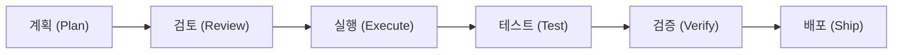
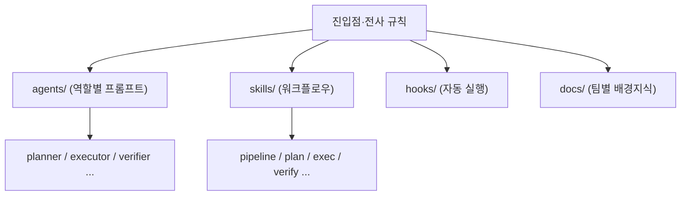
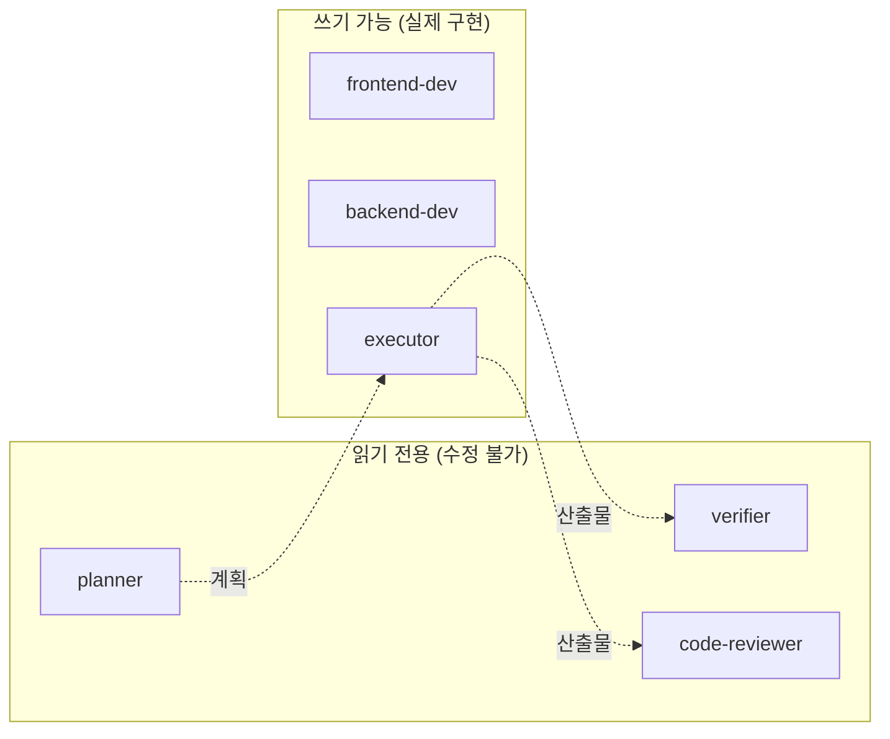

사내에서 여러 직군이 [Claude Code](https://docs.claude.com/en/docs/claude-code)(터미널이나 Claude Desktop App에서 사용하는 AI 코딩 도구)로 PoC를 만들기 시작했다. 그런데 아무런 장치 없이 사용하면 결과가 들쭉날쭉했다. 모델이 아무리 똑똑해도 계획 없이 곧장 파일을 수정하고, 검증을 건너뛰고, "다 됐다"라고 확신하는 일이 잦았기 때문이다. 마침 그 무렵에는 모델과 Claude Code CLI도 불안정해서, 복잡한 문제 앞에서 추론을 성급히 생략하거나 토큰을 비정상적으로 소모하는 문제까지 있었다.

돌이켜 보면 이런 결과가 모두 AI의 탓만은 아니었다. 내가 목표를 분명하게 주지 못했거나, 프롬프트를 명확하게 작성하지 못한 데에서 비롯된 경우도 있었기 때문이다. 곤란하기는 했지만 다시 요청하면 해결되는 일이었다. 다만 같은 일이 반복되지 않도록 계속 노력했던 것 같다.

그래서 **하네스**(harness; AI가 사고 치지 않도록 감싸주는 규칙과 안전 장치의 묶음)가 필요하다고 생각했다. 하네스는 모델 자체가 아니라, AI를 안전하게 사용하도록 돕는 운전 보조 장치에 가깝다. 운전 실력이 늘면 어떤 보조 장치는 필요 없어지지만, 안전벨트나 브레이크 점검은 실력과 무관하게 계속 필요한 것과 같다.

그런데 이 하네스를 아무것도 없는 상태에서 설계하기는 어려웠다. 관련 지식이 많지 않았고, Claude가 사용하는 플러그인 환경에도 익숙치 않았기 때문이다. 게다가 이미 공개된 하네스가 여럿 있었다. 그래서 코드를 작성하기 전에, **다른 사람이 만들었고 많은 사용자가 쓰고 있는 하네스 5개를 먼저 살펴보기로 했다.**

## 살펴본 5개의 하네스 플러그인

먼저 5개 가운데 4개의 규모와 특징을 표로 정리했다.

| 항목    | gstack          | everything-claude-code | Oh-My-Claudecode    | superpowers          |
| ----- | --------------- | ---------------------- | ------------------- | -------------------- |
| 저자    | Garry Tan       | Affaan M               | Yeachan Heo         | Jesse Vincent (obra) |
| 에이전트  | \~33개의 역할 스킬 | **47개**                | 19개                 | 1개(+14개 스킬)       |
| 스킬    | \~33개           | **181개**               | 37개                 | 14개                  |
| 슬래시 커맨드 | `/qa`, `/ship`   | **79개 slash**          | 매직 키워드              | slash+스킬          |
| 멀티 AI | Claude+Codex    | Claude 중심              | Claude+Codex+Gemini | Claude 중심            |
| 주요 기능 | 헤드리스 브라우저 QA    | 생산 환경 플러그인             | 멀티에이전트 오케스트레이션     | 문서를 TDD로             |

표에 없는 다섯 번째는 `hermes-agent`이다. 컨테이너 단위로 환경을 격리하고 스스로 스킬을 만들어 내는 자율 에이전트여서, 우리가 지금 당장 사용할 규모는 아니었다. 그래서 실질적으로 참고한 것은 나머지 4개였고, 이 4개는 각각 성격이 뚜렷했다.

- **everything-claude-code**(ECC)에는 규모로 압도당했다(?). 에이전트가 47개, 스킬이 181개, 슬래시 커맨드가 79개나 된다. 언어별로 디렉토리를 완전히 분리해 두고 `./install.sh typescript`처럼 필요한 것만 골라서 주입하는데, 이렇게 하면 사용하지 않는 언어의 규칙이 프롬프트에 포함되지 않아 토큰이 낭비되지 않는다.

- **superpowers**는 정반대로 규모가 작다. 스킬이 14개뿐이지만, "스킬 문서도 코드처럼 TDD로 만든다"는 철학이 가장 단단했다. 오픈소스 PR의 거부율이 94%에 달할 만큼 품질 기준도 높았다.

- **Oh-My-Claudecode**(OMC)는 라우터가 작업을 나누어, 권한이 분리된 서브에이전트들에게 강제로 위임한다. UI는 Gemini에, 백엔드 검증은 Codex에 넘겨서 서로 다른 모델끼리 교차 검증까지 하게 한다. (이 강제 위임이 어디에서 일어나는지는 나중에 다시 살펴보면서 바로잡았다. 플러그인 안이 아니라 사용자의 작업 디렉토리를 변조하는 방식이었다. 이 내용은 [[harness-9-orchestration|오케스트레이션을 다룬 글]]에서 정정한다.)

- **gstack**은 실제 QA를 자동화한다. Playwright 기반의 헤드리스 브라우저(화면 없이 실행되는 브라우저)를 계속 실행해 두고, 명령 하나에 100밀리초로 화면을 검사한다.

## 넷이 똑같이 하던 것

성격은 달랐지만, 4개를 나란히 놓고 보니 공통된 골격이 보였다. 4개 모두 **마크다운 파일을 AI의 행동을 규정하는 코드로** 사용한다. `agents/`에는 역할별 프롬프트를, `skills/`에는 워크플로우를, `hooks/`에는 자동으로 실행하는 장치를 둔다.

작업의 흐름도 약속이라도 한 듯 같았는데, 그 흐름을 그려 보면 아래와 같다.



단계의 이름만 달랐다. OMC는 `team-plan → team-prd → team-exec → team-verify → team-fix`, ECC는 `planner → tdd-guide → executor → code-reviewer → verifier`, gstack은 `/plan-ceo-review → /plan-eng-review → /qa → /ship`의 순서로 진행한다. 결국 모두 <u>계획부터 세우고, 끝났다고 말하기 전에 증거를 확보한다</u>는 한 문장으로 정리할 수 있었다.

## 가져온 것과 버린 것

그렇다고 이 모든 것을 가져올 수는 없었다. 우리의 목표는 비개발 직군까지 사용하는 사내 개발 도구였고, 첫 버전은 러프하게 "그냥 쓰는 것보다 품질 하한선을 올려 준다" 정도면 충분했기 때문이다. 그래서 가져올 것과 버릴 것을 나누었다.

### 가져온 것

1. 코딩을 시작하기 전에 의도를 명확히 하는 단계를 강제하는 구조. 4개 모두의 공통점이자 가장 중요한 골격이다.
2. 작업한 AI와 검토하는 AI를 **분리**하는 구조. 자기가 쓴 글을 자기가 교정하면 오류를 찾지 못하는 것과 같은 이유다.
3. 삭제, 덮어쓰기, 배포처럼 되돌리기 어려운 행동을 하기 전에 사람에게 묻는 게이트 단계.
4. 팀마다 다른 컨텍스트 파일을 제공해서 각 팀의 방식을 학습시키는 구조.
5. 이번 세션에서 배운 것이 다음 세션에 남는 기록.

### 버린 것

- 에이전트 10개가 동시에 실행되는 대규모 병렬 오케스트레이션. 복잡한 데 비해 이득이 없고 비용도 크다.

- 사람의 확인 절차가 없는 자동 배포. 금융 서비스에는 맞지 않는다.

- ECC의 스킬 181개를 통째로 복사하는 것. 스킬이 많을수록 AI는 무엇을 써야 할지 헷갈리고 토큰 사용량만 늘어난다. 적은 단위로 시작하는 것이 맞았다.

## 그래서 만든 V0 하네스

이렇게 추린 결론을 그대로 코드로 옮겼다. 첫 **스캐폴드**(scaffold; 뼈대만 세운 초기 구조)는 아래와 같은 모양이었다.



이 구조에서 가장 먼저 한 일은 **권한 분리**였다. ECC에서 본 패턴 그대로, 검토하는 에이전트에게는 읽기 도구만 설정했다.

```yaml agents/code-reviewer.md
name: code-reviewer
description: 구현이 완료된 코드를 계획서 및 코딩 표준과 대조하여 리뷰. Read-only
tools: ["Read", "Grep", "Glob"]  # [!code highlight]
```

도구 목록에 `Edit`이나 `Write`가 아예 없기 때문에, 이 에이전트는 리뷰를 하다가 원본 코드를 몰래 수정하는 일이 구조적으로 불가능하다. 텍스트로 "고치지 마세요"라고 부탁한 것이 아니라, 도구 목록에서 제외해서 할 수 없게 만든 것이다. 다른 에이전트들도 같은 기준에 따라 읽기 전용과 쓰기 가능으로 나누었다.



그다음에는 AI가 스스로 합리화하는 것을 막았다. superpowers에서 본 "Red Flags" 패턴을 가져와, 검토하는 에이전트가 빠뜨리기 쉬운 부분을 프롬프트에 명시했다. 확신하지 말고 증거를 제시하라는 태도를 글로 강제한 것이다.

```text agents/code-reviewer.md
<Red_Flags>
  - BLOCK 판정 후 수정 없이 APPROVE로 번복하는 것
  - "괜찮아 보입니다"처럼 근거 없는 찬사
  - 코드를 직접 수정하려는 시도
</Red_Flags>
```

마지막은 파이프라인이다. 모든 작업이 아래의 한 줄짜리 흐름을 따르도록 했다.

```text skills/pipeline/SKILL.md
Stage 1: Plan  →  Stage 2: Exec  →  Stage 3: Verify  →  [Stage 4: Fix]
```

Plan 단계가 끝나면 사용자에게 요약을 보여주고, **승인을 받아야** Exec 단계로 넘어간다. Verify를 통과하면 작업이 끝나고, 실패하면 Fix 단계로 넘어가 최대 세 번까지 스스로 수정한다. 4개의 하네스를 살펴보며 찾은 "계획부터, 증거 확보 후 완료"가 이 흐름에 들어 있다.

## 돌아보면

거창하게 시작하지 않은 것이 다행이었다. 멀티에이전트 오케스트레이션처럼 화려한 기능부터 욕심을 냈다면 첫 버전을 내놓지 못했을 것이다. 비개발 직군이 그냥 쓰는 것보다 하한선을 올린다는 소박한 목표 하나로 좁힌 덕분에, 권한 분리, 파이프라인, 합리화 차단이라는 골격만 단단히 갖추고 시작할 수 있었다.

다음 글은 이 골격을 실제로 운영하면서 처음 마주친 문제를 다룬다. 모델이 스스로 계획 단계를 건너뛰려고 했고, 이를 어떻게 시스템으로 막았는지에 관한 이야기다. 🌱
