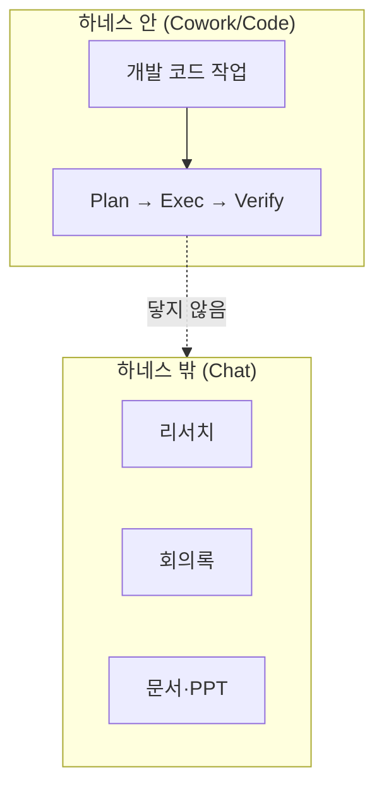
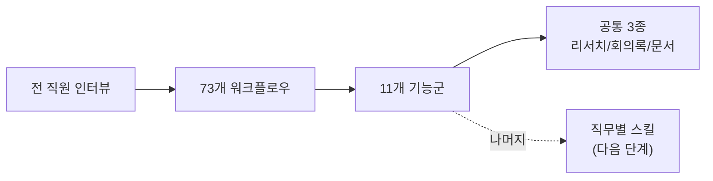
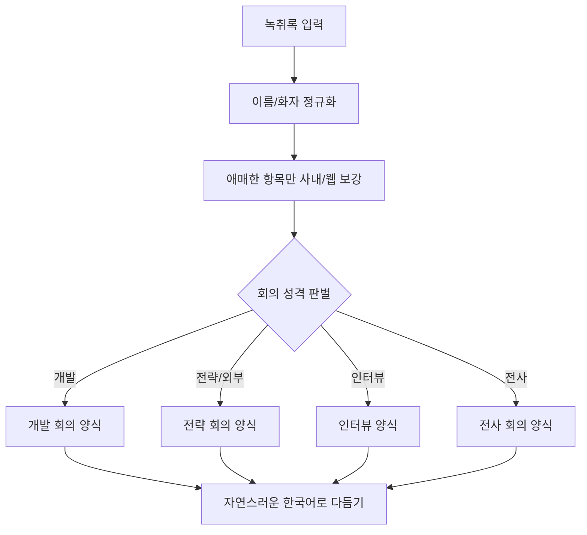
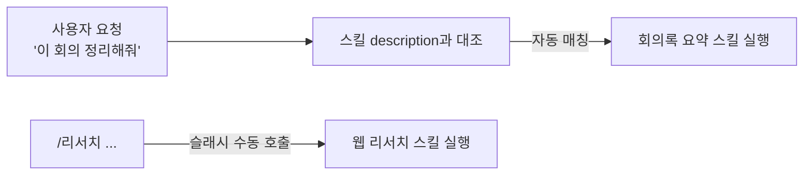

하네스를 만들어 전 직원에게 배포하고 얼마 동안 지켜보니, 정작 그 하네스 플러그인을 매일 실행하는 사람은 Claude Desktop App 기준으로 **전 직원의 절반쯤**이었다. 나머지 절반은 하네스를 한 번도 실행하지 않고도 업무를 할 수 있었다. 기획서를 작성하고, 회의록을 정리하고, 발표 자료를 만드는 일은 하네스 플러그인 없이도 가능했기 때문이다. 그 일들은 내가 만든 파이프라인의 바깥에 있었다.

여기서 **하네스**(harness; AI가 사고 치지 않게 감싸는 규칙들의 묶음)는 모델 자체가 아니라, 계획을 세우고 검증을 거치도록 강제하는 안전 장치이다. [[harness-9-orchestration|비개발 업무까지 받치는 방법을 다시 벤치마킹하며]], 나는 이미 가지고 있는 훅 아키텍처 위에 에이전트 몇 개를 추가하면 되겠다고 판단했다. 그런데 막상 무엇을 추가해야 하는지는 코드가 아니라 사람에게 물어보아야 알 수 있었다. 그래서 이번에는 코드를 무작정 작성하기 전에, 하네스를 사용하지 않는 사람들부터 만나 보게 되었다.

## 하네스는 절반만 덮고 있었다

사람들을 만나기 전에, 먼저 하네스가 왜 절반에게만 쓰이는지부터 살펴보았다. 내가 만든 하네스에는 스킬이 9개 있었다. 이름을 나열하면 아래와 같다.

```text skills/
plan/         exec/            verify/
deploy/       tdd/             review/
pipeline/     memory-load/     memory-save/
```

하나하나 살펴보면 성격이 모두 같다. `plan`은 요구사항을 태스크로 나누고, `exec`는 코드를 작성하고, `verify`는 `lint`와 `build`를 실행하고, `review`는 읽기 전용으로 코드를 검토하고, `tdd`는 테스트 코드부터 작성하게 한다. [[harness-1-benchmarking|처음 골격을 세울 때]] 잡았던 `Plan → Exec → Verify → Fix`라는 흐름을, 단계별 스킬로 나누어 놓은 것이다. 결국 9개 전부가 <u>개발 파이프라인의 부품</u>이었다. 회의록이나 발표 자료를 위한 스킬은 하나도 없었다.

문제는 그것만이 아니었다. 이 하네스는 **Node 기반 스크립트 플러그인**(plugin; 스킬/에이전트/훅을 담은 패키지)이기 때문에, Claude가 로컬 프로젝트 디렉토리를 깊게 다루는 Cowork와 Code 환경에서만 실행된다. 그런데 비개발 직군이 실제로 일하는 곳은 대부분 **Chat**(Chat; 프로젝트/지침/스킬과 커넥터로 대화하며 쓰는 Claude의 환경)이었다. 그리고 Chat에는 하네스를 강제로 호출하는 방식을 아예 넣을 수 없는 구조였다. 그 이유는 플러그인의 설정에서 확인할 수 있다.

```json .claude-plugin/plugin.json
{
  "hooks": {
    "UserPromptSubmit": "node scripts/pipeline-injector.mjs"  // [!code highlight]
  },
  "skills": ["pipeline", "plan", "exec", "verify", "review", "deploy", "..."]
}
```

하네스는 `UserPromptSubmit` 훅에 등록된 스크립트로 모든 요청을 가로채서 파이프라인으로 라우팅한다. 이 스크립트는 Node로 실행되는데, Chat에는 Node 스크립트를 등록할 자리가 없다. 하네스가 좋고 나쁘고를 떠나서, 절반의 사람들에게는 하네스가 실행될 자리 자체가 없었던 것이다.



두 환경의 차이도 컸다. Cowork나 Code는 하나의 프로젝트를 깊게 다루거나 로컬 파일을 수정하는 데 강하지만, 세션을 새로 시작할 때마다 컨텍스트가 리셋되는 느낌이 크다. 반대로 Chat은 프로젝트, 지침, 커넥터로 대화를 이어가기 좋아서, 일반 업무는 자연스럽게 Chat으로 기울어 있었다. 회의를 마친 뒤의 후속 처리 같은 일이 특히 그랬다. 사람들은 이미 Chat에 가 있는데, 하네스만 반대편 환경에 있었던 것이다.

솔직히 이것은 [[harness-1-benchmarking|첫 버전]]부터 감수한 한계였다. 개발 환경 전용으로 좁게 시작한 덕분에 첫 버전을 내놓을 수 있었기 때문에, 후회하는 결정은 아니다. 다만 "**그냥 쓰는 것보다 모든 이들의 하한선을 올려 준다**"는 목표를 회사 전체로 넓히려면, 이 절반을 더는 미룰 수 없었다.

## 이틀 동안 전 직원을 만났다

무엇을 만들지 정하기 전에, 무엇이 필요한지부터 알아야 했다. 그래서 이틀에 걸쳐 전 직원을 인터뷰했다. 그냥 "AI 잘 쓰고 계신가요?"라고 여쭤보면 답이 모두 비슷하게 돌아온다는 것을 알게 되어서, 먼저 AI를 활용하는 정도를 재는 **척도를 두 축으로** 설계했다.

- **사용 깊이(D1\~D5)** - D1은 단순 리서치나 요약, D5는 스킬을 엮어 서비스를 구현하는 수준.

- **장벽 깊이(B1\~B5)** - B1은 "그런 게 있는지 몰랐다" 수준의 인지 부족, B5는 보안이나 규정 때문에 손을 못 대는 구조적인 장벽을 느끼는 수준.

이 두 축으로 나누어 놓으니, 뭉뚱그려 보이던 사람들이 또렷하게 구분되었다. 개인을 특정하지 않고 유형만 적으면 아래와 같다.

**장벽이 얕은 유형(B1\~B2).** 툴은 이미 가까이에 있는데 사용해 본 적이 없어서 못 쓰는 경우이다. 이 유형은 가이드 한 번, 시연 한 번이면 해결된다고 생각했다. 새 기능을 만들어야 하는 문제가 아니라, 알려 주면 되는 문제였다.

**이미 자기 파이프라인을 운용하는 최상위 운용자(D5).** 이 사람들과의 인터뷰는 "이런 것을 만들어 달라"는 요청을 받는 자리가 아니었다. 이미 사용하고 있는 사람에게서 제품의 피드백을 받는 자리에 가까웠다. 눈높이가 달랐기 때문에, 받아 적는 태도도 달라야 했다.

**툴은 아는데 기준이 없는 유형.** 리서치를 시켜 본 적은 있는데, 나온 결과에서 무엇을 믿어야 할지 모르겠다는 사람들이었다. AI가 그럴듯하게 써 준 문장에 출처가 없거나, 보도 자료 하나를 여러 매체가 받아쓴 것을 여러 개의 근거로 착각하는 식이다. 툴이 없는 것이 아니라 판단 기준이 없는 문제였다.

**접할 기회 자체가 없던 유형.** 하네스가 개발 전용 플러그인이어서 자기 업무에는 와닿지 않는다고 답한 사람들이다. 틀린 말이 아니었다. 앞에서 본 것처럼, 이들에게는 하네스가 실행될 자리조차 없었다.

인터뷰에서는 하네스 자체를 향한 지적도 나왔다. 잘 쓰는 사람일수록 **단순한 작업에까지 계획을 강제하는 마찰**을 불편해했다. "한 줄 고치는데도 매번 계획서를 보여준다"는 것이다. 세션이나 모델이 바뀌면 컨텍스트가 통째로 사라져서 매번 다시 설명해야 한다는 컨텍스트 소실 문제도 반복해서 나왔다.

여러 사람은 하네스가 과하게 처리한다고도 느꼈다. 파일 이름 하나만 물었을 뿐인데 계획을 세우고, 검토자를 호출하고, 검증까지 실행하는 식이었다. 안전을 위해서 넣은 절차가, 가벼운 질문 앞에서는 오히려 답을 느리게 만든 것이다. 하네스가 "잘 쓰는 사람을 느리게 하는 장치"로 느껴지는 순간이 있다는 것은, 만든 사람으로서 뼈아픈 피드백이었다. 이 지적은 뒤에서 다룰, 복잡도에 따라 계획을 차등하는 개선으로 이어질 예정이다.

## 73개의 일이 11개로, 일단은 3개만

인터뷰에서 나온 실제 업무를 모두 받아 적으니, 업무의 워크플로우(흐름)가 **73개**였다. 그대로는 손댈 수 없어서, 겹치는 것끼리 묶어 보았다. 표현만 다를 뿐 같은 일인 것들을 합치자 11개의 기능군으로 수렴했다. 그중에서도 직군을 가리지 않고 가장 자주 나온 상위 세 가지 기능군이 또렷했다. 웹 리서치, 회의록 요약, 문서와 발표 자료 제작이 그 셋이었다.



여기서 전략을 한 번 뒤집었다. 처음에는 D5 운용자의 요청을 받아서 잘 쓰는 사람의 상한을 더 올리는 쪽으로 마음이 기울어 있었다. 하지만 인터뷰 결과를 모아 놓고 보니, 지금 급한 것은 상한이 아니라 하한선이었다. **잘 쓰는 사람의 상한을 높이기보다, 전 직원의 하한선을 올리기로 했다.** 상한을 높이는 일은 D5 운용자가 스스로도 하고 있었지만, 하한선은 아무도 대신 올려 주지 않았기 때문이다.

그래서 이 세 가지를 **스킬**(skill; Claude가 반복 작업을 수행하는 설명서 한 장)로 만들기로 했다. 스킬은 Chat에서도 실행되고, Node 스크립트가 필요하지 않다. 하네스가 닿지 못하던 절반에게 정확히 필요한 형태였다.

## 웹 리서치 스킬

리서치 스킬은 아무것도 없는 상태에서 시작하지 않았다. `research-mode`라는 오픈소스 스킬을 받아서 며칠 동안 사용해 보았는데, 뼈대가 좋았다. 별도의 키가 필요하지 않고, **모든 사실에 출처를 붙이며, 근거가 없으면 "모른다"고 답한다**는 원칙이 특히 그랬다. AI 리서치에서 가장 위험한 것은 그럴듯하게 지어낸 내용인데, 이 스킬은 그것을 구조적으로 막고 있었다.

그런데 실제 회사와 기술에 관한 주제로 수십 번 실행해 보니 한계도 분명했다. 그래서 드러난 약점을 그때그때 고치면서 네 가지를 추가했다.

첫째는 **교차 검증**(cross-check; 같은 수치를 독립된 출처 둘로 겹쳐 확인)이다. 리서치의 결론에 쓰는 주요 수치는 반드시 서로 다른 출처 두 곳을 확보하게 했다. 여기서 중요한 것은 무엇을 독립된 출처로 볼 것인가이다. 링크가 세 개 붙어 있더라도 원본이 하나라면 근거는 하나이다. 회사의 발표를 여러 매체가 받아쓴 것을 세 개의 증거로 계산하면, 확인한 것처럼 보일 뿐 실제로는 아무것도 확인하지 못한 것이 된다. 그래서 스킬에 아래와 같이 적어 두었다.

```md skills/web-research/SKILL.md
결론이나 산출물에 수치를 쓸 때는 독립된 출처 두 곳을 확보한다.

- 같은 발표를 옮긴 기사 여러 개는 독립 출처가 아니다.
- 한 곳뿐이면 그 수치 옆에 "미검증(단일 출처)"이라고 붙인다.
- 진짜 독립 출처는 발표 주체가 다른 자료다. (회사 발표 vs 전자공시)
```

둘째는 보도 자료의 배포처를 신뢰할 수 있는 매체로 착각하지 않는 규칙이다. GlobeNewswire 같은 출처는 뉴스를 배포해 주는 곳이지, 취재해서 전하는 곳이 아니다. 그래서 배포처의 링크를 만나면 그 뒤에 있는 원본을 한 번 더 찾게 했다.

셋째는 국내 기업이라면 전자공시 같은 국내 1차 소스를 먼저 보게 한 것이다. 넷째는 열리지 않는 링크를 그냥 버리지 않고, 같은 사실을 담은 다른 자료로 대신 확인한 뒤에야 제외하게 한 것이다.

이 네 가지에 더해서, 결과를 쉬운 한국어로 다듬어서 내도록 했다. 이것은 리서치의 정확성만큼이나 중요했다. 비개발 직군이 바로 읽을 수 있어야 쓸모가 있기 때문이다.

```text skills/web-research/SKILL.md
- 문장을 서술어로 끝낸다. 명사·체언으로 끝내지 않는다.
  나쁜 예: "성장세 지속." / 좋은 예: "성장세가 이어집니다."
- 어려운 말을 쉬운 말로 바꾼다. (지배적 운영 모델 → 가장 널리 쓰는 방식)
- 과장어를 뺀다. (해자, 구조적, 정면, 임박, 혁신적)
- 자기 규칙·방법을 소리 내 설명하지 않는다. 결과만 낸다.
```

명사로 끝나는 개조식 보고서는 한눈에 보아도 AI가 쓴 티가 난다. 그래서 문장을 서술어로 맺게 하고, 조사한 과정을 길게 설명하지 않고 결과만 내게 했다. 그러자 읽는 사람이 "이거 AI가 썼네"라고 느끼는 순간이 눈에 띄게 줄었다.

산출물의 맨 끝에는 **다음에 이어서 보면 좋은 것**을 붙이게 했다. 답을 내고 끝내는 것이 아니라, 검색창에 그대로 넣을 수 있는 다음 검색어와 그것을 보면 무엇을 알 수 있는지를 한 줄씩 남긴다. 리서치는 대개 한 번으로 끝나지 않는데, 툴은 늘 한 번의 답만 주고 멈춘다. 그래서 다음에 할 일을 함께 알려 주는 것이, 기준이 없다고 했던 그 유형에게 특히 필요했다.

한 가지 더, 리서치 스킬은 사내 데이터를 조회하지 않도록 범위를 정했다. 웹과 외부 데이터만 본다. 회사 데이터는 최신성이나 권한에 대한 판단이 따로 필요하기도 했지만, 비용 문제가 더 컸다. 사내 검색에서는 Snowflake 웨어하우스가 켜져 있는 시간만큼 과금된다. 그런데 웨어하우스는 30초 뒤에 자동으로 중지되었다가 요청이 올 때마다 다시 켜지기 때문에, 그때마다 붙는 최소 시간이 계속 쌓인다. 실제로 측정해 보니 순수 연산은 78초인데 청구 시간은 약 53분으로 늘어난 사례도 있었다. 웹 리서치를 할 때마다 사내 데이터를 무조건 찾아보게 하면, 이렇게 다시 켜지는 시간이 낭비로 쌓이게 된다. 그래서 사내 조회는 별도의 스킬이 맡게 하고, 리서치 중에 필요하면 그쪽으로 넘기게 했다.

## 회의록 요약 스킬

인터뷰에서 가장 자주 나온 불편이 회의록이었다. 미팅이 많다 보니 회의록 작성, Notion 등록, 이메일 팔로업, 자료 제작 같은 후속 처리가 쌓였기 때문이다. 이 스킬은 클로바노트나 Notion의 녹취록을 넣고 "회의록 요약해줘"라고 입력하면 실행된다.

스킬이 가장 먼저 하는 일은 **이름 교정**이다. 녹취록에는 화자가 "참석자 1, 참석자 2"로만 표시되거나, 사내 직원과 외부 업체의 이름이 잘못 변환되어 있는 경우가 많다. 그래서 사내 직원의 정식 명단을 먼저 읽게 하고, 발음이나 철자가 가까운 이름을 정식 표기로 교정하게 했다.

```text skills/meeting-summary/SKILL.md
발음/철자가 가까우면 정식 이름으로 스냅한다. (예: "민준 → 민재")
화자 라벨(참석자 N)은 문맥/자기소개/호칭의 단서로 실제 인물에 연결한다.
근거가 약하면 단정하지 말고 라벨을 유지한 채 후보로만 둔다.
```

다만 애매한 경우에는 지어내지 않게 했다. 명단과 매칭되지 않거나 변환이 잘못된 업체와 용어는, 사내 회의록 DB와 사내 메신저 커넥터에서 먼저 찾아보고, 거기에서도 나오지 않으면 웹 리서치로 보강하게 했다. 그래도 찾지 못하면 "확인 필요"로 남긴다.

그다음은 회의의 계열에 따른 분기 처리이다. 회의는 성격이 제각각이어서, 하나의 양식으로 요약하면 어색해진다. 그래서 기존 회의록의 양식을 학습시켜서, 개발 회의인지 전략 회의인지 인터뷰인지 전 직원 회의인지를 판별하고 그에 맞는 템플릿으로 요약하게 했다.



여기까지는 스킬을 공유하기 전에 설계한 흐름이었다. 그런데 정작 큰 개선은 공유한 뒤에 현장에서 받은 피드백에서 나왔다. 회의록을 자주 작성하는 한 동료가 이렇게 지적했다.

> Notion에 그냥 강제로 자동 등록하게 되면, 완료 알림이 뜨기 전에도 미리 보는 사람이 많아요. 그런데 그 뒤에 내용이 바뀌면 누가 뭘 봤는지 추적이 안 돼요.

맞는 말이었다. 자동 등록은 편리하지만, 등록한 뒤에 고치는 구조이기 때문에 버전이 엉키게 된다. 그래서 **등록하기 전에 사람이 검토하는 단계**를 하나 추가했다. 요약 초안을 먼저 Chat에 보여주고, 사람만 답할 수 있는 애매한 항목을 함께 물어본 뒤, 승인을 받아야 등록하도록 했다. 전체 단계는 아래와 같고, 이 가운데 7단계가 피드백으로 새로 생긴 절차이다.

```text skills/meeting-summary/SKILL.md
1단계 입력 수집
2단계 화자/이름 정규화
3단계 사내 근거 보강 (애매한 항목 한정)
4단계 회의 계열 자동 판별
5단계 요약 본문 작성 (계열별 양식)
6단계 자연스러운 한국어로 다듬기
7단계 초안 검토 게이트   # 등록 전, 사람이 검토
8단계 검토 반영 후 등록
```

"등록한 뒤에 Notion에서 고친다"를 "등록하기 전에 Chat에서 먼저 고친다"로 순서를 바꾼 것이다. 돌이키기 어려운 일 앞에서는 사람에게 묻는다는 [[harness-1-benchmarking|하네스의 원래 기준]]이, 개발이 아닌 회의록에서도 똑같이 통했다.

## 문서/PPT 제작 스킬

세 번째는 문서와 발표 자료이다. 회사에는 색, 폰트, 로고, 레이아웃을 규정한 디자인 시스템이 있었지만, 그것은 사람이 눈으로 보고 맞추는 규칙이었다. 그래서 이 규칙을 스킬이 따를 수 있도록 **글로 옮기는 것**이 주된 작업이었다.

```text skills/docs-ppt/SKILL.md
- 보고서/일반 문서 = 회사 표준 네이비 단색
- 발표 덱/다이어그램/목업 = 확장 팔레트
- 강조색은 주요 한두 곳에만. 다이어그램 1개당 의미색 최대 3색.
- 제품 화면이 필요하면 남의 캡처를 붙이지 않고 SVG로 직접 그린다.
```

팔레트, 타이포, 로고의 규칙을 이렇게 글로 명시해 두니, AI가 매번 색을 새로 고르지 않고 회사의 톤을 지키게 되었다. 제품 화면의 목업도 아무 스크린샷이나 붙이지 않고, 회사의 토큰에 맞춰서 SVG로 직접 그리게 했다.

그런데 이 스킬에서 가장 어려웠던 것은 디자인이 아니라, 파일이 깨지지 않게 빌드하는 것이었다. 발표 파일을 만들 때, 그림자 설정 하나를 여러 도형에 재사용하면 파일이 조용히 망가질 수 있다. 그림자 값은 도형마다 새로 변환되는데, 같은 객체를 재사용하면 두 번째 도형부터 값이 이상해지기 때문이다. 그래서 상수 하나를 공유하지 않고 함수로 만들어서, 도형마다 새 그림자 객체를 만들어 넘기도록 했다.

```js skills/docs-ppt/references/build.js
// 그림자 상수를 여러 도형에 재사용하면 두 번째부터 값이 이상해져
// PowerPoint가 "복구가 필요합니다" 경고를 낸다. 매번 새 객체를 넘긴다.
const sh = () => ({ type: "outer", color: BRAND_NAVY, opacity: 0.1, blur: 7, offset: 3 }); // [!code highlight]
```

그런데 이렇게 적용하더라도, 문제가 생기면 파일을 받는 사람의 PowerPoint에서만 경고가 나타난다. 그래서 빌드한 뒤에 압축을 풀어서 그림자 값이 0건인지 검사하는 절차까지 추가했다.

시연할 때에는 이 스킬의 한계를 솔직하게 인정했다. 사진을 능동적으로 배치하는 고난도 디자인은 아직 하지 못한다.

> 사진을 예쁘게 붙여주는 건 아직이지만, 콘텐츠 중심 문서를 바로 만들어 배포하는 용도로는 충분하다고 생각해요.

하한선을 올리는 것이 목표였으니, 이 정도면 그 목표에는 도달했다고 생각한다.

## 스킬 공유, 그리고 "지침과 스킬이 뭐가 달라요?"

이렇게 만든 세 스킬을 조직 스킬로 전 직원에게 공유했다. 설치는 Claude Desktop App에서 사용자 지정 → 스킬 → 공유된 스킬 순으로 들어가면 된다. 앱의 버전이 낮으면 화면이 달라서 업데이트가 필요할 수 있다는 안내도 함께 전달했다.

다만 조직 스킬이라고 해서 모두에게 저절로 공유되지는 않았다. 조직 계정에 속하지 않은 사람에게는 자동으로 공유되지 않아서, 그 계정에는 스킬을 직접 따로 전달해야 했다. 전 직원 공유라는 말이 무색하게, 마지막 한 부분은 결국 사람이 채웠다.

스킬이 실행되는 방식은 단순하다. 사용자가 무언가를 요청하면, Claude가 각 스킬의 설명(`description`)과 요청이 맞는지 살펴보고, 맞으면 그 스킬을 호출해서 실행한다. 슬래시(`/`)로 직접 호출할 수도 있다.



시연이 끝난 뒤에 나온 질문 하나가 오래 남았다. 한 직원이 "프로젝트 지침이랑 스킬이 뭐가 다르냐"고 물었다. 답은 이렇다. 지침은 한 프로젝트 안에서만 적용된다. 그래서 사람마다, 프로젝트마다 회의록의 포맷이 달라진다. 반면 **스킬은 전 직원에게 공통으로 적용된다.** 누가 어느 프로젝트에서 호출하든 같은 회의록 스킬이 같은 결과를 낸다. 하한선을 전 직원의 하한선으로 올리려면, 개인의 지침이 아니라 공통 스킬이어야 하는 이유가 여기에 있었다.

## 하네스는 버린 게 아니다

오해하기 쉬운데, 이것은 하네스를 그만두고 스킬로 옮겨 간 이야기가 아니다. 개발 코드 작업에는 여전히 계획과 검증을 강제하는 하네스가 맞다. 스킬은 그 옆에 만든 **더 가벼운 진입점**이다. Chat에서 한 줄로 호출할 수 있고, 계획서를 요구하지 않는다.

동시에 하네스 자체의 마찰도 손보고 있다. 인터뷰에서 나온 "단순 작업까지 계획을 강제한다"는 불편은, 요청을 복잡도에 따라 나누고 계획을 차등하는 방향으로 고칠 예정이다.

```text skills/pipeline/SKILL.md
[요청 유형 분류]
 A: 바로 응답                     (단순 질문/조회, 계획 없이)
 B: Exec → Verify                (작은 수정)
 C: Plan → Exec → Verify → Fix   (복잡 작업만 촘촘히 계획)
```

모든 요청을 C로 보내지 않고, 단순한 것은 A로 바로 답하고 복잡한 것만 계획을 촘촘하게 세우게 하려고 한다. 잘 쓰는 사람이 느끼던 번거로움은 이 차등으로 줄일 예정이다.

인터뷰에서 나온 또 하나의 불편인 컨텍스트 소실도 함께 다루었다. 세션이나 모델이 바뀌면 매번 처음부터 다시 설명해야 한다고 했던 그 불편이다. 이것은 계획서와 메모리를 세션에 묶어 두지 않고, 다른 세션이나 다른 모델에서도 안전하게 이어서 사용할 수 있는 형태로 남기는 방향으로 손보려고 한다.

한 번 세운 계획과 한 번 쌓은 기록이 세션이 닫힌 뒤에도 남아 있으면, 매번 다시 설명하는 낭비가 줄어들 수 있다. 이것은 [[harness-4-memory|메모리를 처음 만들 때]] 세운 "한 번 배운 건 다음에 남는다"는 방향을, 세션과 모델의 경계 너머로 넓히는 일이기도 하다.

결국 하네스는 개발 작업을 깊게 받치는 역할을, 스킬은 전 직원이 가볍게 들어오는 진입점의 역할을 나누어 맡게 되었다.

## 남은 것

이번에 스킬 3종을 공유한 것은 시작이다. 다음에는 기획, 디자인, 운영처럼 직군별로 깊이를 더한 스킬과, 부서별 개발 프로젝트들을 받치는 하네스의 지원을 함께 진행해 볼 생각이다.

한 가지 배운 것이 있다. 나는 늘 무엇을 더 만들지부터 고민했는데, 정작 이번에 가장 크게 바뀐 것은 새 코드가 아니라 질문의 방향이었다. <u>"무엇을 만들까"가 아니라 "누가 못 쓰고 있나"를 물으니, 만들 것이 저절로 좁혀졌다.</u> 사용하지 않는 사람을 만나 본 것이, 결국 가장 쓸모 있는 스펙이었던 것 같다. 🍀
