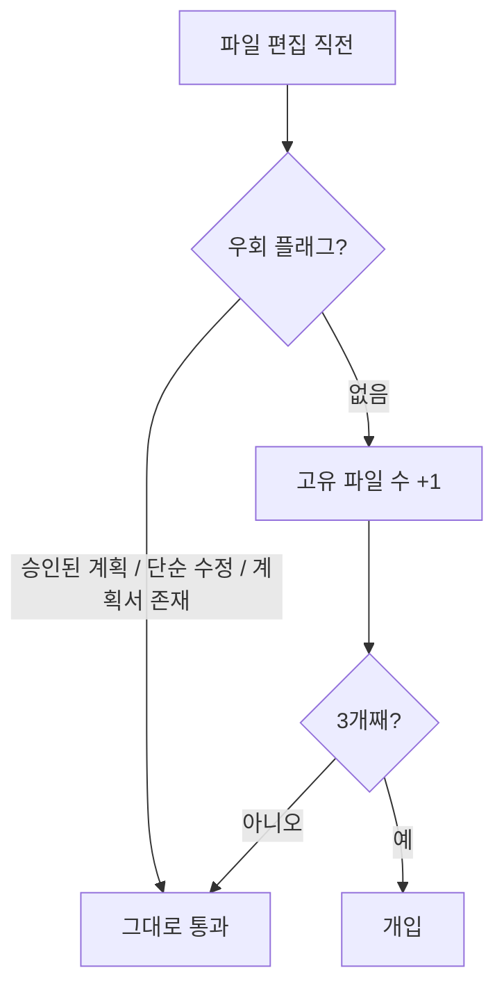

[[harness-1-benchmarking|지난 글]]에서 "복잡한 작업은 계획부터 세운다"는 파이프라인을 만들어 AI가 따르도록 했다. 그런데 실제로 운영해 보니, AI가 그 규칙을 스스로 건너뛰는 경우를 발견하게 되었다. 하네스를 직접 사용하던 중에 본 일이었고, 계획 스킬을 거치지 않았다는 것은 바로 알아챌 수 있었다.

증상은 늘 비슷했다. 사용자가 기능을 요청하면, AI는 계획 스킬을 호출하지 않고 곧장 파일을 수정하기 시작했다. 그러다가 두세 번째 파일을 수정하면서 채팅에 이런 식으로 적었다. "수정 파일: A, B, C / 승인해 주시면 진행하겠습니다." 겉으로는 계획처럼 보이지만, 이것은 정식 계획 절차를 **흉내만 낸 우회**였다. planner 에이전트도, 계획서 저장도, 자가 점검도 거치지 않고 AI가 즉석에서 적어 낸 계획이기 때문이다.

모델에게 "그러지 마"라고 적어두는 것만으로는 부족했다. 똑똑한 모델일수록 "이번에는 작은 수정이니까"라며 스스로를 설득했기 때문이다. 그래서 말로 부탁하지 않고 장치로 막기로 했다.

## 수정한 파일의 수부터 계산하기

아이디어는 단순하다. 사용자의 한 턴 안에서 **계획 없이 수정한 고유 파일의 수**를 계산하는 것이다. 세 번째 파일을 수정하려는 순간을 "이것은 단순한 수정이 아니다"라는 신호로 본다.

3개라는 기준에 뚜렷한 근거가 있었던 것은 아니다. 2개와 5개로도 지정해 보았는데, 5개는 기준이 너무 느슨해서 계획 없이 진행되는 경우가 많았고, 2개는 계획을 세우는 경우가 지나치게 많았다. 그래서 3개로 정했다.

이 계산은 [`PreToolUse`](https://docs.claude.com/en/docs/claude-code/hooks) [훅](https://docs.claude.com/en/docs/claude-code/hooks)(파일을 수정하는 도구가 실행되기 직전에 개입하는 장치)에서 한다. `Edit`, `Write`, `MultiEdit`, `NotebookEdit`가 호출되기 직전마다 카운터를 올린다.

```js scripts/edit-counter.mjs
// Edit / Write / MultiEdit / NotebookEdit 직전에 이 턴의 고유 파일 수를 센다
const FILE_EDIT_TOOLS = new Set(["Edit", "Write", "MultiEdit", "NotebookEdit"]);
const length = recordFile(sessionId, fp);  // [!code highlight]
```

물론 정말 단순한 수정까지 막아서는 안 된다. 그래서 파일의 수를 계산하기 전에 우회 플래그를 먼저 확인하도록 했다. 플래그가 하나라도 켜져 있으면 카운터를 건드리지 않고 즉시 통과시킨다.

```js scripts/preedit-guard.mjs
// 승인된 계획이 있거나, 사용자가 단순 수정이라 못박았으면 즉시 통과
if (hasApprovedPlanFlag() || hasBypassFlag(sessionId) || hasPlanForSession(sessionId)) {
  process.exit(0);
}
const length = recordFile(sessionId, fp);
```

이 세 가지 플래그는 역할이 서로 다르다. `hasApprovedPlanFlag`는 계획(plan) 스킬이 정식으로 사용자의 승인을 받았을 때 켜지는 1순위 신호다. `hasBypassFlag`는 사용자가 "그냥 해줘"나 "단순 수정"처럼 우회를 명시적으로 요청했을 때 켜진다. `hasPlanForSession`은 계획서 파일이 실제로 저장되어 있는지를 확인하는 마지막 안전망이다. 여기까지의 판단을 순서대로 그리면 아래와 같다.



## 처음에는 강제로 차단했다

이제 세 번째 파일에 이르렀을 때 무엇을 할지가 남았다. 처음 버전(v1.1.14)에서는 세 번째 파일의 수정을 아예 차단했다. 훅이 `decision: "block"`을 반환하면 그 편집은 거부되고, AI는 **강제로** 계획(plan) 스킬을 실행하게 된다.

```js scripts/preedit-guard.mjs
// v1.1.14 기준, 3개째 파일이면 강제 차단
if (length < 3) process.exit(0);

const blockOutput = {
  decision: "block",                       // [!code highlight]
  reason,                                  // "곧장 /plan 스킬을 시행하세요" 등
  hookSpecificOutput: {
    hookEventName: "PreToolUse",
    permissionDecision: "deny",
  },
};
process.stdout.write(JSON.stringify(blockOutput));
```

이때 `reason`에는 단순한 거부가 아니라, 다음에 무엇을 해야 하는지에 대한 지시를 담았다. 사용자에게 사과나 메타 설명을 늘어놓지 말 것, 첫 도구 호출로 곧장 계획 스킬을 부를 것, 첫 줄은 계획 스킬이 출력하는 안내 한 줄이어야 한다는 것까지 적었다. 차단당했다는 것이 드러나지 않고, 작업이 자연스럽게 이어지는 것처럼 보이게 하려는 것이었다.

한편 planner 에이전트를 거치지 않은 계획을 채팅에 적는 우회는 편집 훅이 아니라 프롬프트 단계에서 막았다. "수정 파일:", "Phase 1/2/3", "승인해 주시면"처럼 즉석에서 만든 계획의 패턴을 자연어로 금지하는 규칙을 매 턴마다 주입했다.

## 그런데 다시 차단을 풀었다

이 차단은 잘 동작했지만, 지나치게 잘 동작했다. 비개발 직군에게는 문제없이 진행되던 작업이 **갑자기 거부당하는 경험**이 거칠게 느껴질 수도 있겠다는 생각이 들었다. 그래서 정식 버전(v1.2.0)을 준비하면서 이 부분을 다시 손보게 되었다.

결론은 강제 차단을 폐기하고, 파일의 수는 계속 계산하되 막지는 않는 것이었다. 카운터는 그대로 두고, 세 번째 파일부터는 표준 에러 채널에 힌트 한 줄만 남긴 뒤 통과시킨다. 계획을 거칠지 말지는 AI의 판단에 맡겼다.

```js scripts/preedit-guard.mjs
// v1.2.0 부터 block 폐기. 카운터는 유지하되 힌트만 남기고 통과
if (length >= 3) {
  process.stderr.write(/* 한 줄 힌트 */);  // [!code highlight]
}
process.exit(0);  // 차단하지 않음
```

우회 플래그를 다루는 함수들은 그대로 두었다. 계획 저장과 프롬프트 주입 같은 다른 장치가 여전히 "이번 턴에 몇 개나 고쳤나"를 참조하기 때문이다. 결국 차단하는 동작만 제거하고, 인프라는 남긴 것이다.

## 돌아보면

이 과정에서 얻은 교훈은 <u>강제와 신뢰 사이의 균형</u>이었다. 모델이 덜 똑똑할 때는 차단이 필요했지만, 모델(Opus 4.7)이 충분히 똑똑해지자 차단은 방해가 될 뿐이었다. 그래서 막는 것에서 알려 주는 것으로 방향을 바꾸었고, 차단을 해제한 뒤에도 힌트 한 줄만으로 충분했다. 안전 장치를 한 번 만들었다가 완화하는 이 패턴은, 이 하네스를 운영하면서 더 많이 반복된다.

다음 글은 하네스에 외부에서 제공하는 툴을 처음 연결한 이야기다. 코드를 더 잘 읽게 해 주는 [Serena](https://github.com/oraios/serena) MCP를 도입하면서, "첫 세션부터 연결되어 있어야 한다"는 까다로운 요구를 해결하려고 했던 과정을 다룬다. 😎
