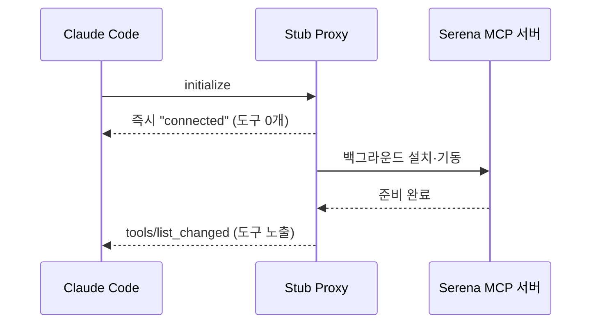

[[harness-2-self-bypass|지난 글]]까지는 하네스의 내부 규칙을 다듬는 작업을 다루었다. 이번 글은 하네스에 처음으로 외부에서 제공하는 툴을 연결하는 이야기다.

AI가 긴 코드베이스를 다룰 때, 파일을 통째로 읽게 되면 AI의 토큰이 빠르게 소진된다. [Serena](https://github.com/oraios/serena)는 이 문제를 줄여 주는 [MCP](https://modelcontextprotocol.io/) 서버(AI가 외부 도구를 호출할 수 있게 해 주는 표준 규약을 따르는 서버)이다. Serena를 연결하면 AI는 파일 전체가 아니라 **심볼**(symbol; 함수나 클래스처럼 의미를 가진 코드 단위) 단위로 코드를 탐색한다. 필요한 함수 하나만 읽기 때문에 토큰 사용량도 크게 줄어든다. 그래서 이 Serena MCP를 하네스에 연결하기로 마음 먹었다.

문제는 설치와 연결이었다. Serena는 Python으로 작성된 프로그램이어서 별도의 실행 환경이 필요하고, MCP 서버가 처음 실행되기까지 시간이 약간 소요된다. 그런데 Claude Code는 MCP 서버가 제때 응답하지 않으면 연결을 포기해 버린다. 그렇게 되면 사용자는 첫 세션에서 `serena: failed` 라는 문구를 보게 되고, 재연결하는 명령어를 직접 입력해야 한다. 이런 절차는 비개발 직군에게 부담스러울 수밖에 없었기 때문에, 그대로 둘 수는 없었다.

## 연결되었다고 먼저 응답하는 프록시

해결할 방법을 찾아보다가 **Stub Proxy**(실제 서버를 대신해 응답을 먼저 돌려주는 중간 프로그램)라는 것을 처음 알게 되었다. 그전까지는 MCP가 그저 연결되기만 하면 되는 것이라고 생각했다. 그런데 연결되는 과정 사이에 프록시를 하나 두는 것만으로도 이 문제를 해결할 수 있다는 사실이 꽤 새롭게 다가왔다. 원리는 단순하다. Claude Code가 MCP 서버를 실행하면, Serena가 아직 준비되지 않았더라도 프록시가 먼저 연결되었다는 응답을 즉시 보낸다. 그리고 그동안 백그라운드에서는 Serena를 설치하고 실행한다. 이후 Serena의 준비가 끝나면 도구 목록이 변경되었다는 사실을 Claude Code에 알리고, 그때부터 Serena MCP의 툴들이 보이게 된다.



여기서 가장 중요한 것은 `initialize` 요청에 지체 없이 응답하는 것이다. 프록시는 Serena를 기다리지 않고 응답을 먼저 보내는데, 이 응답에 `listChanged: true` 라는 값을 함께 담아서 보낸다. 지금은 도구가 없지만 이후에 목록이 변경될 수 있다는 것을 미리 선언해 두는 것이다.

```js scripts/run-serena.mjs
// initialize엔 즉시 응답해 "connected"를 확보하고, Serena MCP 서버는 백그라운드에서 실행한다
if (method === "initialize") {
  respondResult(id, {
    protocolVersion,
    capabilities: { tools: { listChanged: true } },  // [!code highlight]
    serverInfo: { name: PROXY_NAME, version: PROXY_VERSION },
  });
  setImmediate(prepareInBackground);
  return;
}
```

한 가지 더 신경 써야 하는 부분이 있었다. 프록시가 백그라운드에서 Serena를 설치하는 동안에는 설치 로그가 계속 출력된다. 그런데 Claude Code와 MCP 서버는 표준 입출력으로 JSON 메시지를 주고받기 때문에, 이 로그가 응답과 같은 채널에 섞이게 되면 통신이 깨져 버린다. 그래서 통신 채널을 용도에 따라 분리했다. 표준 입력은 Claude Code의 요청을, 표준 출력은 프록시의 응답을 전달하고, 표준 에러에는 설치 로그만 기록하도록 했다.

설치 과정 또한 사용자의 환경에 영향을 주지 않도록 격리했다. Python 패키지를 실행하는 [uv](https://github.com/astral-sh/uv)를 플러그인 전용 디렉토리(Claude Plugin Data)에만 설치해서, 사용자가 기존에 사용하던 환경은 그대로 유지되도록 했다.

## 결국 제거한 프록시

여기까지는 아무런 문제가 없었다. 그런데 공식 문서를 읽다가 예상하지 못한 사실을 알게 되었다. Claude Desktop App은 도구 목록이 변경되었다는 알림을 구조적으로 지원하지 않는다는 것이었다. 그렇다면 프록시가 알림을 아무리 보내도 Desktop App은 이를 받지 못하고, 툴은 **0개인 상태로 고정**되어 버린다. 이 하네스는 비개발 직군도 함께 사용해야 하는데, 이런 구조에서는 어렵겠다는 생각이 들었다. 첫 세션의 연결을 보장하려고 만든 장치가, 다른 환경에서는 오히려 툴을 아예 사용할 수 없게 만드는 것이었다.

결국 프록시를 폐기하고 가장 단순한 방식으로 돌아가기로 했다. 막상 그렇게 결정하고 나니 오히려 후련했다. Serena는 우리가 개발하는 사내 하네스보다 훨씬 큰 프로젝트였다. 그런 프로젝트의 연결 과정을 프록시로 직접 관리하고 계속 유지 보수하는 일은 부담이 컸는데, 그 부담을 한꺼번에 덜어낼 수 있었기 때문이다.

## 프록시 없이 직접 연결한 Serena

프록시를 제거했다고 해서 Serena까지 제거한 것은 아니다. Serena는 그대로 사용하되, 그 앞에 두었던 프록시만 없애고 Claude Code와 Serena를 직접 연결했다. uv의 실행 명령어인 uvx로 Serena를 실행하고, 표준 입출력을 그대로 넘겨주면 된다. 이때 대시보드와 GUI 로그 창은 비활성화했는데, 이 옵션을 켜 두면 세션을 시작할 때마다 Serena의 대시보드가 브라우저 창으로 열리기 때문이다.

```js scripts/run-serena.mjs
// 프록시 폐기(2026-04-24). uvx로 Serena를 직접 실행해 stdio 그대로 연결한다
const child = spawn(uvxPath, [
  "--from", "git+https://github.com/oraios/serena",
  "serena", "start-mcp-server",
  "--context", "claude-code",
  "--enable-web-dashboard", "false",  // [!code highlight]
  "--enable-gui-log-window", "false",
  "--project", projectRoot,
], { stdio: "inherit", windowsHide: true });
```

프록시가 없어졌기 때문에, 처음에 해결하려던 문제는 그대로 남는다. 첫 세션에서 툴이 잠시 보이지 않는 것은 감수하기로 했다. 한 번 설치한 뒤에는 캐시된 실행 파일을 바로 재사용하기 때문에, 실제로 지연을 느끼는 것은 처음 한 번뿐이었다.

## 결론

Stub Proxy는 분명 영리한 해결책이었지만, 내가 사용하던 CLI 환경에서만 통하는 방법이었다. 한 환경의 문제를 해결하려고 만든 장치가 Desktop App에서는 오히려 더 큰 문제가 될 수 있었기 때문이다. 결국 영리한 우회보다는, 단순하면서 어느 환경에서나 동작하는 방식이 더 나았다. 이 교훈은 2026년 6월 말, [[harness-8-trimming|하네스에서 Serena 자체를 제거하면서]] 다시 한번 확인하게 되었다. 무언가를 더 만드는 것보다 덜어내는 쪽이 마음이 가벼울 때도 있다는 것을, 이 과정에서 알게 되었다.

다음 글에서는 하네스의 메모리를 다룬다. AI가 무엇을 기억하고, 그 기억을 다음 세션에서 어떻게 불러오는지에 관한 이야기다. 🌱
