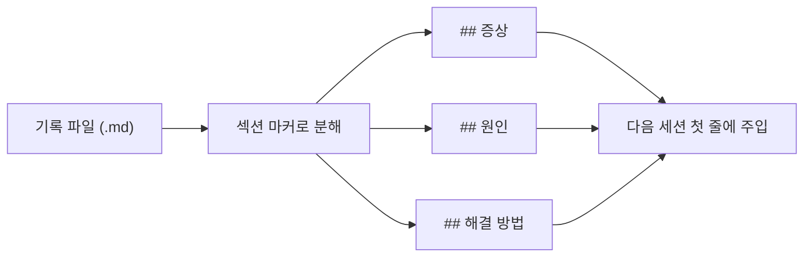

[[harness-3-serena-proxy|지난 글]]에서는 하네스에 외부에서 제공하는 툴을 연결했다. 이번 글은 하네스의 기억에 관한 이야기다.

세션이 끝나면 **AI의 컨텍스트는 사라진다.** 그렇게 되면 AI는 같은 실수를 다음 세션에서 다시 하게 된다. 그래서 작업하면서 마주친 에러 패턴, 알게 된 사실, 세웠던 계획을 마크다운 파일로 남기고, 다음 세션이 시작될 때 다시 불러오기로 했다. 흔한 오해와 달리 이 저장은 거의 자동으로 이루어진다. 세션이 시작되고 종료되는 시점마다 기록이 저장되고, 사람이 "기억해 줘"라고 요청하는 것은 보조 수단일 뿐이다.

그래서 문제는 저장하는 쪽이 아니라 불러오는 쪽에 있었다.

## 앞부분만 잘라서는 부족했다

처음에는 단순하게 구현했다. 저장된 메모리 파일의 앞부분을 잘라서 넣은 것이다. 그런데 첫 8줄, 240자만 잘라 넣다 보니, 정작 중요한 "원인"과 "해결 방법"이 잘려 나갔다. 기록은 남아 있는데 다음 세션이 그 기록을 활용하지 못하는 상황이었다.

그래서 앞부분을 자르지 않고, **필요한 섹션을 골라서 가져오도록** 변경했다. 기록의 종류마다 어떤 제목(마커)의 내용을 얼마나 가져올지를 아래와 같이 정의했다.

```js scripts/memory-loader.mjs
const SUBDIR_CONFIG = {
  "error-patterns": {
    markers: ["## 증상", "## 원인", "## 해결 방법"],  // [!code highlight]
    sectionCap: 250,
    maxCount: 5,
    title: "최근 에러 패턴"
  },
  "learnings": {
    markers: ["## 내용", "## 적용 상황"],
    sectionCap: 350,
    maxCount: 5,
    title: "학습 인사이트"
  },
  // plans: 목표·영향 범위·Task 단위로 더 길게
};
```

에러 패턴은 증상, 원인, 해결 방법의 세 섹션을 각각 250자까지, 5건만 불러온다. 학습 내용은 내용과 적용 상황의 두 섹션을 각각 350자까지 불러온다. 앞부분을 기계적으로 자르던 것에서, 의미가 있는 섹션만 골라 다음 세션에 제공하는 것으로 바뀐 것이다. 이 흐름을 그리면 아래와 같다.



이 과정에서 사소하지만 번거로운 문제도 하나 있었다. 마커를 정규식으로 찾다 보니, 기록의 본문에 인용된 `## 요약` 같은 글자(코드 블록 안의 예시)까지 실제 제목으로 잘못 인식한 것이다. 이 문제는 여러 줄을 한 번에 보는 정규식으로 걸러 냈다.

## 세션이 시작될 때 불러오기

이렇게 골라낸 메모리는 세션이 시작될 때 [`SessionStart`](https://docs.claude.com/en/docs/claude-code/hooks) [훅](https://docs.claude.com/en/docs/claude-code/hooks)으로 주입한다. 사용자가 보는 첫 줄에 "이전 작업 기록 3건을 불러왔어요" 같은 안내가 표시되는 것이 그 결과다.

얼마나 주입할지는 두 가지 값으로 정한다. 앞에서 본 `maxCount`(종류별 건수)와, 설정 파일에 있는 **전체 상한**이다.

```js scripts/memory-loader.mjs
// 전체 주입량 상한은 설정에서 읽는다(기본은 50)
let maxEntries = 50;
try {
  const s = JSON.parse(readFileSync(settingsPath, "utf-8"));
  if (s?.memory?.max_entries) maxEntries = s.memory.max_entries;
} catch {}
```

기록이 많아질수록, 전부 주입하게 되면 그것이 다시 AI의 토큰을 소모한다. 그래서 "최근/중요 순으로 이만큼만"이라는 상한을 둔 것이다.

## 저장하는 쪽도 수정

불러오는 쪽을 고치고 나니 저장하는 쪽의 결함도 보이게 되었다. 먼저 AI가 기록 저장을 잊는 빈도를 줄이기 위해, **작업이 끝나는 시점**([`PostToolUse`](https://docs.claude.com/en/docs/claude-code/hooks))에 저장을 강하게 권하는 장치를 두었다.

여러 세션이 동시에 실행될 때, 같은 마커 파일을 함께 수정하다가 파일이 깨지는 경합(race condition)도 막아야 했다. 이 문제는 임시 파일에 먼저 쓰고 마지막에 이름만 바꾸는 원자적 교체(atomic rename)로 해결했다. 이렇게 하면 쓰다 만 절반짜리 파일이 읽히는 일이 없어진다.

## 결론

메모리에서 어려운 것은 저장이 아니라 "무엇을, 얼마나 불러오느냐"였다. 전부 기억하면 비용이 크고, 적게 기억하면 쓸모가 없다. 이 문제를 마커라는 단순한 규칙 하나로 해결할 수 있었다. <u>기록의 형식을 미리 약속해 두면, AI가 그 형식을 기준으로 필요한 부분만 가져갈 수 있다</u>는 것이 이 과정에서 얻은 작은 발견이었다.

다음 글에서는 시선을 바꾼다. 지금까지는 하네스의 내부에서 동작하는 것들을 다루었다면, 다음은 비개발 직군에게 하네스가 어떻게 보이는지에 관한 이야기다. 친화적인 안내 문구와 첫 줄의 가시화로 정식 버전을 다듬는다. 🍀
