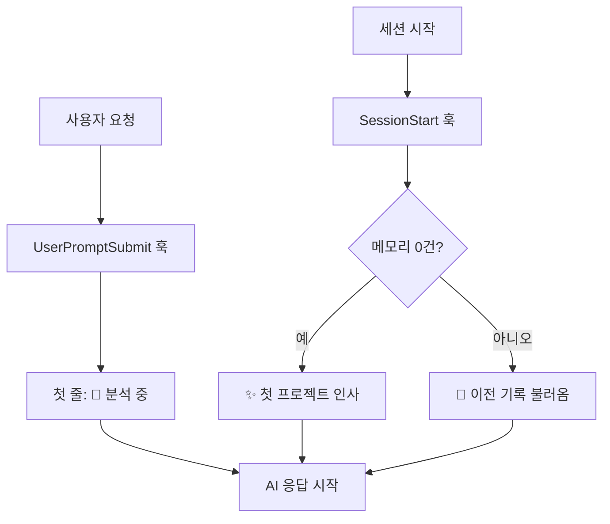

[[harness-4-memory|지난 글]]까지는 하네스의 내부에서 동작하는 것들을 다루었다. 이번 글은 하네스가 사용자의 화면에 어떤 문구로 보이는지에 관한 이야기다.

이 하네스는 개발자만 사용하도록 만든 것이 아니다. 기획자나 디자이너, 운영팀에서도 사용할 수 있게 하려고 했다. 그런데 그동안 개발을 할 때 화면에 표시되던 말은 모두 개발 용어였다. "lint가 통과되었습니다." 같은 문구를 개발자가 아닌 사람이 본다면, lint라는 과정이 무엇인지 과연 알 수 있을까 하는 생각이 들었다. 그래서 정식 버전(v1)을 준비하면서, 이 문구들을 **모두가 알아들을 수 있는 말로 바꾸는 작업**이 필요했다.

## 그 전에는 무엇이 문제였나

하네스는 기능을 다 갖추었다고 할 수는 있었지만, 고유의 말투가 없었다. 계획, 작업, 검증을 모두 거치면서도, 그 사실이 사용자의 화면에는 거의 드러나지 않았다. 그렇게 되면 AI가 답을 내놓았을 때, 그것이 안전한 답변인지 즉흥적으로 내놓은 답변인지 구분할 단서가 없다. 검증 결과도 `verify.sh`의 원본 출력 형식(PASS/FAIL & exit code)을 거의 그대로 보여주었고, 진행 안내에는 `planner`, `/harness:plan` 같은 **내부 도구의 이름**(에이전트/슬래시 커맨드; AI를 동작하게 하는 내부 도구 호출)이 그대로 노출되었다.

개발자에게는 이런 출력이 오히려 정보가 되었지만, 비개발 직군에게는 신뢰를 떨어뜨리는 노이즈였다. 그래서 v1의 과제는 새로운 기능이 아니라 번역이었다. 같은 일을 하되, 모두가 읽을 수 있는 형태로 제공하는 것이다.

## 작동하고 있다는 걸 보여주기

가장 먼저 한 일은 **하네스의 가시화**였다. 사용자가 무언가를 요청하면, AI가 답하는 맨 첫 줄에 "하네스가 지금 일하고 있다"는 신호를 반드시 출력하게 했다. 이 신호는 사용자의 매 턴마다 항상 출력되도록 설정해 두었다.

이 일은 사용자의 입력이 모델에 전달되기 직전에 개입하는 [`UserPromptSubmit`](https://docs.claude.com/en/docs/claude-code/hooks) [훅](https://docs.claude.com/en/docs/claude-code/hooks)이 담당한다. 이 훅은 매 턴마다 프롬프트를 구성해서 `additionalContext`(모델에게만 덧붙이는 숨은 지시문)로 전달하는데, 그 마지막에 가시화를 위한 문장 하나를 그대로 출력하라는 규칙을 넣어 두었다.

```js scripts/pipeline-injector.mjs
// 매 사용자 턴마다 첫 응답 첫 줄에 하네스 가시화 헤더를 강제 출력.
// 회피 시그널(--simple 등)이 있어도 항상 출력.
baseLines.push(
  "사용자 가시화 규칙 - 사용자에게 보내는 첫 응답의 맨 첫 줄에 다음 한 줄을 그대로 출력하세요. 의역·추가 설명·prefix 금지.",
  "> 🚀 하네스가 요청을 분석하고 있어요."  // [!code highlight]
);
```

사소해 보이지만, 비개발 직군에게는 중요한 부분이었다. AI가 그냥 답변하는 것인지, 우리 하네스를 거쳐서 답변하는 것인지 구분되지 않으면 신뢰가 생기지 않기 때문이다. 사용자는 이 문장으로 "지금 하네스가 켜져 있다"는 것을 매번 확인할 수 있다.

하네스를 처음 사용하는 사람에게는 다른 문구를 보여주었다. 세션을 처음 시작할 때 실행되는 `SessionStart` 훅이 프로젝트의 메모리 디렉토리를 확인하고, 기록이 0건이면, 즉 이 하네스로 처음 작업하는 프로젝트이면 빈 화면 대신 앞으로 기억이 쌓인다는 문구를 먼저 보여준다.

```js scripts/memory-loader.mjs
// 메모리 폴더가 없거나 기록 0건이면, 첫 응답 첫 줄에 띄울 콜드 스타트 인사를 내보낸다
const emptyHeadline = "✨ 하네스로는 처음 하는 프로젝트네요! 이번 세션부터 메모리가 차곡차곡 쌓일 거예요.";
const emptyOutput = { hookSpecificOutput: { hookEventName: "SessionStart",
  additionalContext: [emptyHeadline, "", `…맨 첫 줄에 그대로 출력하세요.`, `> ${emptyHeadline}`].join("\n") } };
process.stdout.write(JSON.stringify(emptyOutput));  // [!code highlight]
```

**콜드 스타트**(cold start; 아무 기록도 없는 첫 실행)에서도 화면이 비지 않게 한 것이다. 기록이 있는 경우에는 "이전 기록을 불러왔다"고 알린다. 두 경우를 함께 그리면 아래와 같다.



## 모두가 알아들을 수 있는 말로

검증 결과를 보고하는 말도 바꾸었다. 내부적으로는 lint, build, test를 그대로 실행하되, 사용자에게 보이는 응답에는 그 단어를 **절대 노출하지 않기로** 했다. 이를 위해 검증 스킬의 문서에 단어를 대응시킨 표를 명시해 두었다.

| 내부에서 쓰는 말                | 사용자에게 보이는 말        |
| ------------------------ | ------------------ |
| build 통과                 | 프로그램이 정상적으로 만들어졌어요 |
| PASS / FAIL              | 통과 / 문제 발견         |
| lint·build·type check 통과 | 코드 점검이 모두 통과했어요    |
| sentinel을 작성합니다          | 기록을 남기고 있어요        |

"디스크"나 "파일에 저장" 같은 표현도 "메모리에 기록"으로 바꾸었다. 기록을 남길 때 화면에 표시되는 말은 한 줄뿐이다. "💾 작업 내용을 기록으로 남겼어요."

더 중요한 것은 무엇을 숨기느냐였다. 사용자는 무엇을 했는지만 알면 되고, 어떤 내부 도구가 그 일을 했는지는 알 필요가 없다. 내부 도구의 이름이 사용자에게 노출되면, 그것은 정보라기보다 군더더기라고 생각했다. 그래서 에이전트의 이름이나 슬래시 커맨드, 내부에서 분류하는 라벨은 사용자의 응답에 아예 노출하지 않기로 정책을 정하고, 그 정책을 매 턴 주입되는 안내문의 맨 위에 명시했다.

```js scripts/pipeline-injector.mjs
// 주요 사항만 한 줄로 압축. 내부 라벨(A/B)·슬래시커맨드·에이전트명은 사용자 가시 영역에 노출 금지.
const baseLines = [
  "[하네스] 새 요청이면 분류 후 진행: 질문/열람=즉답, 1~2파일 단순수정=즉시작업+점검, 그 외=계획→승인→작업→점검.",
  "내부 라벨·슬래시커맨드·에이전트명을 사용자 응답에 노출 금지. 진행 중 흐름이면 이어가세요.",  // [!code highlight]
];
```

[[harness-2-self-bypass|계획 단계의 우회를 차단하던 방식]]도 이 과정에서 함께 완화되었다. 강제로 차단하면 비개발 직군에게는 거친 경험이 되겠다는 생각이 들어서, 막지는 않는 쪽으로 결정한 것이 바로 이 정식 버전이었다.

## 교훈

이 과정에서 배운 것은 <u>하네스는 보여야 신뢰받는다</u>는 것이었다. 아무리 좋은 검증 절차와 메모리 기록을 갖추어 두어도, 사용자가 그것이 동작하는지 모르면 없는 것과 같다. 첫 줄의 한 문장, 인사 한 줄이 기능 목록보다 신뢰에 더 크게 기여했다. 정식 버전의 핵심은 새로운 기능이 아니라 말투였던 것이다.

다음 글에서는 범위를 조금 더 넓힌다. 지금까지 [Claude Code](https://docs.claude.com/en/docs/claude-code) 위에서만 동작하던 하네스를, [Codex](https://github.com/openai/codex)라는 다른 LLM에서도 동작하도록 확장한다. 🌱
