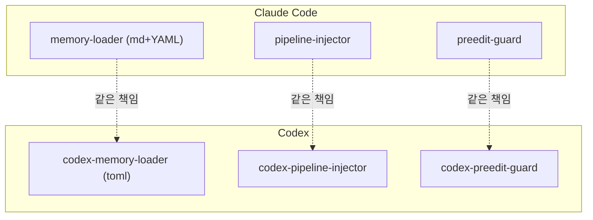

지금까지 만든 하네스는 [Claude Code](https://docs.claude.com/en/docs/claude-code) 위에서만 동작했다. 그런데 사내에서는 [Codex](https://github.com/openai/codex)(OpenAI의 코딩 에이전트)도 함께 사용하고 있었기 때문에, Codex용 하네스도 자연스럽게 필요해졌다. 문제는 두 도구의 **런타임**(runtime; AI가 실제로 도는 실행 환경)이 다르다는 것이었다. 하네스를 Codex에서도 사용하려면, 같은 로직을 Codex의 방식으로 다시 구현해야 했다.

## 그 전에는 무엇에 묶여 있었나

기존 하네스는 Claude Code의 구조에 묶여 있었다. 역할별 에이전트는 `agents/*.md`(YAML 머리말이 붙은 마크다운)로 정의했고, 워크플로우는 `/harness:plan` 같은 스킬로 호출했다. 세션이 시작될 때, 사용자가 입력할 때, 파일을 편집하기 직전에 실행되는 훅도 Claude Code의 훅 규격(`hooks.json`)에 맞춰져 있었다. 흐름 자체는 런타임과 무관했지만, **그 흐름을 호출하는 방법이 전부 Claude Code 전용**이었던 것이다.

Codex에는 이런 구조가 없거나, 있더라도 사용하는 방법이 달랐다. 에이전트는 마크다운이 아니라 **TOML**(키=값 형식의 설정 파일)로 작성하고, 슬래시 커맨드라는 개념 자체가 없다. 그래서 단순히 복사해서 붙여 넣는 것으로는 해결되지 않았다.

## 표면은 유지하고 내부만 다르게

원칙은 분명했다. 흐름은 그대로 두고 구현만 교체하는 것이다. Claude용 파일은 수정하지 않고, Codex용 파일을 `codex/` 디렉토리 아래에 따로 두었다. 같은 파이프라인(계획 → 실행 → 검증 → 수정)과 같은 메모리, 계획 보조 스크립트를 Codex 쪽에도 동일하게 두되, Codex의 방식에 맞게 변경했다.

먼저 훅의 구조를 보면 양쪽이 거의 같다. 세션이 시작될 때 메모리를 불러오고, 사용자가 입력할 때마다 파이프라인을 주입하고, 파일을 편집하기 직전에 범위를 점검한다. Codex의 훅은 플러그인 디렉토리의 루트를 환경 변수로 받아서, 같은 이름의 `codex-` 스크립트를 실행한다.

```json codex/hooks/hooks.json
{
  "hooks": {
    "SessionStart":     [ /* codex-memory-loader.mjs   */ ],  // 기억 불러오기
    "UserPromptSubmit": [ /* codex-pipeline-injector.mjs */ ], // 파이프라인 주입 [!code highlight]
    "PreToolUse":       [ /* codex-preedit-guard.mjs    */ ], // 편집 범위 점검 (matcher: apply_patch|Edit|Write)
    "Stop":             [ /* codex-completion-saver.mjs  */ ]
  }
}
```

Codex에는 슬래시 커맨드가 없기 때문에, 워크플로우를 호출하는 일은 전부 훅과 컨텍스트 주입으로 옮겼다. 사용자가 `/plan`을 직접 입력하는 대신, `UserPromptSubmit` 훅이 매 턴마다 파이프라인 안내를 주입해서 같은 흐름이 자동으로 실행되게 한 것이다.

에이전트도 다시 만들었다. 책임은 같지만, Claude의 YAML 마크다운이 아니라 Codex의 TOML로 작성했다. 모델, 추론 강도, 샌드박스 권한을 TOML의 형식에 맞춰 적는다.

```toml codex/agents/implementer.toml
name = "implementer"
description = "프론트엔드·백엔드·DB·범용 작업을 한 에이전트가 도메인에 맞춰 처리"
model = "gpt-5.5"
sandbox_mode = "workspace-write"        # [!code highlight]
model_reasoning_effort = "medium"
developer_instructions = """
승인됐거나 명확히 범위가 잡힌 작업만 한다. 변경은 작게, 한 커밋 단위로.
편집한 모든 줄은 맡은 작업과 직접 매핑돼야 한다. 곁다리 리팩터링·임포트 정렬·죽은 코드 삭제 금지.
검증은 가장 좁은 의미 있는 체크로. DONE / DONE_WITH_CONCERNS / NEEDS_CONTEXT / BLOCKED 중 하나로 보고.
"""
```

에이전트마다 모델, 권한, 추론 강도도 따로 설정했다. 구현을 담당하는 에이전트는 쓰기 권한과 medium 의 추론 강도를, 검증하는 에이전트는 읽기 전용, 그리고 low 단계의 추론 강도를 설정했다. [[harness-1-benchmarking|첫 글에서 검토하는 에이전트에게 읽기 도구만 설정했던 권한 분리]]가, 여기서는 **샌드박스 모드라는 더 강한 형태**로 나타났다. 검증하는 에이전트의 설정은 아래와 같다.

```toml codex/agents/verifier.toml
name = "verifier"
model = "gpt-5.4"
sandbox_mode = "read-only"            # 파일을 못 고친다 [!code highlight]
model_reasoning_effort = "low"        # 검증은 무거운 추론이 필요 없다
```

이렇게 만든 Codex용 파일들은 하나의 플러그인 매니페스트가 묶는다. 스킬, 훅, 도구의 경로를 이 파일 하나에 적고, 버전은 Claude 쪽과 같은 숫자로 맞춰서 두 런타임이 버전을 따로 가지지 않도록 했다.

```json codex/.codex-plugin/plugin.json
{
  "name": "harness-dev",
  "skills": "./skills/",
  "hooks": "./hooks/hooks.json",     // [!code highlight]
  "mcpServers": "./mcp.json"
}
```

[[harness-2-self-bypass|편집 범위 점검]]도, [[harness-4-memory|메모리 불러오기]]도, [[harness-5-nondev-ux|가시화]]도 모두 `codex-` 접두어가 붙은 모습으로 다시 만들었다. 워크플로우 스킬(`harness-plan`, `harness-exec`, `harness-verify` ...)도 `codex/skills/` 아래에 같은 이름으로 옮겼다. 두 런타임의 스크립트를 나란히 놓으면 아래와 같이 대응한다.



## 저장 위치를 한 곳에서

두 런타임을 동시에 지원하려고 하니 저장 위치가 문제가 되었다. 메모리나 카운터를 어디에 둘지가 런타임마다 달라지면 코드가 둘로 갈라지기 때문이다. 그래서 **경로를 한 곳에서 결정하는** 작은 추상화 층을 두었다. 플러그인 데이터 디렉토리를 기본으로 사용하되, 환경 변수로 덮어쓸 수 있도록 했다.

```js codex/scripts/lib/harness-paths.mjs
export function dataRoot() {
  const configured = process.env.PLUGIN_DATA || process.env.CODEX_HARNESS_DATA;
  const root = configured?.length ? configured : join(homedir(), ".codex-harness-dev");  // [!code highlight]
  mkdirSync(root, { recursive: true });
  return root;
}
// memory/, counter/ 같은 하위 경로는 전부 이 dataRoot() 한 곳에서 파생된다
export function memoryDir(cwd = process.cwd()) {
  return subdir(join(dataRoot(), "projects", toSlug(cwd)), "memory");
}
```

저장 위치를 코드 한 곳에서 관리하도록 한 이 정리는 사소해 보여도 중요했다. 나중에 [[harness-7-snowflake|메모리를 팀이 공유할 수 있도록 옮길 때]], 이 한 곳만 바꾸면 되었기 때문이다. 당장 필요해서가 아니라, 다음 확장을 위해 미리 준비해 둔 것이다.

## 결론

Codex로 확장하는 일은 단순히 복사해서 붙여 넣는 정도가 아니었다. 슬래시 커맨드처럼 한쪽에만 있는 기능에 흐름이 묶여 있으면, 그 의존부터 끊어야 했다. 그 과정에서 하네스의 본질이 더 뚜렷해졌다. <u>슬래시 커맨드는 껍데기였고, 알맹이는 "계획 → 실행 → 검증"이라는 흐름과 그것을 강제하는 훅들이었다.</u>

지금까지의 기록은 내 PC에만 쌓였다. 다음 글에서는 이 기록을 팀이 함께 공유할 수 있도록 사내 공용 저장소에 적재하는 파이프라인을 만든다. 그 과정에서 민감정보를 다루는 문제를 마주하게 된다. 🥹
