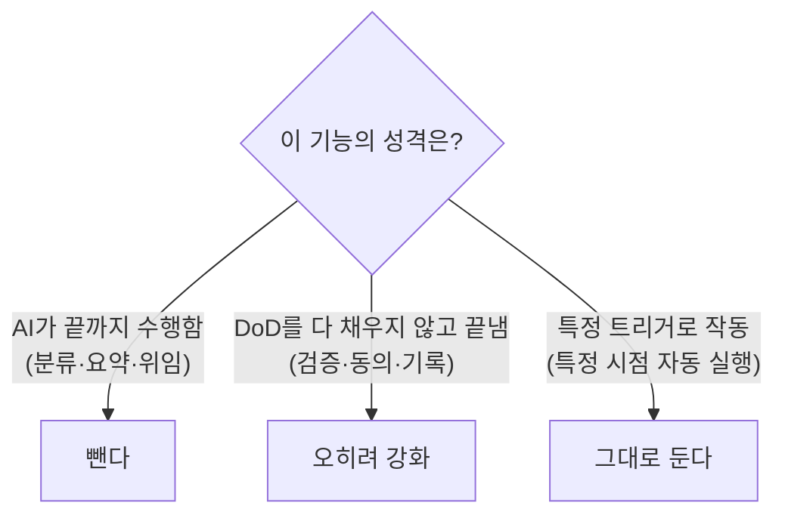

[[harness-1-benchmarking|첫 글]]부터 [[harness-7-snowflake|지난 글]]까지는 계속 무언가를 추가하는 이야기였다. 파이프라인이 실행되게 하고, 툴을 계속 연결하고, 메모리를 공유할 수 있게 했다. 그런데 그사이 모델(Opus 4.8)이 부쩍 똑똑해졌다. 그러자 계속 추가하기만 하던 것에서, 이제는 오히려 무엇을 제외해야 할지를 고민하게 되었다.

그래서 제외할 기능을 고르는 기준부터 다시 세웠다. "더 똑똑해진 AI가 이 일을 할 수 있는가"가 아니라 **"AI가 내가 맡긴 일을 끝까지 수행하는가"**를 기준으로 보아야 했다. 내가 DoD(완료의 기준)를 설정했을 때, AI가 그 DoD를 모두 달성하는지를 보는 것이다.



이 기준에 따르면 기능은 세 가지로 나뉜다. 장치가 없어도 AI가 끝까지 수행하는 일은 제외하고, AI가 DoD를 다 채우지 않고 끝낼 수 있는 일은 오히려 강화하고, 특정한 시점에 자동으로 실행되는 일은 그대로 둔다.

## AI가 알아서 잘하는 일은 제외했다

제외해도 되는 것은 이미 AI의 능력에 흡수되어 있는 기능이었다. 구체적으로는 아래의 세 가지가 사라졌다.

- 작업을 A/B/C로 나누는 분류에 걸려 있던 **계획의 강제**. 분류 자체는 남기되, 복잡한 작업(C)에 계획을 강제하던 것을 사용자에게 권유하는 것으로 바꾸었다. 모델이 알아서 분류를 잘하기 때문이다.

- 사실상 같은 일을 하던 **프론트, 백엔드, DB, 단순 개발 에이전트 넷**. "편집한 모든 줄은 맡은 작업과 직접 매핑돼야 한다"는 수술적인 변경 원칙만 공통으로 흡수시키고, `implementer` 에이전트 하나로 합쳤다.

- 한참 전에 비활성화해 둔 **배포 기능**. `deploy-*` 에이전트와 배포 스크립트는 호출하더라도 즉시 종료하도록 가드만 남겨 둔, 사실상 동작하지 않는 기능이었다.

진입점으로 제공되는 문서(`CLAUDE.md`)도, 계획을 권유로 바꾼 정식 버전(v1.2.0)에서 151줄에서 89줄로 줄었다. 반대로 검증이나 권한 분리, 메모리는 AI가 똑똑해질수록 더 중요해졌다. AI가 확신을 가질수록 객관적인 검증이 필요하기 때문이다.

여기까지는 문서와 에이전트를 줄이는 작업이었다. 같은 기준을 가지고, 이보다 더 큰 제거를 두 번 진행했다.

## 메모리 공유 제거

첫 번째는 [[harness-7-snowflake|지난 글]]에서 만든 메모리 동기화 기능이었다. 데이터 조회와 기록 저장을 공식 커넥터가 맡기로 하면서, 직접 만들어 운영하던 부분이 통째로 **중복**이 되었기 때문이다. 그래서 동기화 기능을 제거하고, 그 기능에만 종속되어 있던 보조 모듈들도 함께 삭제했다. 청킹, 마스킹, 증분 마커처럼 이전에 공들여 작성했던 코드들이다.

```text 삭제된 파일
- run-harness-rag.mjs, set-harness-rag-secret.mjs
- memory-sync{,-trigger,-exclude}.mjs
- lib/memory-{sync-marker, chunker, scrubber}.mjs
→ .mcp.json: harness-rag 서버 제거 / SessionStart 핸들러 4→3
```

아까운 코드이기는 했다. 그렇지만 중복은 부채이다. 같은 일을 두 곳에서 하게 되면 둘 다 관리해야 하고, 둘이 서로 어긋나면 문제가 커질 수 있다. 유지보수할 코드가 줄어들어서 조금 후련하기도 했다. 이 삭제로 SessionStart 훅을 트리거로 삼던 스크립트도 네 개에서 세 개로 줄었다.

## Serena MCP 제거

두 번째이자 더 큰 결정은, [[harness-3-serena-proxy|프록시만 제거하고 직접 연결해 두었던]] 코드 분석 툴인 Serena MCP를 하네스에서 제거하는 것이었다.

Serena를 사용할 때는 AI의 토큰을 아끼기 위해서 코드 탐색에 계단식 정책까지 두었다. 먼저 **심볼**(symbol; 함수나 클래스 같은 코드 단위)을 정확하게 찾고, 찾지 못하면 부분 일치로 찾고, 그래도 안 되면 파일의 개요를 보고, 마지막에야 파일을 통째로 읽는 식이었다. 그런데 모델이 똑똑해지자, `rg`(ripgrep; 빠른 텍스트 검색 방법)와 파일 읽기 같은 기본 도구만으로도 코드를 잘 찾아냈다. Serena를 비활성화하고 비교해 보았을 때에도, 단계적인 코드 분석을 받쳐 주던 외부 툴이 없다고 해서 탐색 능력이 떨어지지 않았다. 게다가 Claude Opus가 검색할 때 스스로 ripgrep을 사용한다는 것을 알고 나서부터는, 굳이 Serena의 방식을 쓰지 않아도 모델이 개선될 때마다 탐색이 그렇게 효율적인 방식으로 바뀌어 가겠다는 생각이 들었다. 결국 **외부 툴 하나가 주는 이득보다, 세션마다 외부 프로세스를 실행하는 부담이 더 커지게 되었다.**

그래서 읽기 도구만 가지고 있던 검토 에이전트와 계획 에이전트의 기본 검색을 보강하고, 외부 프로세스를 실행하는 과정을 제거했다. 제거한 뒤의 MCP 설정에는 아무 서버도 남지 않았다.

```json .mcp.json
// 제거 후, 빈 통로만 남긴다
{
  "mcpServers": {}   // [!code highlight]
}
```

## PC마다 남아 있던 Serena의 캐시 정리

설정에서 Serena를 제거한 뒤에도 한 가지가 더 남아 있었다. 하네스의 코드를 지운다고 해서, 이미 각자의 PC에 설치된 격리된 uv와 Serena의 캐시(1기가가 넘었다)까지 사라지지는 않는다. 그래서 PC마다 **딱 한 번씩만** 실행되는 정리 스크립트를 추가했다.

```js scripts/serena-cleanup.mjs
if (existsSync(doneFlag)) return;          // 이 PC에서 이미 돌았으면 즉시 끝 [!code highlight]
// uv 캐시 중 serena로 "식별된" 것만 회수. 내용으로 확인하지, 경로만 보고 지우지 않는다
const SERENA_URL_RE = /oraios[\/\\]serena/i;
// ... 회수 끝나면
writeFileSync(doneFlag, new Date().toISOString());  // 완료 표시
process.exit(0);                                     // 어떤 경우에도 정상 종료
```

이 스크립트는 지켜야 하는 불변식이 까다로웠다. 우선 사용자의 화면을 어지럽히지 않도록, 출력을 내보내지 않고 로그는 파일에만 쌓이게 했다. 그리고 스크립트가 도중에 실패하더라도 세션을 막지 않도록, 어떤 예외도 던지지 않고 항상 `exit 0`으로 끝나게 했다. 완료 표시를 남겨서 한 번만 실행되도록 한 것도 같은 이유이다.

여기에 한 가지 조건이 더 있었다. 다른 직원이 다른 용도로 사용하고 있는 같은 uv의 패키지는 절대 건드리지 않아야 한다. 그래서 경로만 보고 지우지 않고, 파일의 내용에 `oraios/serena` 흔적이 남아 있는 것들만 회수하도록 했다. 이 정리 스크립트 자체도 일회성 작업이기 때문에, 다음 배포 과정에서 함께 지울 예정이다.

## 결론

하네스를 자동차의 운전 보조 장치라고 가정해 본다. 운전 실력(모델의 성능)이 늘면 어떤 보조 장치는 떼어 내도 된다. 하지만 안전벨트와 브레이크 점검은 실력과 무관하게 계속 필요하다. 지금까지 하네스를 운영하며 적어 온 글들은 결국 이 둘을 구분해 온 기록이다. <u>AI가 끝까지 수행하는 일은 AI에 맡기고, DoD를 다 채우지 않고 끝낼 수 있는 일은 더 단단히 잡는다.</u>

[[harness-3-serena-proxy|Stub Proxy를 제거했던 글]]에서 영리한 우회보다 단순한 방식이 더 나았던 것처럼, 여기서도 직접 만든 것보다 표준적인 방법과 네이티브 기능이 더 나았다. **만드는 것만큼 지우는 것도 엔지니어링**이라는 것을, 이 과정에서 가장 또렷하게 배우게 되었다.

여기까지가 하나의 하네스를 쌓고 덜어낸 기록이다. 그런데 덜어내고 나니 이제는 또 채워야 할 부분이 생겼다. 지금까지의 하네스는 개발 업무만 받쳐 주었지만, 기획, 영업, 디자인 같은 다른 영역까지 받쳐 주려면 에이전트를 여럿 두고 일을 나누어야 한다. [[harness-9-orchestration|다음 글]]에서는 그 멀티에이전트를 다시 벤치마킹하는 이야기를 꺼내본다. 🌼
