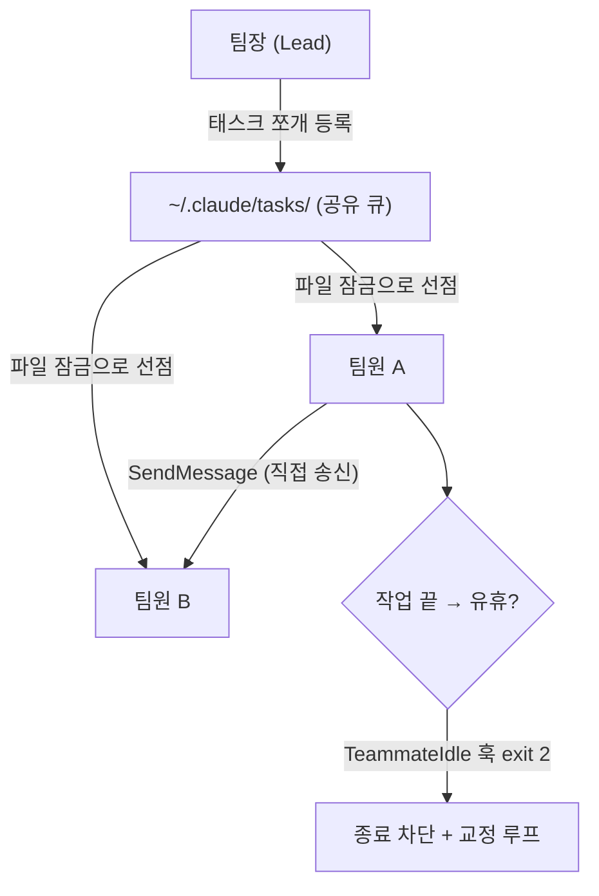
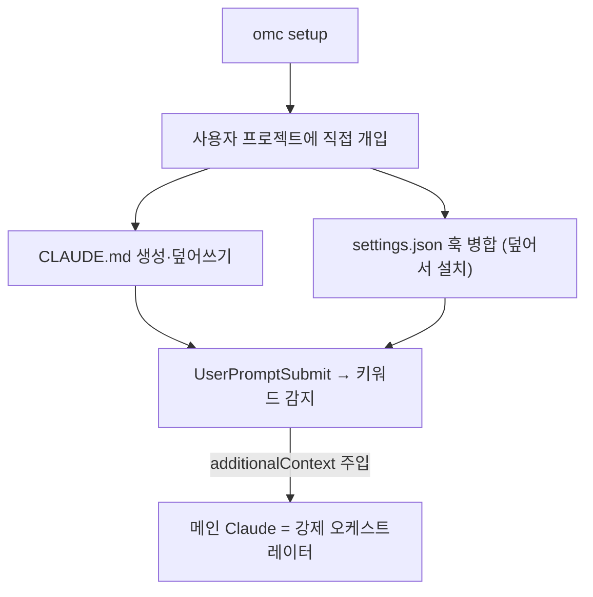
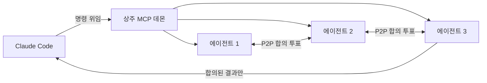

[[harness-8-trimming|지난 글]]에서는 기존에 사용하던 하네스를 가볍게 만들었다. 그런데 이 하네스는 지금까지 개발 업무만 받쳐 주고 있었다. 사내의 다른 직군이 하는 업무까지 받쳐 주려면, 일을 나누어 맡길 **에이전트나 플러그인이 여럿** 필요했다.

[[harness-1-benchmarking|처음 벤치마킹을 했던 글]]에서 나는 "에이전트 열 개가 동시에 도는 대규모 병렬 오케스트레이션"을 복잡성에 비해 이득이 없다는 이유로 채택하지 않았다. 그 판단은 첫 버전에서는 옳았다. 하지만 영역을 넓히려고 하니, 그 문제를 다시 살펴보아야 했다. 에이전트가 하나뿐이면 **컨텍스트 윈도우**(context window; 모델이 한 번에 참고하는 대화/파일의 총량)가 가득 차 버리고, 한 에이전트에게 작업과 리뷰를 동시에 시키면 역할이 충돌하기 때문이다. 그래서 다시 벤치마킹을 해 보기로 했다. 그때와 달라진 것이 한 가지 있다면, 이번에는 겉모습이 아니라 작동하는 원리를 조금 더 깊게 보았다는 것이다.

## 네 갈래로 나뉜 방법

먼저 전체적인 흐름부터 살펴보았다. 거대한 "라우터 에이전트" 하나가 모든 것을 통제하는 블랙박스 모델은 이미 한물간 방식이었다. 그 대신 마크다운, JSON 훅, 작업 디렉토리를 활용하는 **화이트박스 라우팅**(whitebox routing; 어느 에이전트로 일이 가는지 코드로 들여다보이는 방식)이 대세였다. 이 방식들은 구동되는 환경과 라우팅 철학에 따라 크게 네 갈래로 나뉘었다.

| 갈래         | 대표                                | 환경              | 라우팅 방식                      | 무게     |
| ---------- | --------------------------------- | --------------- | --------------------------- | ------ |
| 공식         | Claude Code agent-teams           | 로컬 파일시스템        | 공유 태스크 큐 + 파일 잠금            | 중간     |
| 네이티브 강화형   | agent-teams(wshobson) / SuperClaude | Claude Code 그대로 | description 의미론 / 훅 컨텍스트 주입 | 가장 가벼움 |
| 워크스페이스 변조형 | Oh-My-Claudecode                  | 사용자 프로젝트 디렉토리     | CLAUDE.md 심기 + 훅 가로채기       | 중간     |
| 외부 데몬형     | ruflo                             | 상주하는 MCP 서버     | P2P 합의 투표                   | 가장 무거움 |

아래에서는 이 네 갈래를 표의 순서대로 하나씩 살펴본다.

## 공식 방법인 agent-teams

[Anthropic이 공식 문서로 제시한 방식](https://code.claude.com/docs/en/agent-teams)은 의외로 소박했다. 외부 서버 없이 **오직 로컬 파일시스템과 프로세스 제어**만으로 여러 에이전트를 운용한다. `CLAUDE_CODE_EXPERIMENTAL_AGENT_TEAMS=1`을 설정하고 첫 에이전트를 호출하면, 그 순간 메인 세션이 팀장(Team Lead)으로 전환된다.

팀장이 일을 하위 태스크로 나누어 `~/.claude/tasks/{팀}/`에 상태 파일로 등록하면, 팀원들은 그 디렉토리를 살펴보다가 `pending` 상태인 작업을 가져간다. 이때 여럿이 동시에 같은 작업을 가져가지 않도록, OS 수준의 파일 잠금으로 작업을 선점하고 상태를 `in progress`로 바꾼다.



이 가운데 흥미로웠던 것은 다이어그램의 마지막 단계였다. 팀원이 작업을 마치고 유휴 상태로 들어가려고 하면 `TeammateIdle` 훅이 트리거된다. 이때 하네스의 스크립트가 종료 코드 2(exit code 2)를 돌려주도록 설정해 두면, 팀원의 종료가 차단되고 검증자의 피드백을 받아서 교정 루프를 다시 실행하게 할 수 있다. 이것은 [[harness-2-self-bypass|이전 글]]에서 `PreToolUse` 훅이 `block`으로 편집을 되돌렸던 것과 정확히 같은 방법이다. 훅의 종료 코드로 흐름을 조정하는 패턴은 어디에서나 통하는 것 같다.

## 가장 가벼운 방법은 네이티브를 강화하는 것

두 번째 갈래는 별도의 **데몬**(daemon; 백그라운드에서 상시 실행되어 있는 프로그램)을 실행하지 않고, Claude Code가 가진 기능만 극대화하는 방법이다. 지금 우리 하네스가 사용하고 있는 방법이기도 하다. 이 갈래에서는 두 가지 플러그인을 조사해 보았다.

첫 번째인 agent-teams(by wshobson)에는 중앙 라우터 코드가 아예 없다. 그 대신 `.claude/agents/`에 에이전트 마크다운 파일들을 모아 두고, 각 파일의 `description`에 "언제 이 에이전트를 부르는가"를 아주 상세하게 적는다. 메인 스레드는 이 설명들을 도구 목록처럼 읽고, 사용자의 요청과 비교해서 가장 알맞은 에이전트를 골라 위임한다. 코드가 아니라 모델이 문맥을 이해하는 과정이 라우터의 역할을 하는 것이다.

```md .claude/agents/biz-writer.md
---
name: biz-writer
description: 기획서·제안서 초안 작성. 문서/기획/PRD 키워드나 docs 폴더 작업일 때 호출.  # [!code highlight]
tools: [Read, Write, Edit]
---
당신은 비즈니스 문서 초안을 쓰는 에이전트다. 사내 정책을 준수하고, 논리 맹점을 남기지 않는다.
```

두 번째인 SuperClaude는 `hooks.json`으로 `UserPromptSubmit`을 가로챈다. 사용자가 엔터를 입력하면 0.1초 만에 스크립트가 실행되어 현재 작업 경로(`cwd`)를 분석한다. 그래서 `package.json`이 보이면 프론트엔드 작업으로 판단하고, `docs` 디렉토리라면 해당하는 지침서를 읽어서 `additionalContext`로 메인 프롬프트에 주입한다. 그렇게 되면 다른 에이전트로 이동하지 않고도 메인 스레드가 즉시 그 분야의 전문가처럼 답하게 된다. 가벼운 방식으로 멀티에이전트의 효과를 내는 것이다.


이 흐름이 우리 하네스의 `pipeline-injector.mjs`가 이미 하고 있던 일과 똑같다는 것을 알게 되었을 때, 방향이 조금은 잡혔다. 반갑기도 했다. 적어도 내 가설과 설계가 맞았다는 뜻이었기 때문이다. **우리는 이미 이 방법을 사용**하고 있었다.

## 내가 잘못 이해했던 OMC

세 번째 갈래를 살펴보기 전에, 내가 가장 크게 잘못 이해했던 것부터 바로잡아야겠다. [[harness-1-benchmarking|처음 벤치마킹을 했던 글]]에서 나는 OMC(Oh-My-Claudecode)를 "라우터가 작업을 쪼개 권한이 분리된 서브에이전트들에게 강제로 위임"한다고만 적었다. 그때 내가 이해한 구조는, 플러그인 안에 라우터가 들어 있고 플러그인의 `CLAUDE.md`를 단일 진입점으로 삼아서 흐름이 진행된다는 것이었다. 그런데 그 이해가 틀렸었다. OMC를 직접 설치한 뒤에 `CLAUDE.md`를 읽어 보고서야 그것을 알게 되었다.

실제 OMC는 **샌드박스 바깥에서 사용자의 실제 프로젝트 디렉토리로 침투한다.** 여기에는 이유가 있다. Claude Code에는 "플러그인 내부의 설정 파일(`CLAUDE.md` 등)은 무시하라"는 기본 규칙이 있다. 그래서 플러그인 안에 라우팅 방법을 아무리 적어 두어도 적용되지 않는다. OMC는 이 격리를 우회하기 위해서, `omc setup`을 실행할 때 사용자가 실제로 작업하는 디렉토리에 자신의 설정을 심는다. 심는 것은 아래의 두 가지이다.

- 프로젝트 최상단에 `.claude/`를 만들고, 프로젝트의 '헌법' 격인 `CLAUDE.md`를 내려받아서 생성하거나 덮어쓴다. 그 안에는 "직접 코딩하지 말고 반드시 전문 에이전트에게 위임하라"는 지시문이 들어 있다.

- `settings.json`에는 `UserPromptSubmit`, `Stop` 훅의 등록을 병합한다. 기존 설정은 보존하되, 자신의 스크립트를 끼워 넣는 방식이다.

```jsonc settings.json (OMC가 병합해 넣는 훅 등록의 형태)
{
  "hooks": {
    "UserPromptSubmit": [
      { "hooks": [{ "type": "command", "command": "node .../keyword-detector.mjs" }] }  // [!code highlight]
    ],
    "Stop": [ { "hooks": [{ "type": "command", "command": "node .../skill-injector.mjs" }] } ]
  }
}
```

이렇게 설정이 심어지고 나면, 채팅에서 사용자의 프롬프트를 가로채는 현상이 일어난다. 사용자가 프롬프트를 보내면 메인 세션의 Claude가 읽기 전에 `keyword-detector`가 먼저 실행되어 plan이나 team 같은 매직 키워드를 스캔하고, "이 작업은 `team-plan`에게 넘겨라"는 지시를 `additionalContext`로 주입한다. 그렇게 되면 메인 Claude는 덮어쓴 `CLAUDE.md`의 규칙과 방금 주입된 지시에 따라서, 스스로 판단하기를 멈추고 오케스트레이터의 역할만 하게 된다.



정리하면, 그때의 나는 OMC의 "강제 위임"이 플러그인 안에서 일어난다고 보았지만, 실제로는 **사용자의 작업 공간을 변조**해서 일어나게 하는 것이었다. 이것은 우리가 이 방식을 채택하지 않은 이유이기도 하다. 사내 도구가 사용자의 `CLAUDE.md`를 말없이 덮어쓰는 것은, [[harness-1-benchmarking|첫 글]]에서 가져온 기준(되돌리기 어려운 행동을 하기 전에 사람에게 묻는다)에 정면으로 어긋나기 때문이었다.

## 가장 무거운 방법인 ruflo

마지막 갈래인 ruflo(구 claude-flow)는 앞의 세 가지와 성격이 완전히 다르다. 백그라운드에 Node.js/Python 기반의 **MCP 서버 데몬**을 영구히 실행해 둔다. 사용자가 명령을 내리면 Claude Code가 그 명령을 통째로 데몬에 넘기고, 데몬 안의 중앙 오케스트레이터가 전문가 에이전트 서너 명을 호출한다. 이 에이전트들이 P2P 네트워크로 의견을 주고받으면서 "어떤 코드가 최선인가"를 투표로 결정하고, 최종 결과만 화면으로 돌아온다.



강력한 방식이지만 보안 설정이 까다롭고 자원을 많이 사용한다. 그래서 일반적인 부서 업무에는 과한 스펙이라고 결론을 내렸다. 초반에 대규모 병렬 오케스트레이션을 채택하지 않았던 그 판단이, 여기서도 유효했다.

## 우리 하네스가 갈 방향

네 가지 방법을 나란히 놓고 보니 방향이 조금은 보였다. 무거운 외부 데몬(ruflo)도, 사용자의 디렉토리를 변조하는 방식(OMC)도 필요하지 않았다. 우리는 이미 가장 가벼운 갈래(네이티브 강화형)에 있었다. 그래서 비개발 영역으로 넓히는 일은, 이미 가지고 있는 훅 아키텍처(`hooks.json`, `pipeline-injector.mjs`) 위에 **세 가지만 추가**하면 되는 것이었다.

1. **에이전트 역할 세분화**. 코드를 작성하는 `implementer` 외에, 문서의 초안을 작성하는 `biz-writer`와 그 논리를 비판하는 `critic-reviewer`를 추가한다.
2. **분류기 정규식 확장**. `pipeline-injector.mjs`가 `/제안서|기획서|초안/` 같은 키워드와 작업 디렉토리(`cwd`)를 보고, 코드 작업인지 문서 작업인지를 스스로 판단해서 알맞은 라우팅 지침을 주입한다.
3. **검증의 의미 재정의**. 개발 작업의 Verify가 `lint`와 `build`를 실행하는 것이었다면, 문서 작업의 Verify는 `critic-reviewer`의 **토론 통과**(Debate; 비판 에이전트가 논리 맹점을 따져 APPROVE)로 바꾼다.

이 세 가지는 결국 개발의 `Plan → Exec → Verify → Fix`를 문서 영역으로 치환한 것이다. 컴파일러가 하지 못하는 검증을, 에이전트 사이의 교차 검토가 대신하게 된다.

부서 간의 인수인계도 단순한 텍스트가 아니라 구조화된 JSON으로 넘겨서, 무엇이 전달되었는지를 투명하게 확인할 수 있게 하면 좋을 것 같다. 예를 들어 `biz-writer`가 작성한 초안을 `critic-reviewer`에게 넘길 때는 아래와 같은 형태가 된다.

```json .claude/handoffs/PRD-{id}.json
{
  "task_id": "PRD-101",
  "from_agent": "biz-writer",
  "to_agent": "critic-reviewer",
  "context": "신규 기능 PRD 초안",
  "focus_areas": ["빠진 정책 없는지", "추가 검토가 필요한 항목"]  // [!code highlight]
}
```

## 결론

처음의 벤치마킹이 "잘 쓰고 있는 하네스를 처음 뜯어본" 기록이었다면, 이번 글은 같은 일을 더 깊이 다시 한 기록이다. 그사이에 보는 눈이 달라졌다. 그때는 기능의 목록과 규모를 보고 판단했고, 이번에는 라우팅이 어디서 어떻게 일어나는지를 보았다. 그러자 그때 OMC를 잘못 읽었던 것도 드러나게 되었다.

기준은 [[harness-8-trimming|지난 글]]과 같았다. <u>AI가 DoD를 다 채우지 않고 끝낼 수 있는 일은 단단히 잡되, 무거운 것은 버린다.</u> 데몬도, 사용자의 디렉토리를 변조하는 방식도 버리고, 들여다보이는 훅 라우팅만 가져오면 될 것 같다.

참고한 글은 Anthropic의 [Building Effective Agents](https://www.anthropic.com/engineering/building-effective-agents), Claude Code의 [서브에이전트](https://code.claude.com/docs/en/sub-agents)와 [agent-teams](https://code.claude.com/docs/en/agent-teams) 문서, 그리고 [agent-teams(wshobson)](https://github.com/wshobson/agents/tree/main/plugins/agent-teams), [SuperClaude](https://github.com/SuperClaude-Org/SuperClaude_Framework), [OMC](https://github.com/Yeachan-Heo/oh-my-claudecode), [ruflo](https://github.com/ruvnet/ruflo)의 코드이다. 같이 확인해보면 좋을 것 같다. ☺️
