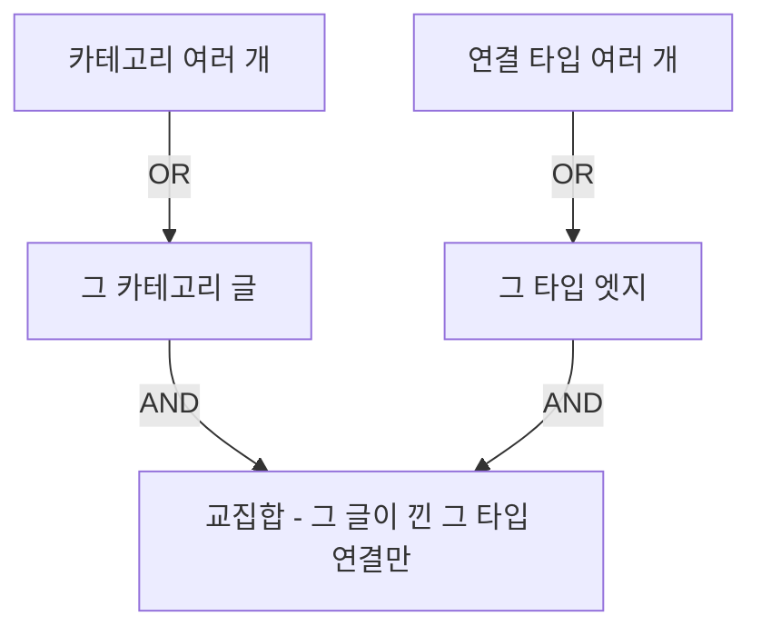

글은 꾸준히 쌓였는데, 정작 그 글을 읽고 쓰는 화면에는 손이 덜 간 자리가 많았다. 그래서 날을 잡고 네 부분으로 나누어 다듬게 되었다. 읽는 화면, 글을 작성하는 화면, 글 안의 다이어그램과 표, 그리고 [그래프](/graph/)이다. 무엇을 더했고 그것이 왜 필요했는지를, 만든 코드 한두 줄과 함께 적어 두려고 한다.

## 우측 하단의 버튼을 하나로 합치기

글을 읽다 보면 공유하고 싶을 때가 있고, 본문만 보고 싶을 때도 있다. 그래서 이 두 기능을 각각 버튼으로 만들었더니 글의 우측 하단이 금세 복잡해졌고, 결국 **스피드다이얼**(speed dial; 버튼 하나를 누르면 위로 항목이 펼쳐지는 UI)로 합쳤다. 평소에는 버튼 하나만 보이고, 누르면 집중, 공유, 맨 위로 가는 항목이 나온다.

집중 읽기 모드는 헤더, 목차, 푸터를 감추고 본문만 남긴다. 처음에는 글을 넘기면 모드가 풀려 버렸다. 다음 글도 계속 집중해서 읽고 싶은데 매번 다시 켜야 했다. 그래서 이 상태를 `localStorage`에 저장해서 해결했다. 아래 코드는 집중 모드를 켜면 표식을 저장하고, 끄면 지우도록 한 부분이다.

```ts src/components/PostReading.astro
const setFocus = (on: boolean) => {
  if (on) {
    document.documentElement.dataset.focus = 'true';
    localStorage.setItem('focus-read', '1'); // [!code highlight]
    setOpen(false);
  } else {
    delete document.documentElement.dataset.focus;
    localStorage.removeItem('focus-read');
  }
};
```

글 상세 페이지는 처음 표시되기 전에 이 표식을 다시 읽어서 적용한다. 그래서 글을 넘겨도 헤더가 나타나지 않고 집중 상태가 이어진다. 목록이나 그래프 같은 다른 화면에는 적용하지 않는다.

## 쓰다 만 글이 사라지지 않게

글을 작성하는 화면(`/write`)에서 발행하면 곧장 GitHub 저장소로 커밋된다. 그런데 글을 쓰다가 탭을 닫거나 실수로 새로고침하면 쓰던 내용이 그대로 사라졌다. 그래서 폼을 `localStorage`에 자동으로 저장하고, 화면을 다시 열면 "**이어 쓰기**"를 묻도록 했다. 새 글뿐 아니라 기존 글을 수정하던 내용도 글마다 따로 저장한다.

여기서 조용한 버그를 하나 발견했다. 기존 글을 불러오면 본문을 채우는 동작이 자동 저장을 예약하는데, 그 예약이 1초 뒤에 **방금 불러온 원본**을 초안 자리에 덮어써 버렸다. 그렇게 되면 다시 불러왔을 때 "이어 쓰기"를 눌러도 내가 고치던 내용이 아니라 원래 글로 돌아갔다.

그래서 불러온 직후 폼 상태의 지문(제목, 본문 등을 이어 붙인 문자열)을 기록해 두고, 자동 저장은 그 지문과 지금 상태가 다를 때만 실행하게 했다.

```ts src/pages/write.astro
function saveDraft() {
  const f = collectForm();
  if (!f.title.trim() && !f.body.trim()) return;
  if (formSignature() === loadedSignature) return; // [!code highlight]
  localStorage.setItem(draftKey(), JSON.stringify(f));
}
```

지문이 같다면 사람이 아무것도 고치지 않은 것이므로 저장하지 않고 넘어간다. 한 글자라도 고치면 지문이 달라지고, 그때부터 저장된다.

## 다이어그램과 표 다듬기

글 안의 블록들도 손보게 되었다. 먼저 다이어그램이다. Injoy의 [다이어그램](/posts/markdown-styleguide/)은 대부분 흐름(누가 무엇으로 이어지는지)을 그린다. 그래서 화살표 방향대로 선에 물결이 흐르게 했다. 아래 CSS가 그 규칙이다.

```css src/pages/posts/[slug].astro
.mermaid-diagram.flow-on :is(g.edgePaths path, path.flowchart-link) {
  stroke-dasharray: 6 5 !important; /* [!code highlight] */
  animation: injoy-edge-flow 0.9s linear infinite;
}
@keyframes injoy-edge-flow { to { stroke-dashoffset: -11; } }
```

이 규칙은 엣지를 짧은 대시로 만들고, 그 대시를 화살표 쪽으로 밀어 흐르게 한다. `!important`를 붙인 것은 mermaid가 그린 SVG 안에 자기 스타일을 ID로 넣어 두기 때문이다. 화면에 보이는 다이어그램만 재생하고(스크롤로 벗어나면 멈춘다), 모션을 줄이는 설정이면 정지한다.

표는 격자선이 빽빽하고 긴 값이 쪼개지지 않아서 가로로 넘치곤 했다. 그래서 격자선을 제거하고, 헤더에는 옅은 강조색을 넣고, 첫 열은 굵게 표시하고, 셀은 줄바꿈되게 바꾸어 비교 카드에 가깝게 만들었다. 좁은 화면에서는 행마다 카드로 쌓고 첫 열을 제목으로 올린다. 이 글 아래의 [요약](#요약) 표가 바로 그 모양이다.

## 그래프에 재생과 필터 추가

가장 공들인 것은 그래프이다. 여기에는 두 가지를 더했다.

첫째는 **재생**이다. 글이 쓰인 순서대로 노드가 하나씩 돋아난다. 블로그가 자라온 과정을 몇 초로 압축해서 보여준다. 이때 노드의 물리 계산은 건드리지 않고, 이미 자리 잡은 좌표 위에 등장만 시키도록 했다. 아래 코드는 진행도에 노드 수를 곱해서, 순서상 i번째 노드가 진행도가 i를 지날 때 서서히 나타나도록 계산한다.

```ts src/pages/graph.astro
const revealOf = (id) => {
  if (!playing) return 1;
  const p = (performance.now() - playStart) / playMs;
  return Math.max(0, Math.min(1, p * nodes.length - appearIndex.get(id))); // [!code highlight]
};
```

물리 법칙을 다시 적용하지 않기 때문에 예전처럼 화면이 출렁일 일이 없다. (그 출렁임은 [[polish-round-12|그래프를 가라앉힌 글]]에서 해결했던 문제이다.)

둘째는 필터이다. 처음에는 노드 두 개를 눌러 그 사이의 경로를 찾는 기능을 넣었는데, 막상 얻는 의미가 크지 않았다. 그래서 범례를 누르면 그 종류만 밝히는 필터로 바꾸었다. 그런데 이 첫 버전에는 문제가 두 가지 있었다. 하나는 UI였다. 기능이 캔버스를 덮어서, 필터를 걸어도 정작 결과가 보이지 않았다. 그래서 그래프 위에 항상 보이는 바로 옮겼다.

다른 하나는 더 근본적이었다. 카테고리와 관계의 타입을 여러 개 고를 수 있게 했는데, 처음에는 단순한 합집합이었다. 그러면 "AI이면서 확장인 글"을 고를 수 없다. AI 글 전부와 확장 연결 전부가 따로 밝아질 뿐이기 때문이다. 같은 그룹 안에서는 OR, 그룹을 가로지를 때는 AND가 되어야 했다. 그래서 아래 코드에서는 선택한 타입의 엣지 중에서, 한쪽 끝이 선택한 카테고리의 글인 것만 밝히도록 했다. 이렇게 하면 "AI + 확장"을 골랐을 때 AI 글이 낀 확장 연결만 밝아지는 **교집합**이 된다.

```ts src/pages/graph.astro
// 둘 다 선택 - 선택 타입 엣지 중 한쪽이 선택 카테고리 글이면 밝게
for (const e of edges) {
  if (!activeEdges.has(e.type)) continue;
  if (isCatPost(e.a) || isCatPost(e.b)) { // [!code highlight]
    ovEdgeKeys.add(ekey(e.a.id, e.b.id));
    ovSet.add(e.a.id);
    ovSet.add(e.b.id);
  }
}
```

이 조건을 더하면서 걱정한 것은 아무것도 고르지 않은 평소 화면이 깨지는 것이었다. 다행히 멀쩡했다. 필터도 재생도 없을 때는 예전 그리기 경로를 그대로 타도록 두었기 때문이다. 숫자로도 확인했는데, 합집합일 때 25개가 밝던 것이 교집합에서는 9개로 정확히 좁혀졌다. 이 조합을 그림으로 나타내면 아래와 같다.



모바일에서도 하나를 더 챙겼다. 데스크톱에서는 호버하면 노드가 하이라이트되지만, 모바일에는 호버가 없어서 노드를 잡아도 밋밋했다. 그래서 터치로 노드를 잡으면 하이라이트가 걸리도록 했다.

```ts src/pages/graph.astro
if (ev.pointerType === 'touch') selected = n; // [!code highlight]
```

이 조건을 터치일 때로 한정한 이유가 있다. 데스크톱에서 이것을 걸었더니, 노드를 끌어 옮긴 뒤에도 하이라이트가 풀리지 않아서 나머지가 계속 어두워지는 회귀 문제가 생겼기 때문이다.

## 요약

| 회차 | 더한 것                 | 어디에  | 담긴 의미                  |
| -- | -------------------- | ---- | ---------------------- |
| 1  | 공유 버튼, 집중 읽기 모드      | 글 상세 | 읽는 데 방해를 덜고, 상태를 이어 준다 |
| 2  | 초안 자동 저장/복구          | 글쓰기  | 쓰다 만 글을 잃지 않는다         |
| 3  | 다이어그램 흐름 효과, 표 비교 카드 | 글 본문 | 블록이 흐름과 비교로 읽힌다        |
| 4  | 그래프 재생, 필터(교집합)      | 그래프  | 자라온 과정을 보고, 조건으로 좁혀 본다 |

결국 이 네 가지는 하나로 이어진다. 특히 그래프 필터는 종류를 켜고 끄는 데서 그치지 않고 조건을 겹쳐서 물을 수 있게 되었기 때문에, 이 블로그가 말하는 "타입 있는 지식 그래프"에 한 걸음 더 가까워졌다고 생각한다. 남은 일은 위키 링크에 미리보기를 붙이는 것인데, 이는 다음에 손볼 것 같다. 🌱
