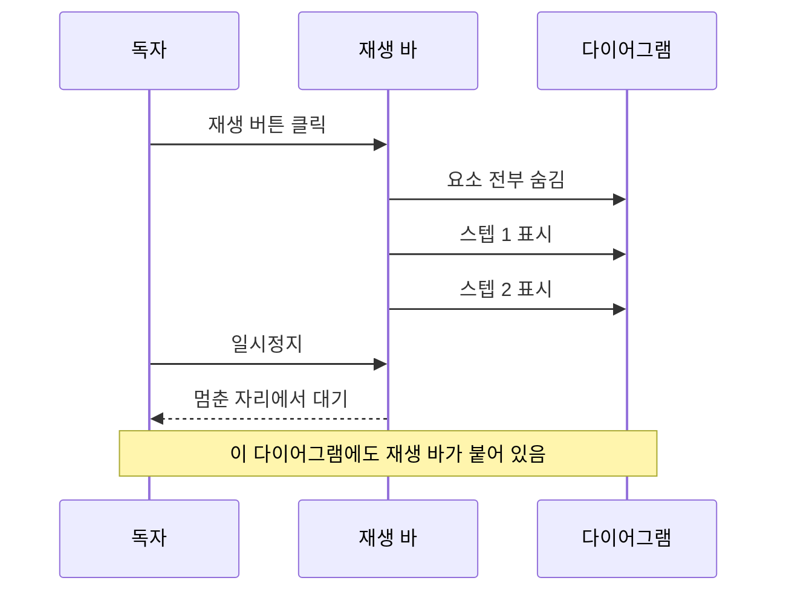

모바일로 [[singleton-pattern]] 글을 읽다가 이상한 것을 발견했다. 시퀀스 다이어그램의 박스 안에 있는 텍스트가 수직으로 정렬되지 않고 위로 살짝 떠 있었다. 박스는 제자리에 있는데 글자만 천장에 붙어 있는 모습이었다. 처음에는 이것만 고치려고 했다가, 이런저런 욕심이 들어서 다이어그램에 재생 버튼도 달고 코드에는 실행 순서를 보여주는 기능까지 만들게 되었다. 이번 글에서는 그 과정을 하나씩 짚어 볼 예정이다.

## 박스 위로 떠 있던 텍스트

먼저 이 문제부터 해결했다. 원인은 바로 전날 넣은 옵션이었다. 긴 한글 텍스트가 박스 밖으로 넘어가는 문제를 막으려고 mermaid에 `sequence: { wrap: true }`를 켰는데, 이 wrap 모드가 **텍스트의 세로 배치를 바꾼다**. 데스크톱의 Chrome 화면에서는 멀쩡하지만 iOS Safari에서는 글자가 박스 위로 떠 보이게 된다. 브라우저마다 SVG 텍스트의 기준선(baseline; 글자가 떠 있는 가상의 줄)을 다르게 처리하기 때문이다.

브라우저마다 다르게 나타나는 문제라면, 원인을 좇기보다 문제가 되는 결과를 실측해서 되돌리는 쪽이 확실했다. 그래서 렌더링이 끝난 직후에 박스와 텍스트의 실제 좌표를 재고, 그 차이만큼 텍스트를 옮기는 보정을 렌더링 과정에 더했다. 아래 코드는 박스 중앙과 텍스트 중앙의 차이를 가로와 세로 두 축으로 재서, 그만큼 텍스트를 옮긴다. 차이가 1픽셀 미만이면 손대지 않기 때문에, 이미 정렬된 브라우저에서는 아무 일도 일어나지 않고 문제가 되는 브라우저에서만 동작하는 안전망이 된다.

```ts mermaid-render.ts
const tr = t.getBoundingClientRect(); // [!code step:1]
const rr = rect.getBoundingClientRect(); // [!code step:1]
const dy = (rr.top + rr.height / 2) - (tr.top + tr.height / 2); // [!code step:2]
const dx = (rr.left + rr.width / 2) - (tr.left + tr.width / 2); // [!code step:2]
if (Math.abs(dy) < 1 && Math.abs(dx) < 1) continue; // [!code step:3]
prependTranslate(t, dx * scale, dy * scale); // [!code step:4]
```

여기서 한 가지 배운 것이 있다. 처음 계획은 텍스트의 줄마다 따로 중앙 보정을 하는 것이었는데, 실측해 보니 그 방법은 공수가 조금 드는 일이기도 했고 두 줄짜리 노트의 각 줄을 전부 박스 중앙으로 옮기면 두 줄이 같은 자리에 겹치게 되었다. 그래서 여러 줄을 한 덩어리로 보고 덩어리 전체를 같은 거리만큼 옮기는 방식으로 바꾸었다.

> [!NOTE]
> **공용 렌더러**\
> 이 보정 과정은 글 본문, 확대되는 모달, 글을 작성하는 화면의 미리보기가 공유하는 렌더러에 들어갔다. 한 곳을 고치면 세 화면이 같이 고쳐지고, 앞으로 새로 그리는 시퀀스 다이어그램에도 자동으로 적용된다.

## 시퀀스 다이어그램에 재생 버튼

버그를 고치고 나니 욕심이 생겼다. 시퀀스 다이어그램은 원래 **시간 순서**가 있는 그림이다. 위에서 아래로 메시지가 오가는 순서가 중요한데, 완성본을 한 번에 보여주면 그 순서가 눈에 잘 들어오지 않는다. 다른 사이트에서 단계별로 하나씩 나타나는 시퀀스 다이어그램을 보았던 기억이 나서, 이 블로그에도 재생 버튼을 달기로 했다.

재생 버튼은 아래와 같이 동작한다.

- **초기 상태는 완성본** - 재생을 누르지 않으면 지금까지와 똑같다.

- **재생을 누르면** 전부 사라졌다가 메시지가 0.9초 간격으로 하나씩 나타난다.

- **일시정지/이전/다음/처음부터** - 원하는 단계에 멈춰 두고 글을 읽을 수 있다.

바로 아래의 다이어그램이 실제로 이렇게 동작한다. 하단의 재생 버튼을 눌러 보면 된다.



구현에서 가장 재미있었던 것은 스텝을 어떻게 나누느냐였다. mermaid가 그린 SVG에는 "이것은 1번째 메시지"라는 표시가 없다. 처음에는 세로 좌표가 비슷한 요소끼리 묶으면 되겠다고 생각해서 그룹핑을 설계했는데, 실제로 보니 메시지 텍스트가 자기 화살표보다 35픽셀이나 위에 있었다. 그룹핑으로는 한계가 있었다. 그래서 요소를 세로 순서로 줄 세운 뒤, **텍스트가 나타날 때마다 새로운 스텝을 여는 방식으로** 풀었다. 아래 코드는 메시지 텍스트를 만나면 새 스텝을 만들고, 그 밖의 요소는 마지막 스텝에 넣는다. 그 사이에 있는 화살표, 텍스트, 활성화되는 박스가 직전 스텝에 따라붙는 것이 이 때문이다.

```ts sequence-player.ts
const items = [...svg.querySelectorAll(SELECTOR)].map((el) => ({
  el, y: el.getBoundingClientRect().top,
  starter: el.tagName.toLowerCase() === 'text' && el.classList.contains('messageText'),
}));
items.sort((a, b) => a.y - b.y);
for (const it of items) {
  if (it.starter || steps.length === 0) steps.push({ els: [] }); // [!code highlight]
  steps[steps.length - 1].els.push(it.el);
}
```

확대되는 모달에서도 같은 과정이 적용된다. 다만 스텝 수집이 화면 좌표를 기반으로 하기 때문에, 줌이 되기 이전에 적용해야 한다는 순서 문제가 하나 있었다.

## 코드 블록에도 실행 순서를

여기까지 하고 나니 자연스러운 질문이 생겼다. 코드 블록에도 이런 것을 달 수 있을까? 코드야말로 실행 순서가 있는 텍스트인데...

정직하게 말하면, 자동으로는 되지 않았다. 임의의 코드 조각에서 실행 순서를 알아내려면 언어마다 파서를 연결해야 하고, 그마저도 설정 파일이나 CSS처럼 순서라는 개념 자체가 없는 블록이 많다. 그래서 방향을 바꾸었다. 순서는 글쓴이만 안다. 글쓴이가 코드 주석으로 순서를 표시하면, 빌드할 때 그것을 읽어서 재생 바를 추가하는 방식이다.

마커는 기존 하이라이트 마커와 같은 문법 가족인 `[!code step:1]`을 쓴다. Python이면 `#` 주석으로, CSS면 `/* */` 주석으로, 그 언어의 주석 문법을 그대로 따른다. 빌드할 때 마커의 텍스트는 지워지고 그 줄에 순서 정보만 남기 때문에, 독자에게 마커가 보일 일은 없고 **복사 버튼도 깨끗한 코드만 복사한다.** 마커가 코드 안의 주석이라는 점이 중요한데, 덕분에 글을 작성하는 화면의 에디터를 한 줄도 고치지 않고 검증 과정을 통과했다. 저장했다가 다시 열어도 마커가 그대로 남아 있는 것을 확인했다.

재생하면 지금 단계의 줄만 파랗게 하이라이트하고, 지나간 줄은 옅은 잔상으로 남는다. 위의 정렬 보정 코드 블록이 실제 예시이다. 재생을 눌러 보면 좌표를 재고, 차이를 구하고, 옮기는 순서대로 한 줄씩 하이라이트된다.

기존 글에도 넣을 수 있는 만큼 넣어 보려고 28편의 코드 블록 약 120개를 전부 훑어보았다. 결과는 예상보다 훨씬 보수적이었다. **넣은 것은 싱글톤 글의 구현 6개뿐이다.** 나머지는 설정 파일이거나, 한두 줄짜리이거나, 이미 하이라이트 마커로 핵심 줄 하나만 짚어 둔 블록이었다. 하이라이트로 핵심을 이미 짚은 코드에 스텝까지 얹으면 두 장치가 서로를 방해하게 된다. 확신이 없으면 넣지 않는 편이 맞다고 판단했다.

## 연결된 글을 작은 관계도로 바꾸기

글 하단의 "연결된 글" 영역도 크게 바뀌었다. 원래는 관계 문구와 제목이 줄줄이 놓인 목록이었는데, 이번에는 현재 글을 중심에 둔 작은 관계도를 그 자리에 보여주도록 했다. 중심에서 뻗은 선이 연결된 글로 이어지고, 선의 색은 그래프 화면과 같은 관계의 타입 색을 그대로 쓴다.

- **빌드 타임 SVG** - 물리 시뮬레이션 없이 원형 배치를 빌드할 때 계산해 둔다. 이 관계도를 위한 클라이언트 JavaScript는 0줄이다.

- **선의 흐름** - 본문 다이어그램의 흐름 모션을 재사용해서, 화면에 보일 때만 중심에서 바깥으로 대시가 흘러간다. 시선이 자연스럽게 연결된 글 쪽으로 끌리게 된다.

- **호버하면 카드가 표시된다** - 노드에 호버하면 관계 문구, 제목, 설명, 연결에 달아 둔 메모까지 카드로 보여준다. 목록이 주던 정보를 그래프가 잃지 않는다.

기존 목록은 버리지 않고 "목록으로 보기" 접이식으로 아래에 남겼다. 모바일처럼 호버가 없는 환경에서는 여전히 이 목록이 안전망의 역할을 한다.

이와 같은 **호버 카드**(마우스를 올리면 보이는 카드)는 본문에도 추가했다. 본문의 위키 링크에 호버하면 대상 글의 제목과 설명이 미리 표시되고, 각주 번호에 호버하면 페이지 맨 아래로 내려가지 않고도 각주 내용을 그 자리에서 읽을 수 있다. 링크를 눌러야 할지 말아야 할지를 누르기 전에 판단하게 해 주는 기능이다.

## 읽는 화면의 잔모션

큰 기능 사이사이에 작은 모션도 여럿 들어갔다.

- **본문 블록의 은은한 등장** - 스크롤로 새 문단이 들어올 때 8픽셀만 살짝 떠오른다. 첫 화면에 이미 보이는 블록은 아예 손대지 않아서, 로드하는 순간 번쩍이는 일이 없다.

- **Flow Chart 노드의 순차적인 등장** - 다이어그램이 처음 화면에 들어올 때 노드가 60밀리초 간격으로 하나씩 자리를 잡는다. 딱 한 번만 재생되고, 테마를 바꿔 다시 그려져도 반복하지 않는다.

- **목차 마커** - 데스크톱 목차의 세로선을 따라 현재 섹션 위치가 미끄러지듯 따라온다.

이 모션은 전부 `prefers-reduced-motion`(모션 줄이기; 어지러움 등으로 화면 움직임을 줄여 달라는 시스템 설정)을 따른다. 이 설정이 켜져 있으면 모션 없이 곧바로 완성된 상태로 표시한다.

## 그래프의 첫 화면과 일시정지

그래프 화면에도 두 가지를 수정하고 추가했다.

하나는 첫 화면이다. 지금까지는 페이지를 열면 축소된 그래프가 몇 초 동안 움직이고, 정착한 뒤에야 화면에 맞춰졌다. 이제는 **열자마자 화면에 꼭 맞는 그래프**가 보인다. 방법은 단순한데, 처음 그리기 전에 물리 시뮬레이션을 동기로 미리 실행해서 거의 정착시킨 뒤, 화면 맞춤을 한 번만 하는 것이다. 매 프레임 맞춤을 반복하면 그래프가 흔들리는 버그를 예전에 겪은 적이 있어서, 맞춤은 딱 한 번으로 정했다.

다른 하나는 그래프 성장 재생이다. 글이 쌓인 순서대로 노드가 나타나는 재생 기능에 일시정지와 초기화를 추가했다. 아래 코드는 멈춰 있는 동안에는 쌓아 둔 시간만 읽고, 흐르는 동안에는 현재 시각을 더해서 읽도록 진행도를 계산한다.

```ts graph.astro
const playProgress = () =>
  (playElapsed + (playPaused ? 0 : performance.now() - playStart)) / playMs; // [!code highlight]
```

버튼은 아이콘만 남기고 글자를 제거했다.

## 요약

멈춰 있던 화면들이 이제는 순서를 가지고 움직인다.

- 시퀀스 다이어그램 텍스트 정렬을 보정했다. 본문, 모달, 미리보기가 같이 고쳐졌다.

- 시퀀스 다이어그램과 코드 블록에 재생 바가 생겼다. 코드는 주석 마커로 순서를 지정하는 방식이다.

- 연결된 글이 미니 관계도가 되었고, 위키 링크와 각주에 미리보기 카드가 붙었다.

- 본문 블록과 노드의 등장, 목차 마커, 그래프의 첫 화면 맞춤을 추가했고, 그래프 재생에는 일시정지까지 들어갔다.

하나를 고치러 들어갔다가 열 가지를 만들고 나온 과정이었는데도, 이상하게 피곤하지 않다. 내 블로그가 실제로 움직이는 것을 보는 재미가 있어서 그런 것 같다 😎
