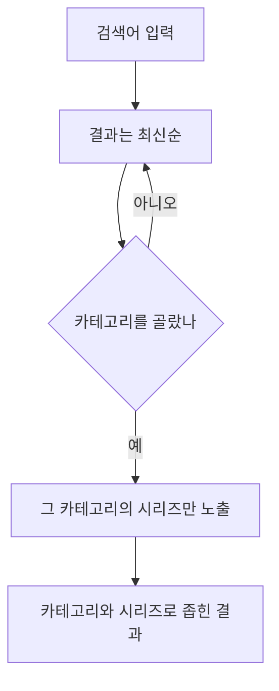
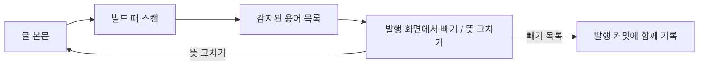
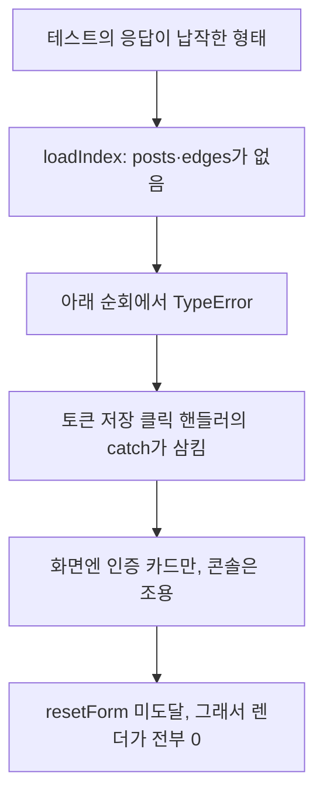
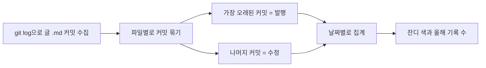

글이 30편을 넘기자 문제가 하나 생겼다. 글을 쓰는 것은 편해졌는데, 정작 **쌓인 글을 다시 찾고 이어서 보는 일**이 불편해졌다. 검색 페이지에서는 최신 글만 위로 올라왔고, 글에 나온 전문 용어는 뜻을 알려면 매번 그 글로 돌아가야 했다. 그래서 최근 며칠은 새 글을 쓰는 대신 블로그 내부를 탐색하기 좋게 만드는 기능들을 추가했다. 기능 목록만 늘어놓으면 심심하니, 각각을 만들면서 실제로 만난 버그와 그것을 어떻게 풀었는지를 함께 적어 둔다. 추가한 것보다 헤맨 것이 더 많았던 것 같기도 하다.

## 검색 필터의 계층 구조

검색은 **Pagefind**(pagefind; 정적 사이트에 얹는 검색 인덱스)로 제목과 본문을 찾는다. 여기에 카테고리와 시리즈로 좁히는 필터를 더하려고 했는데, 첫 시도부터 조용한 데이터 문제에 부딪혔다.

Pagefind는 글마다 `data-pagefind-filter` 속성을 지정해 두면 그 값으로 필터를 만들어 준다. 한 속성에 콤마로 여러 개를 담을 수 있다고 해서 아래처럼 넣었다.

```astro
<!-- 처음 시도: 한 속성에 콤마로 두 필터 -->
<article data-pagefind-filter={`category:${category}, series:${series}`}> <!-- [!code --] -->
```

그런데 빌드 로그를 확인해 보니 `Indexed 1 filter`라고 찍혀 있었다. 둘을 넣었는데 하나만 잡혔다는 뜻이다. 필터 값을 열어 보니 시리즈가 있는 글의 카테고리 값이 `개발`이 아니라 `개발, series:네트워크`와 같이 통째로 들어가 있었다. Pagefind가 콤마로 쪼개지 않은 것이다. 그래서 키마다 별도 요소로 나누어, **글마다 카테고리와 시리즈가 인덱스에 따로 채워지도록** 했다. 화면에는 보이지 않는 빈 span 요소를 키마다 하나씩 둔 것이다.

```astro
<!-- 고친 뒤: 키마다 빈 span 하나씩 (화면엔 안 보인다) -->
<span data-pagefind-filter={`category:${post.data.category}`}></span> <!-- [!code ++] -->
{post.data.series && <span data-pagefind-filter={`series:${post.data.series}`}></span>} <!-- [!code ++] -->
```

그러자 빌드 로그가 `Indexed 2 filters`로 바뀌고 값도 깨끗해졌다.

그다음은 계층이었다. 카테고리와 시리즈를 나란히 늘어놓으니 **그 시리즈가 어느 카테고리의 것인지 알 수 없었다.** 그래서 카테고리를 먼저 고르면 그 카테고리의 시리즈만 아래에 펼쳐지도록 했다. 그 흐름은 아래와 같다.



이 흐름을 위해 카테고리별 시리즈 목록은 빌드할 때 미리 모아 두도록 했다.

```ts
// 시리즈가 여러 카테고리에 걸치면 각각에 넣는다
const seriesByCategory: Record<string, string[]> = {};
for (const post of posts) {
  const { category, series } = post.data;
  if (!category || !series) continue;
  (seriesByCategory[category] ??= []).push(series); // [!code highlight]
}
```

`??=`는 그 카테고리의 배열이 없으면 만들고, 있으면 그 배열에 시리즈를 이어 붙인다. 이렇게 카테고리 하나에 어떤 시리즈들이 속해 있는지를 표 하나로 만들어 두고, 검색 화면은 이 표를 보고 시리즈 버튼들을 그린다.

## 검색어를 지워도 돌아오던 결과

마지막으로 가장 신경 쓰이던 것은 **검색어를 지웠는데 방금의 결과가 다시 나타나는 문제**였다. 입력을 지우면 화면은 즉시 비우지만, 그 전에 보낸 검색 요청이 뒤늦게 도착해서 결과를 다시 화면에 그리고 있었다. 그래서 검색마다 번호를 부여해서 이를 막았다.

```ts
let searchGen = 0;
async function run(term: string) {
  const myGen = ++searchGen; // 이번 검색의 번호표
  const results = await pagefind.search(term, opts);
  if (myGen !== searchGen) return; // 그새 더 새 검색이 있었으면 이 결과는 버린다 // [!code highlight]
  render(results);
}
```

`await` 다음 줄에서 번호가 최신인지 확인하고, 최신이 아니면 결과를 버리도록 했다. 비동기 작업이 순서를 지키지 않을 때 흔히 쓰는 방법이다.

## 용어 사전 페이지

이 블로그에는 전문 용어가 처음 나올 때 `용어(뜻)`처럼 굵은 용어와 괄호 풀이를 함께 적는 규칙이 있다. 이미 구조가 정해져 있으니, 빌드할 때 이 패턴만 수집하면 **용어 사전**(glossary; 용어와 뜻을 한곳에 모은 페이지)이 공짜로 만들어진다. 규칙 하나가 그대로 데이터가 되는 셈이다.

문제는 **아무 괄호나 다 모으면 안 된다**는 것이었다. `공인 IP(public IP)`처럼 괄호가 뜻이 아니라 영어 원어인 경우가 섞여 있었다. 그래서 아래 함수로 괄호 안에 한국어 뜻이 있을 때만 모으도록 걸러 두었다.

```ts
// 괄호가 영어 원어(public IP)가 아니라 진짜 한국어 뜻인지 가린다
function isKoreanDef(gloss: string): boolean {
  if (!/[가-힣]/.test(gloss)) return false;        // 한글이 없으면 영어 원어 // [!code highlight]
  return /\s/.test(gloss) || gloss.length >= 6;    // 짧은 뜻 풀이 제외
}
```

한글이 하나도 없으면 영어 원어로 보고 제외하고, 한글이 있더라도 너무 짧으면(공백 없이 6자 미만) 풀어쓴 단어로 보고 제외한다. 이 함수 덕분에 33개 후보가 실제로 뜻이 붙은 13개로 정리되었다.

## 숨겼는데도 보이던 용어

그다음 용어 사전에 검색 기능을 추가했는데, 여기서도 조금 헤맸다. 개수는 "1/13"으로 정확히 줄어드는데 화면에서는 전체 용어가 사라지지 않았다. 스크립트는 맞지 않는 항목에 `hidden`을 제대로 붙이고 있었다. 그런데도 계속 보이는 문제가 있었다. 원인은 아래 CSS에 있었다. 첫 번째 규칙의 `display: grid`가 `hidden`보다 우선하고 있었고, 두 번째 규칙이 이를 바로잡은 것이다.

```css
.g-item {
  display: grid; /* 이 한 줄이 hidden을 이기고 있었다 */
}
.g-item[hidden] {
  display: none; /* [!code ++] */
}
```

내가 지정한 `display: grid`가 브라우저 기본값인 `[hidden]`의 숨김보다 우선해서, `hidden` 속성이 붙어도 화면에서는 계속 grid로 배치되었다. 그래서 `.g-item[hidden]`에 다시 `display: none`을 명시해서 해결했다.

이 과정에서 교훈이 하나 생겼다. 검증할 때 "hidden 속성이 붙었나"만 보고 됐다고 넘겼는데, 정작 봐야 할 것은 **실제로 화면에서 사라지는가**였다. 속성이 아니라 계산된 스타일(`getComputedStyle`)을 측정해야 이런 문제를 잡을 수 있다.

## 용어를 제외하거나 고치는 기능

마지막으로, 자동 등록만 두는 것도 마음에 걸렸다. 그래서 글을 작성하는 화면에, 연결된 글에 설명을 다는 것처럼, 용어를 감지해서 제외하거나 뜻을 고칠 수 있는 기능을 추가했다.



제외하기로 한 용어의 목록은 발행할 때 글과 같은 커밋에 함께 올라가고, 뜻을 고치면 본문의 괄호가 직접 바뀐다. 용어 사전의 단일 출처는 어디까지나 글의 본문이라는 뜻이다. 새 데이터를 다른 곳에 숨겨 두면 나중에 어긋날 수도 있기 때문이다.

## 글을 작성하는 화면이 통째로 막히던 버그

용어 관리 기능을 추가하고 검증하는데, 글을 작성하는 화면에서 용어 목록이 아예 표시되지 않았다. 그냥 안 뜬 것이 아니라 점검과 연결 목록까지 전부 비어 있었다. 그런데 **콘솔에는 에러가 한 줄도 없었다.** 한참 살펴보니 연쇄적인 문제였고, 그 흐름은 아래와 같다.



이 화면은 열릴 때 글 목록을 먼저 받아 온다(`loadIndex`). 그런데 내 테스트 시나리오는 `posts`와 `edges`가 없는 납작한 형태였다. 그 상태로 아래에서 목록을 순회하다가 `TypeError`가 났고, 이 예외가 토큰 저장 버튼의 `catch`로 넘어가 인증 카드 안에만 표시되었다. 그래서 초기화 함수(`resetForm`)까지 도달하지 못했고, 용어, 점검, 연결 부분이 전부 빈 채로 남았다. 이를 고치려고 응답이 어떤 모양으로 오든 `posts`와 `edges`를 항상 배열로 정규화하도록 했다.

```ts
async function loadIndex() {
  try {
    const raw = await (await fetch(CFG.siteIndexUrl, { cache: 'no-store' })).json();
    // 응답이 어떤 모양으로 오든 posts·edges를 항상 배열로 정규화한다
    state.index = {
      posts: Array.isArray(raw?.posts) ? raw.posts : [], // [!code highlight]
      edges: Array.isArray(raw?.edges) ? raw.edges : [], // [!code highlight]
    };
  } catch {
    state.index = { posts: [], edges: [] };
  }
}
```

이제 응답이 어떤 모양으로 오든 `state.index`는 항상 배열 두 개를 갖는다. 덤으로 화면을 갱신하는 각 단계도 서로 격리해서, 한 곳이 실패해도 다음 단계가 멈추지 않게 했다.

```ts
const scheduleRefresh = () => {
  safe(renderPreview);
  safe(renderSuggestions);
  safe(renderGlossary); // 앞 단계가 던져도 여기는 돈다 // [!code highlight]
  safe(runLint);
};
```

`safe`는 안에서 예외가 나면 `console.error`로 드러내고 넘어가는 함수이다.

## 통계 페이지

추가로, 블로그가 얼마나 자랐는지 한눈에 보는 통계 페이지를 만들었다. 여기서는 먼저 글의 수정 횟수가 실제보다 한참 적게 나왔다. 처음에는 글의 수정일 하나로 계산했는데, 글 하나에 수정일은 하나뿐이어서 **여러 번 고쳐도 1번**으로만 잡혔다. 실제로는 한 글을 열 번도 넘게 손본 적이 있는데 말이다.

그래서 글 파일의 커밋 기록을 통째로 계산하기로 했다. 각 글의 가장 오래된 커밋은 발행으로, 나머지는 수정으로 판단했다. 그 흐름은 아래와 같다.



빌드할 때 git의 기록을 한 번 읽어서 파일별로 커밋 날짜를 모으고, 커밋 하나하나를 발행 아니면 수정으로 분류해 날짜별로 쌓는다.

```ts
// git log는 최신순 → 각 파일의 마지막(가장 오래된) 커밋이 발행, 나머지는 수정
for (const dates of datesByFile.values()) {
  for (let i = 0; i < dates.length; i++) {
    const isPub = i === dates.length - 1; // [!code highlight]
    if (isPub) { bump(pubByDate, dates[i]); totalPub++; }
    else { bump(modByDate, dates[i]); totalMod++; }
  }
}
```

이렇게 하자 수정 횟수가 24번에서 181번으로 바뀌었다. 이제야 실제로 손댄 양에 훨씬 가까워졌다는 것이 느껴졌다.

그런데 문제가 하나 더 있었다. 이 계산은 빌드할 때 git의 기록을 읽는데, 배포된 서버는 기본적으로 커밋을 하나만 받아 온다. 그대로 두면 라이브 화면(현재 이 화면)에서는 각 글의 커밋이 1개뿐이어서 수정이 전부 0으로 측정된다. 그래서 배포 설정에서도 전체 기록을 받도록 켰다.

```yaml
- uses: actions/checkout@v4
  with:
    fetch-depth: 0 # 전체 커밋 기록을 받는다(없으면 라이브 잔디의 수정이 0) # [!code ++]
```

배포하고 라이브를 확인하니 잔디가 "올해 214번 기록했어요"로 표시되었다. 얕은 클론이었다면 발행 수만큼인 30 언저리였을 테니, 이 설정 한 줄 덕분에 수정 횟수가 제대로 측정된 것이다.

## voice 린터와 제거한 기능

글을 발행하기 전에 말투를 계속 점검하는 일은 손이 많이 간다. 그래서 글을 작성하는 화면의 점검에 **voice 린터**(글의 말투 규칙을 룰 기반으로 훑어내는 검사 과정)를 추가했다. 전반적인 말투보다도 AI가 자주 사용하는 엠대시, 제목의 콜론, 합쇼체처럼 판정이 분명한 것만 경고하도록 했다. 그런데 합쇼체를 잡는 규칙에서 작은 문제가 있었다. 아래 코드는 문장 끝의 `니다`를 합쇼체로 보되, 평서체인 `아니다`는 제외하는 조건이다.

```ts
// 문장 끝 '니다'는 합쇼체로 보되, 평서체 '아니다'는 빼야 한다
return /니다[.!?)\]]?$/.test(t) && !/아니다[.!?)\]]?$/.test(t); // [!code highlight]
```

`습니다`로만 찾으면 `납니다`나 `갑니다`를 놓친다. 그래서 문장 끝의 `니다`를 넓게 잡았는데, 그러면 평서체인 `아니다`까지 걸린다. 뒤의 조건으로 그것만 제외했다. 전체를 훑어보니 잡힌 합쇼체는 전부 인용이나 예시였다. 본문의 말투는 이미 깨끗했다는 뜻이라 다행이었다.

솔직히 실패해서 제거한 기능도 있다. 긴 글을 읽다가 중간에 자리를 뜨면 그 자리를 기억했다가 "이어서 읽기"로 돌아오게 하는 기능을 넣었었다. 그런데 눌러도 곧장 그 자리로 가지 않고 살짝 튀는 현상을 목격했다. 이미지와 다이어그램이 뒤늦게 렌더링되면서 **문서 높이가 도중에 바뀌는 탓**이었다. 즉시 이동으로 바꿔도 애매했고, 애초에 "어디까지 읽었나"를 정확히 재는 것 자체가 어려운 문제여서, 후순위로 미루고 이 기능을 통째로 제거했다. 이와 함께 홈 목록에 추가했던 읽음 표시도 제거했다. <u>넣는 것만큼 빼는 것도 다듬기의 일부라고 생각한다.</u>

## 요약

며칠 사이 검색, 용어 사전, 통계 페이지가 블로그에 자리를 잡았다. 이제 쌓인 글을 찾고, 뜻을 모으고, 얼마나 자랐는지 볼 수 있다. 정작 기억에 남는 것은 기능보다 그 사이사이에 조용하게 나타난 버그들이다. 콤마 하나에 뭉쳐 버린 필터, 화면 뒤에서만 일어난 예외, 얕은 클론에 잘려 나간 기록처럼 하나씩 들춰 보며 기록하는 것도 좋은 성장의 과정이라고 생각한다. 🌱
