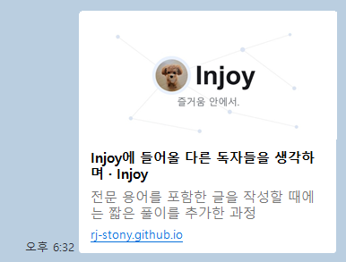

[[polish-round-3|지난 글]]에서는 코드를 모르는 독자도 읽을 수 있도록 글의 안쪽을 다듬었다. 그런데 글은 두 군데에서 독자를 더 만난다. 하나는 링크로 공유될 때이고, 다른 하나는 독자가 글을 읽는 동안이다. 이번에는 그 두 군데를 손보았다.

## 카카오톡에 공유하면 휑하던 링크

글의 URL을 카카오톡이나 Slack에 붙이면, 보통 제목과 그림 한 장이 담긴 작은 미리보기 카드가 뜬다. 그런데 Injoy는 그 그림이 비어 있었다. 대표 이미지(커버)를 넣은 글이 8편 중 2편뿐이어서, 나머지 글은 제목만 덩그러니 떴다.

그래서 **기본 공유 카드** 한 장을 만들었다. 커버가 없는 글은 이 카드를 대신 내보낸다. 이 블로그는 점과 선으로 글을 잇는 곳이기 때문에, 그 그래프를 옅게 깔고 그 위에 조이의 사진과 이름을 얹었다.



어떤 이미지를 내보낼지는 코드 한 줄로 고르게 했다. 글에 커버가 있으면 그 썸네일을, 없으면 기본 카드를 공유 이미지로 사용한다.

```ts src/pages/posts/[slug].astro
// 커버가 있으면 그걸, 없으면 기본 카드를 공유 이미지로
const ogImageURL = new URL(ogImage ?? withBase('/og-default.png'), Astro.site);
```

이제 OG 이미지(링크를 공유했을 때 미리보기에 뜨는 그림)는 어느 글에나 하나씩 있게 되었다. 지금 이 글도 커버가 없기 때문에, 어딘가에 공유되면 그 기본 카드로 뜬다.

## 읽는 동안 편하게

링크를 타고 들어온 독자가 글에 머무는 동안을 위해서도 작은 장치를 몇 개 추가했다.

- **읽기 진행 막대.** 화면 맨 위에 가는 줄이 깔리고, 스크롤한 만큼 왼쪽부터 오른쪽으로 차오른다. 긴 글에서 "얼마나 남았지?"를 한눈에 알 수 있다.

- **맨 위로.** 한참 내려가면 오른쪽 아래에 작은 버튼이 뜬다. 누르면 맨 위로 부드럽게 올라간다.

- **제목 링크.** 제목에 호버하면 🔗가 뜬다. 누르면 그 단락으로 바로 가는 주소가 복사된다. 글의 한 대목만 집어서 공유할 때 쓴다.

세 가지 모두 없어도 글은 읽힌다. 다만 있으면 조금 덜 번거롭다. 그 정도의 장치들이다.

## 검색 엔진에게 또박또박

독자가 글에 닿는 길에는 검색도 있다. 그래서 사람의 눈에는 보이지 않지만, 글마다 검색 엔진에게 건네는 쪽지도 한 장씩 넣었다. 이것을 **JSON-LD**(검색 엔진이 읽기 좋게 정리한 구조화된 정보)라고 부른다. "이 페이지는 블로그 글이고, 제목은 이것, 발행일은 이때, 글쓴이는 누구"라고 또박또박 적어둔 것이다.

```ts
{
  "@type": "BlogPosting",
  "headline": "글 제목",
  "datePublished": "2026-06-22",
  "author": { "@type": "Person", "name": "노준석" }
}
```

구글이 알아서 추측하던 것을, 굳이 한 번 더 분명하게 알려 주는 것이다. 검색 결과에 제목과 날짜가 조금 더 단정하게 뜨기를 바라고 있다.

## 마우스 없이도 그래프를 다룰 수 있게

마지막으로 손본 곳은 [그래프](/graph/) 화면이다. 점과 선으로 그린 이 지도는 그림 한 장(캔버스(브라우저가 그림을 그리는 화면 영역))으로 그려진다. 그래서 마우스로 끌고 누를 수는 있지만, 키보드만 사용하는 사람은 노드를 선택할 방법이 없었다.

이제는 그래프에 `Tab`으로 들어가면 화살표로 노드 사이를 옮겨 다니고, `Enter`로 그 글로 이동할 수 있다. 고른 노드에는 또렷한 테두리가 둘러져서, 지금 어디에 있는지 알 수 있다. 마우스가 없거나 화면 낭독기를 사용하는 사람도 **같은 지도를 따라갈 수 있게 되었다.**

## 남은 것

돌아보면 [[polish-round-3|다른 독자들을 생각하기 시작한]] 뒤로 한 일은 모두 한 곳을 향하고 있다. <u>글이 독자에게 닿는 길목마다 불편한 부분을 한 겹씩 덜어내는 것이다.</u> 공유될 때 휑하지 않게, 읽는 동안 덜 번거롭게, 검색과 키보드에도 친절하게 했다. 발행 과정은 [[how-to-write|예전 그대로]]이고, 이번에 바뀐 것은 그중 일부이다. 🌱
