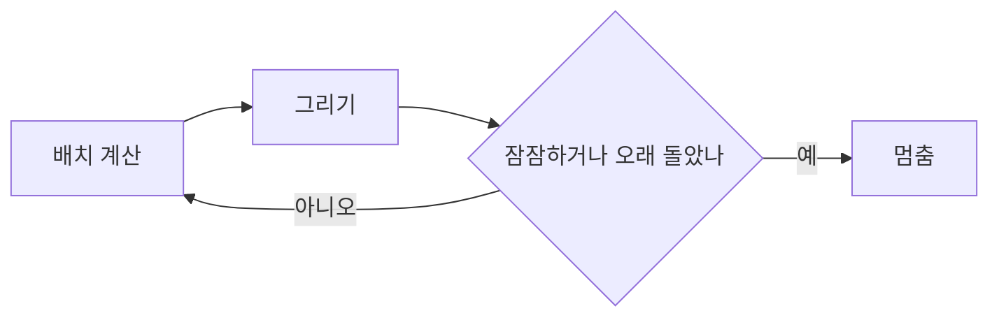

이번에는 새로운 기능을 추가하지 않았다. 그 대신 이미 만들어 둔 것들에 남아 있던 문제를 하나씩 해결했다. 눈에 잘 띄지 않는 수정들이지만, 이런 수정이 쌓이게 되면 글을 쓰는 과정과 읽는 흐름이 조금씩 나아진다고 생각한다.

## 글을 작성하는 화면

[[slash-menu|슬래시 메뉴를 추가한]] 뒤에도 글을 작성하는 화면에는 수정할 곳이 남아 있었다.

먼저 글자를 드래그하면 그 자리에 서식 버튼이 뜨게 했다. 이 버튼으로 굵기, 기울임, 밑줄, 취소선을 고를 수 있어서, 마크다운 문법을 외우지 않아도 Notion에서처럼 누르기만 하면 된다. 이 가운데 밑줄은 표준 마크다운 문법에 없기 때문에 `<u>`로 풀어서 저장한다. 그래서 발행한 결과가 틀리지는 않는지, [[wysiwyg-editor|글쓰기 과정을 갈아엎었을 때]]처럼 검증을 몇 번이고 진행했다.

이미지는 누르면 바로 아래에 설명을 적는 칸이 열리도록 했다. 그동안은 대체 텍스트를 넣을 자리가 아예 없었기 때문이다. 각주 버튼은 번호를 알아서 매기고, 본문에는 참조를, 글의 가장 아래에는 그 정의를 함께 넣는다. 그리고 삽입하는 토글은 글을 길게 쓰더라도 화면 위에 고정되어 따라오게 했다. 예전에는 콜아웃 하나를 넣으려고 맨 위까지 올라갔다가 다시 내려오곤 했다.

## 읽는 화면

글을 작성하는 화면만 다듬은 것은 아니다. 읽는 화면에서도 눈에 걸리던 것들을 함께 고쳤다.

모바일에서는 글 앞부분의 읽기 시간, 연결, 조회수가 위쪽에 있는 날짜와 엉켜서 답답하게 보였다. 그래서 이 세 가지를 제목 아래로 내려서 덜 답답하게 만들었다.

발행된 체크리스트 앞에 붙던 점도 없애서, 체크박스만 단정하게 남도록 했다. 홈 화면도 모바일에서는 썸네일이 맨 위에 올라와 있었는데, 제목과 글이 먼저 보이도록 썸네일을 아래로 내렸다.

목차에는 읽고 있는 자리를 따라 하이라이트하는 기능을 추가했다. 스크롤하면 지금 보고 있는 단락이 목차에서 옅게 하이라이트된다.

원리는 의외로 단순하다. 스크롤을 내리면 제목들이 하나씩 화면 위로 밀려 올라가 사라진다. 그중에서 화면 맨 위(고정 헤더 바로 아래)를 마지막으로 지나간 제목이, 지금 읽고 있는 단락의 제목이다. 그래서 제목들을 위에서부터 차례로 확인하다가, 화면 위쪽의 기준 높이(`LINE`, 88px)를 넘어 올라간 마지막 제목에서 멈추도록 코드를 작성했다.

```ts src/components/TableOfContents.astro
function initToc(nav) {
  const links = [...nav.querySelectorAll('a[href^="#"]')];
  const entries = links.map((a) => ({ a, el: document.getElementById(a.hash.slice(1)) }));
  const LINE = 88; // 고정 헤더(66px) 약간 아래의 기준선
  const update = () => {
    let active = entries[0];
    for (const e of entries) {
      if (e.el.getBoundingClientRect().top <= LINE) active = e; // [!code highlight]
      else break;
    }
    for (const { a } of entries) a.classList.toggle('active', a === active.a);
  };
  window.addEventListener('scroll', () => requestAnimationFrame(update), { passive: true });
}
```

그런데 스크롤할 때마다 제목의 위치를 계산하게 되면 연산이 무거워진다. 그래서 스크롤 이벤트를 `requestAnimationFrame`(화면을 새로 그리는 타이밍에 맞춰 실행하는 함수)으로 묶어서, **한 프레임(화면을 한 번 새로 그리는 단위)에 한 번만 다시 계산**하게 했다.

목록에 보이는 썸네일도 손보았다. 대표 이미지가 없는 글은, 본문에 다이어그램이 있으면 그 첫 다이어그램을 작은 미리보기로 보여주도록 했다. 지금 이 글의 썸네일도 그렇게 만들어진 것이다. 이를 위해 본문에서 첫 mermaid 블록을 찾고, 펜스를 제외한 다이어그램 소스만 돌려주는 함수를 하나 만들었다. 카드는 이 소스를 본문과 똑같은 mermaid 렌더러로 그리기 때문에, 커버가 없는 글도 빈 썸네일로 남지 않는다.

```ts src/utils/post.ts
export function firstDiagram(post) {
  const { codeBlocks } = splitCode(post.body ?? '');
  const block = codeBlocks.find((b) => /^\s*`{3,}\s*mermaid/.test(b)); // 첫 mermaid 블록
  if (!block) return null; // 다이어그램이 없으면 썸네일도 없다
  const inner = block.split('\n').slice(1); // 펜스 머리 줄 제거
  if (/^\s*(`{3,}|~{3,})\s*$/.test(inner.at(-1) ?? '')) inner.pop(); // 닫는 펜스도 제거
  return inner.join('\n').trim() || null;
}
```

여기까지는 화면을 조금씩 고친 일들이었다. 이번에 가장 흥미로웠던 문제는 그래프 화면에 있었다.

## 계속 돌고만 있던 그래프 화면 수정

모바일에서 [그래프](/graph/)를 열면 미세하게 렉이 걸렸다. 이유가 궁금해서 계속 지켜보았더니, 노드(그래프의 점)들을 펼쳐 놓는 시뮬레이션이 멈추지 않고 있었다. 노드끼리 서로 밀어내는 힘과 끌어당기는 힘이 어중간하게 맞물리면서, 노드들이 자리를 잡지 못하고 배치가 끝나지 않았던 것이다. 그 때문에 화면도 쉬지 않고 다시 그려지고 있었다.



해결하는 방법은 단순했다. 배치가 자리를 잡거나 충분히 오래 실행되면 루프를 끝내도록 상한을 두었다. 수정한 것은 프레임 수를 계산하는 변수 하나와, 끝내는 조건에 추가한 `또는` 하나이다.

아래 코드에서 빨간 라인이 기존의 조건이다. '한동안 잠잠하면'(`calmFrames > 30`) 멈추라는 뜻인데, 노드들이 끝내 잠잠해지지 않으면 이 조건은 한 번도 참이 되지 않는다. 그래서 초록 라인에서 `frames > maxFrames`를 `또는`으로 더했다. 이렇게 하면 노드들이 잠잠해지지 않더라도, 정해진 프레임 수가 지나면 반드시 멈추게 된다.

```ts src/pages/graph.astro
let frames = 0;
const loop = () => {
  frames++; // [!code ++]
  tick(); // 힘 계산 + 위치 갱신
  draw(); // 캔버스에 다시 그리기
  const energy = nodes.reduce((s, n) => s + Math.abs(n.vx) + Math.abs(n.vy), 0);
  calmFrames = energy < 0.5 ? calmFrames + 1 : 0;
  // 중력·척력 균형 탓에 에너지가 0까지 안 떨어질 수 있다 → 프레임 상한을 backstop으로
  const maxFrames = isSmall() ? 180 : 300; // [!code ++]
  if (calmFrames > 30 && !dragging) { // [!code --]
  if ((calmFrames > 30 || frames > maxFrames) && !dragging) { // [!code ++]
    running = false; // 루프 종료. 더 이상 rAF를 걸지 않는다
    return;
  }
  requestAnimationFrame(loop);
};
```

수정한 뒤로는 그래프가 펼쳐지고 나면 한 프레임도 더 실행되지 않았다.

모바일에서 그리는 픽셀의 양도 함께 줄였다. 요즘의 고해상도 화면은 **같은 한 프레임을 2\~3배 더 촘촘한 픽셀로 그린다.** 그만큼 프레임마다 칠해야 하는 픽셀이 늘어나서 부담이 커진다. 그래서 `Math.min(..., 2)`로 이 배율을 2배까지만 사용하도록 제한했다. 화면이 아무리 고해상도이더라도, 캔버스(그림을 그리는 화면 영역)는 2배까지만 칠하게 된다.

```ts src/pages/graph.astro
// 고해상도 화면(모바일 2~3배)이라도 캔버스는 2배까지만 그리게 막는다
const dpr = Math.min(window.devicePixelRatio || 1, 2); // [!code ++]
```

이 정도면 나중에 노드가 많이 쌓이게 되어도 괜찮을 것 같다.

## 남은 것

발행 과정은 예전 그대로다. 글을 쓰고 다듬는 방법은 [[how-to-write|글을 올리는 구조를 적어둔 글]] 그대로이고, 이번에 바뀐 것은 사소한 마찰뿐이다. 보이지 않는 곳을 다듬는 일은 끝이 없겠지만, 그래서 더 즐겁다. 🌱
