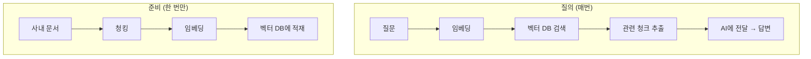
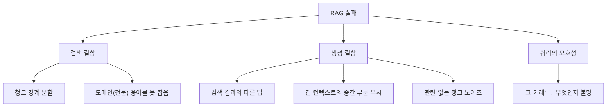

사내에서 사용하는 데이터는 한곳에 모여 있지 않다. 어떤 것은 Notion 페이지에, 어떤 것은 지난 Slack 대화에, 또 어떤 것은 공유 드라이브의 폴더 깊숙한 곳에 있다. 그래서 "그 데이터 어디에 있더라?" 같은 질문이 매번 되돌아오고, 답을 아는 사람은 그때마다 같은 설명을 반복하게 된다.

이 문제를 줄이려고, AI가 사내 문서를 읽고 대신 답해 주는 시스템을 만들어 보기로 했다. 관련 기술을 공부하면서 낯선 용어를 꽤 많이 접했는데, 그중에서 가장 먼저 부딪힌 것이 RAG였다. 그래서 개발을 시작하기 전에, RAG가 무엇이고 우리에게 맞는 방식인지부터 조사했고, 그 내용을 기록으로 남기려고 한다.

## RAG?

**검색 증강 생성**(Retrieval Augmented Generation; 답을 만들기 전에 관련 문서를 먼저 찾아오는 방식)은 이름 그대로의 방식이다. AI가 질문에 곧장 대답하지 않고, 외부 지식 베이스에서 관련 정보를 먼저 검색한 뒤에 그것을 근거로 답변을 생성한다.

비유하자면 이렇다. 자료 없이 머릿속의 지식만으로 답하는 사람이 일반적인 AI라면, RAG는 질문을 받을 때마다 인터넷에서 관련된 자료를 찾아보고 답하는 사람이다. 내가 만들려는 것은, 그렇게 자료를 찾아보는 일을 쉽게 해 주는 시스템이다. 사내 문서를 작은 단위로 나누고 "의미가 담긴 데이터"로 바꾸어 전용 데이터베이스에 넣어 두었다가, 질문이 들어오면 의미가 가까운 것을 찾아내서 AI에게 전달한다.

동작은 두 단계로 나뉜다. 문서를 넣어 두는 준비 과정은 한 번만 하고, 질문에 답하는 쿼리 과정은 질문이 들어올 때마다 반복한다. 두 과정을 그리면 아래와 같다.



이 다이어그램에는 세 가지 용어가 한꺼번에 나온다. **청킹**(chunking; 긴 글을 검색용 조각으로 자르기)은 문서를 일정한 길이로 잘라 두는 과정이고, 이렇게 잘라 낸 단위 하나를 청크라고 부른다. **임베딩**(embedding; 글을 의미가 담긴 데이터로 바꾸기)은 그 청크를 숫자로 이루어진 벡터로 변환하는 일이다. 그리고 그 벡터를 저장해 두는 곳이 **벡터 DB**(vector DB; 의미가 담긴 데이터 전용 데이터베이스)이다.

RAG라는 용어는 2020년의 한 논문(Lewis et al., NeurIPS)에서 처음 정의되었다. 이 논문에서 RAG는 여러 도메인의 QA 벤치마크 3개에서 당시 최고 성능(SOTA)을 달성했고, 단순한 AI보다 더 구체적이고 사실에 기반한 답을 낸다는 것을 보여주었다. 재미있는 것은, 저자인 Patrick Lewis 본인이 나중에 한 인터뷰에서 "이렇게 널리 쓰일 줄 알았다면 이름에 더 신경 썼을 것"이라고 말했다는 사실이다. (지금은 이 세 글자 약어가 업계의 표준어가 되었으니 후회할 만도 하다.)

RAG가 거의 모든 AI의 기본 패턴이 된 이유는 뚜렷하다. AI를 재학습하지 않고도 새로운 지식을 바로 반영할 수 있고, 무엇보다 모델이 답의 출처를 인용할 수 있게 된다. 그렇게 되면 사용자는 근거가 되는 문서를 직접 확인할 수 있다. NVIDIA는 이를 두고 "거의 모든 AI를 거의 모든 외부 자료에 연결해 주는 범용 레시피"라고 표현했다. 여기에 **환각**(hallucination; AI가 그럴듯하게 답변을 지어내는 현상)까지 줄여 준다. 다만 여기서 눈여겨볼 단어는 '줄인다'이다. '없앤다'가 아니다.

## RAG도 자주 틀린다

조사하면서 가장 인상 깊었던 것은, RAG를 연결해도 <u>환각이 완전히 사라지지는 않는다는 사실</u>이었다. Stanford의 연구에서는 전문 법률 관련 AI조차 **17\~33%** 정도는 틀린 답을 냈다. 결국 RAG는 만능 해결책이 아니라, 환각이 일어날 확률을 낮추는 장치에 가깝다.

그렇다면 RAG는 어디에서 틀리는가. 학술 리뷰(MDPI 2025)와 업계에서 나온 분석이 정리한 실패 케이스는 크게 세 부류였다.



첫 번째는 검색 단계의 결함이다. 정답이 하필 청크의 경계에 걸쳐 두 청크로 갈라지게 되면, 어느 쪽에서도 온전한 답을 찾지 못한다. 도메인에서만 쓰이는 특수한 용어를 일반 임베딩 모델이 잡아내지 못하는 경우도 있다.

두 번째는 생성 단계의 결함이다. 검색은 제대로 해 놓고 엉뚱한 답을 내거나(정합성 문제), 긴 컨텍스트의 중간 부분을 AI가 통째로 무시하거나(lost in the middle), 관련 없는 청크가 섞여 들어와 AI가 헷갈리는 일이 생긴다. 세 번째는 쿼리의 모호성이다. "그 거래"처럼 가리키는 대상이 모호한 질문은, 애초에 무엇을 찾아야 할지를 정할 수 없다. 여기에 더해 원본 문서 자체에 오류가 있으면, RAG도 그대로 틀린 답을 내게 된다.

## 직접 구축하려면 정해야 하는 네 가지

이런 한계를 알고도 RAG를 직접 만들려면, 크게 네 가지를 정해야 한다. **임베딩 모델, 벡터 DB, 프레임워크, 생성 전용 AI**이다.

첫째는 임베딩 모델이다. 2026년의 임베딩 모델 시장을 정리하면 아래와 같다.

| 순위 | 모델                            | 고른 이유                   |
| -- | ----------------------------- | ----------------------- |
| 1  | Cohere embed-v4               | 한국어 지원, 128K의 컨텍스트, 안정성 |
| 2  | OpenAI text-embedding-3-small | 가장 보편적, 안전, 저비용         |
| 3  | Google text-embedding-005     | 최저가 (Google Cloud 사용 시) |

그런데 여기에는 한 가지 문제가 있다. <u>Anthropic은 임베딩 모델을 제공하지 않는다.</u> 그래서 Claude를 생성용 AI로 사용하더라도, 임베딩에는 별도의 제공자가 필요하다. (Anthropic의 문서도 Voyage 계열의 모델을 권한다.) 또한 우리의 사내 데이터는 한국어이기 때문에, 한국어를 얼마나 정확하게 처리하는지가 사실상 1순위 기준이었다.

둘째는 벡터 DB이다. 결론부터 말하면, 규모가 웬만큼 크지 않은 한 어떤 것을 선택하든 크게 중요하지 않았다. 벡터의 수에 따른 기준을 정리하면 이렇다.

```text
1M 벡터 이하   : 어떤 DB든 95% 이상의 정확도, 선택 무관
10M 벡터 이하  : pgvector로 충분 (PostgreSQL 있으면 가장 저렴)
50M 벡터 이하  : 관리형 서비스가 자체 호스팅보다 저렴
100M 벡터 이상 : Pinecone/Weaviate가 운영 부담에서 유리
```

남은 두 가지는 길게 따질 것이 없었다. 셋째인 프레임워크는 직접 구현할지 기성 툴을 사용할지의 문제인데, 모델과 DB를 정한 뒤에 선택해도 늦지 않다고 보았다. 넷째인 생성 전용 AI는, 회사가 이미 Claude Team 플랜을 사용하고 있어서 Claude Sonnet 4.6이나 Opus 4.7 모델을 그대로 사용하는 것이 자연스러웠다.

## 비용은 가격표 그대로 나오지 않았다

정해야 할 것을 정리한 다음에는 비용을 가늠해 보았다. 아래와 같은 예시 조건을 세우고 시뮬레이션을 했다.

```yaml
문서_규모: 약 1만 페이지 (~1,000만 토큰)
청크_크기: 500 토큰   # [!code highlight]
임베딩_모델: OpenAI text-embedding-3-small
생성_모델: Claude Sonnet 4.6
일일_질의: 100건
```

이 청크 크기를 기준으로 하면 전체 문서는 약 2만 청크로 나뉜다. 비교를 위해 같은 조건을 **CAG**(Cache-Augmented Generation; 문서를 미리 프롬프트 캐시에 추가하는 방식)로 계산해 보니, 약 567달러/월 수준(캐시 갱신 하루에 24회 가정)이었다. 흥미롭게도 RAG의 단순 비용은 오히려 이보다 낮게 나올 수 있었다. 문제는 가격표에 적히지 않은 비용이다.

업계의 사례를 종합한 분석에 따르면, 가격 페이지를 보고 추정한 금액과 실제 청구액은 **2.5\~4배**까지 벌어진다. 청크의 수, 검색 top-k, 호출 패턴에 따라 비용의 변동이 심하기 때문이다. 여기에 청킹 전략, 평가 파이프라인, 모니터링, 재인덱싱 같은 운영 공수가 추가된다. 임베딩 모델을 한 번 바꾸게 되면, 전체 문서를 다시 임베딩해야 하는 재처리 비용도 발생한다. 참고로 OpenAI 3-large로 100만 문서를 임베딩하면 벡터 데이터만 12GB이고, 인덱스는 여기에 포함되지 않는다.

## 우리 규모에 맞는 조합

조사의 결론은 의외로 담백했다. 우리 규모에서는 **벡터 DB는 pgvector면 충분했다.** 사내 문서가 아무리 늘어나도 수백만 청크 안쪽일 텐데, 그 구간에서는 어떤 DB를 사용해도 정확도의 차이가 거의 없다. 게다가 이미 사용하고 있는 PostgreSQL에 확장 기능만 추가하면 되기 때문에 비용도 가장 저렴하다. pgvector로 구축하면 대략 아래와 같은 모양이 된다.

```sql
-- pgvector 확장 기능을 켜고, 청크마다 임베딩 벡터를 한 칸에 저장한다
CREATE EXTENSION IF NOT EXISTS vector;

CREATE TABLE kb_chunks (
  id         bigserial PRIMARY KEY,
  doc_id     text,
  chunk_text text,
  embedding  vector(1024)          -- 임베딩 모델이 출력하는 차원의 수
);

-- 질문 벡터와 '의미가 가까운' 청크 5개를 거리순으로 꺼낸다
SELECT chunk_text
FROM kb_chunks
ORDER BY embedding <=> :query_embedding   -- [!code highlight]
LIMIT 5;
```

청크마다 벡터를 한 컬럼에 저장해 두었다가, 질문이 들어오면 `<=>` 연산자로 질문 벡터와의 거리를 계산해서 가까운 순서대로 청크를 꺼낸다. 의미가 비슷한 문서를 찾는 일은 사실상 이 쿼리 하나로 이루어진다.

그러면 남는 고민은 임베딩 모델이다. 시장을 정리한 결과로는 한국어를 지원하는 Cohere embed-v4가 1순위였다. 그런데 여기에는 마음에 걸리는 점이 있었다. 클라우드 임베딩 API를 사용한다는 것은 사내 문서를 통째로 외부에 보낸다는 뜻이기 때문이다. 한국어로 된 사내 문서라는 조건과 데이터의 통제를 함께 놓고 보면, 로컬에서 실행하는 한국어 임베딩 모델도 진지하게 후보에 올려야 했다.

조사하면서 한 가지 더 알게 된 것이 있다. 200개 기업의 배포 경험을 정리한 자료는 이렇게 단언했다. **RAG 자체 구축은 "필요할 때 꺼내 쓰는 패턴"이지 "기본 선택지"가 아니다.** 실제로 HR이나 규정처럼 잘 바뀌지 않는 정적 문서에는, 앞에서 계산해 본 CAG가 더 단순하고 저렴하다. Claude의 긴 컨텍스트 윈도우에 문서를 그대로 넣는 것만으로 해결되는 질문도 많다.

## 남은 것

여기까지가 리서치이다. RAG가 무엇인지, 어디에서 틀리는지, 우리에게 맞는 조합이 무엇인지를 정리했다. 같은 질문이 매번 되돌아오는 문제는 아직 그대로이고, 이제는 이 조사를 바탕으로 실제로 무엇을 사용할지 골라야 한다. 벡터 DB는 pgvector로 마음이 기울었지만, 임베딩 모델은 클라우드 모델과 로컬 한국어 모델을 직접 연결해 보고 정해야 한다고 생각했다. [[rag-2-embedding|다음 글]]에서는 이 두 가지를 고른 과정을 다룬다. 🌱
