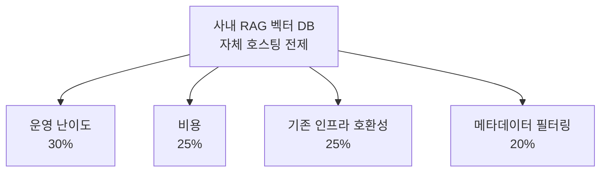
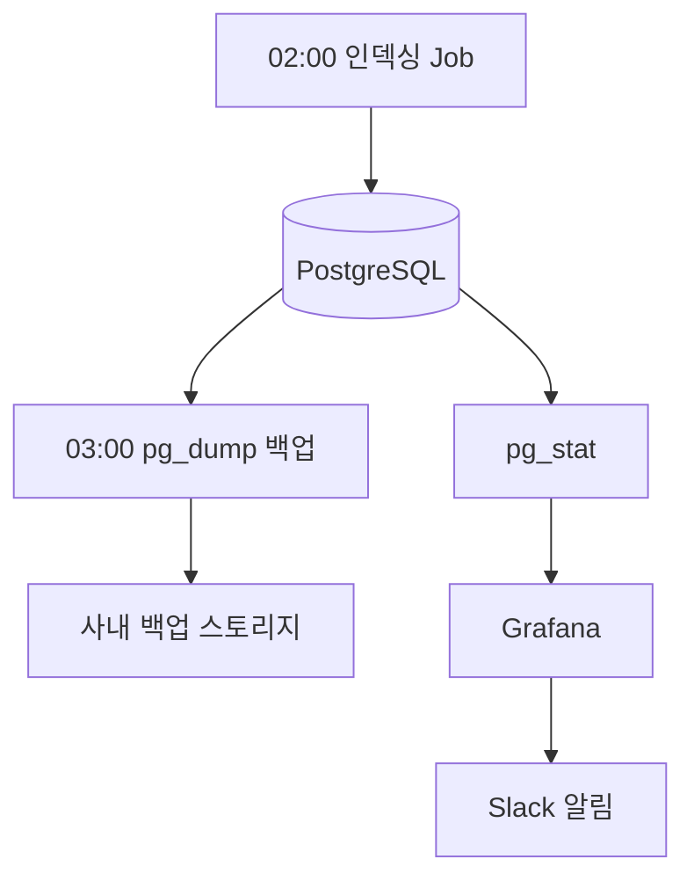

사내 문서를 AI가 대신 찾아 주게 만들자는 계획을 세우고 [[rag-1-survey|RAG에 대한 조사]]를 마치고 나니, 결정할 것이 두 가지 남았다. 무엇으로 문장을 숫자로 바꿀 것인가, 그리고 그 숫자를 어디에 저장할 것인가였다.

전자가 **임베딩**(embedding; 문장을 뜻이 담긴 숫자 벡터로 바꾸는 것) 모델이고, 후자가 **벡터 DB**(vector DB; 그 벡터를 저장하고 비슷한 것끼리 빠르게 찾아 주는 저장소)이다. 두 가지 모두 한 번 정하면 나중에 교체하기가 번거롭다. 그래서 후보를 고르기 전에 기준부터 세우기로 했다.

## 고르기 전에 세운 기준

후보를 늘어놓고 감으로 고르게 되면, 나중에 "왜 이것을 골랐느냐"는 질문에 답하지 못하게 된다. 그래서 임베딩 모델을 채점할 기준을 **필수 요건과 권장 요건**으로 나누어 적었다.

필수 요건은 두 가지였다. 첫째는 데이터를 사내에 보관할 수 있어야 한다는 것이다. 인사, 재무 문서를 다루기 때문에 데이터가 외부로 나가서는 안 된다. 둘째는 한국어 검색이 정확해야 한다는 것이다. 사내 문서가 거의 다 한국어여서, 영어 위주의 모델은 아무리 유명해도 후순위가 된다.

처음부터 평가에서 제외한 항목도 적어두었다. API의 안정성이나 SLA는 로컬 모델을 사용할 것이라 따질 이유가 없었고, 토큰당 가격도 무료 모델끼리는 비교할 수 없기 때문이다.

## 임베딩 모델 후보 5종

이 기준에 따라 후보 5종을 정했다. 한국어 검색 성능은 KURE 한국어 임베딩 리더보드의 Retrieval(검색) 점수를 기준으로 순위를 매겼다.

| 모델                                           | 방식  | KURE Retrieval | 사내 데이터 보관 |
| -------------------------------------------- | --- | -------------- | --------- |
| `dragonkue/snowflake-arctic-embed-l-v2.0-ko` | 로컬  | **79.44**      | 가능        |
| KURE-v1                                      | 로컬  | 77.24          | 가능        |
| BAAI/bge-m3                                  | 로컬  | 75.32          | 가능        |
| OpenAI text-embedding-3-large                | API | 리더보드 없음        | 불가        |
| Solar 계열                                     | API | 리더보드 없음        | 불가        |

표만 보아도 결론이 거의 드러난다. API 모델 2종은 데이터를 외부로 보내야 하기 때문에 첫 번째 필수 요건(사내 내부 보관)에서 탈락했다. 이 모델들은 KURE 리더보드에 올라 있지도 않아서, 한국어 검색 정확도를 직접 비교할 수도 없었다. 남은 로컬 모델 3종 중에서는 `dragonkue/snowflake-arctic-embed-l-v2.0-ko`(줄여서 arctic-embed-ko)가 79.44로 가장 높았다.

이 모델을 채택한 근거는 네 가지로 정리되었다.

- 한국어 검색 성능이 1순위이다. 79.44로 한국어 특화 오픈소스 모델 중 최상위이다. bge-m3는 8192 토큰까지 긴 글을 통째로 입력할 수 있다는 강점이 있었지만, 한국어 검색 점수에서 4점 넘게 뒤처졌다.

- 로컬에서 추론할 수 있다. 먼저 내 노트북에서 `sentence-transformers`로 실행해 보고, 실제 운영에서는 사내 임베딩 서버 1대로 옮긴다. 인사, 재무 같은 민감한 문서를 외부 API로 전송하지 않기 때문에 사내 보관 요건을 충족한다.

- 운영 비용이 사실상 0이다. Apache 2.0 라이선스여서 무료로 추론할 수 있고, 토큰당 과금이 없다. 참고로 OpenAI text-embedding-3-large는 1M 토큰당 약 0.13달러, small은 0.02달러인데, 로컬 모델에서는 이 비용이 발생하지 않는다.

- 차원과 컨텍스트가 청킹 기준에 맞았다. 1024차원에 1300토큰까지 입력받는다. 미리 정해 둔 청킹 기준(500자, 오버랩 50자)을 무리 없이 수용하고, 이후에 연결할 pgvector 인덱스의 운영 부담도 작다.

arctic-embed 시리즈는 MTEB Retrieval 리더보드에서 모델의 크기에 비해 성능이 좋은 모델이어서, 작은 서버로도 최상위권의 검색 품질을 낼 수 있다는 점도 크게 작용했다. 다만 지금 확정하기 어려운 부분은 재평가 시점을 정해 두고 미루었다. 6개월이 지나거나, 새로운 한국어 특화 오픈소스 모델이 나오거나, 한국어 검색 정확도에 대한 사용자의 불만이 쌓이면 다시 검토하려고 했다.

## 벡터를 어디에 저장하나

임베딩 모델을 정했으니 다음은 벡터 DB였다. 벡터 DB는 전제 하나를 먼저 두고 시작했다. **자체 호스팅**이다. 관리형 SaaS가 편하다는 것은 알고 있었지만, 임베딩 모델에서 이미 "데이터는 사내에 둔다"고 정한 이상, 벡터 데이터만 외부로 나가면 앞뒤가 맞지 않았다.

이 전제 위에서 후보를 채점할 기준 네 가지와 가중치를 정했다.



후보는 세 가지였다. 개념을 학습하거나 초기 PoC를 하기에 좋은 ChromaDB, 표준 PostgreSQL의 확장 기능인 자체 호스팅 **pgvector**(pgvector; PostgreSQL에 벡터 검색을 더해 주는 확장 기능), Rust로 작성되어 자체 호스팅 DB 중 성능이 가장 좋은 Qdrant(p50 기준 약 4ms)였다. 이 중에서 ChromaDB는 멀티 유저 환경에 약해서 사내 공용으로 사용하기에는 부족하다고 생각했고, Qdrant는 지금의 규모에서는 과했다.

그렇게 남은 pgvector가 왜 SaaS를 제치고 1위였는지가, 사실 이 글에서 가장 중요한 부분이다.

- 비용이 사실상 0이다. 사내 서버 1대로 충분하다. 사내 문서 100건, 청크 약 1,600개를 기준으로 시뮬레이션해 보니 인프라 비용은 후보 모두 0원으로 같았고, 실질적인 비용은 운영 인력의 시간뿐이었다.

- 이미 사용하던 PostgreSQL을 재사용한다. PostgreSQL은 사내 표준 스택이어서 백업, 마이그레이션, 운영 경험을 그대로 활용할 수 있다. 새로운 시스템을 익히는 학습 비용이 거의 없다.

- 메타데이터 조건을 SQL로 함께 적용할 수 있다. 부서, 권한, 날짜 필터를 벡터 검색과 하나의 쿼리에서 처리한다. 사내 SSO, 권한 시스템과 바로 연결되기 때문에 별도의 인증 레이어도 필요 없다.

- 나중에 다른 시스템과 연결하기 쉽다. 인사 담당 DB나 다른 PoC의 데이터와 같은 데이터베이스 안에서 연계할 수 있다.

물론 대가가 없는 것은 아니다. HNSW 인덱스의 튜닝을 직접 익혀야 했고, 백업과 모니터링 절차도 직접 구축해야 하며, 장애가 발생하면 사내에서 책임져야 한다. 이런 부담을 감수하더라도 호환성, 메타데이터, 비용에서의 강점이 압도적이어서 종합 1위로 평가했다.

## 테이블과 인덱스

DB를 정했으니 이제 문서를 담을 테이블을 설계할 차례였다. 스키마는 관련 도서를 참고해서 패턴을 거의 그대로 가져왔다. 테이블 하나에 문서의 청크와 그 벡터, 필터에 사용할 메타데이터를 함께 담는다.

```sql
CREATE TABLE documents (
  id            bigserial PRIMARY KEY,
  storage_ref   text NOT NULL,
  filename      text NOT NULL,
  document_type text,
  department    text,
  content       text NOT NULL,
  chunk_index   int NOT NULL,
  embedding     vector(1024),   -- [!code highlight]
  created_at    timestamptz DEFAULT now(),
  UNIQUE (storage_ref, chunk_index)
);
```

여기서 임베딩 모델과 벡터 DB가 만나는 지점은 `vector(1024)`로 선언한 컬럼이다. 앞에서 고른 arctic-embed-ko가 1024차원의 벡터를 출력하기 때문에, 컬럼도 1024로 맞추었다. 이 값이 어긋나면 저장 자체가 되지 않는다.

이 테이블에 검색용 인덱스를 추가했다. 인덱스 방식으로는 **HNSW**(그래프를 여러 층으로 쌓아 비슷한 벡터를 빠르게 찾는 인덱스)를 골랐다.

```sql
CREATE INDEX CONCURRENTLY documents_embedding_hnsw_idx
ON documents
USING hnsw (embedding vector_cosine_ops)
WITH (m = 16, ef_construction = 128);
```

1만 청크 안팎의 규모에서는 HNSW가 다른 방식(IVFFlat)보다 압도적으로 유리했다. IVFFlat은 시간당 10만 건이 넘는 쓰기 부하가 있을 때에나 고려할 인덱스여서, 사내 규모와는 거리가 멀었다. 인덱스를 만들 때 `CONCURRENTLY`를 지정한 것은, 운영 중에 인덱스를 만들더라도 쓰기가 막히지 않게 하기 위해서이다.

검색하는 절차는 함수 하나로 묶었다. 이 함수는 질문 벡터와 가장 가까운 문서 청크를, 부서 필터까지 적용해서 가져온다.

```sql
CREATE OR REPLACE FUNCTION match_documents(
  query_embedding vector(1024),
  match_count int DEFAULT 5,
  filter_department text DEFAULT NULL
) RETURNS TABLE (
  storage_ref text, filename text, content text,
  chunk_index int, similarity float
)
LANGUAGE sql STABLE AS $$
  SELECT storage_ref, filename, content, chunk_index,
         1 - (embedding <=> query_embedding) AS similarity   -- [!code highlight]
  FROM documents
  WHERE (filter_department IS NULL OR department = filter_department)
  ORDER BY embedding <=> query_embedding
  LIMIT match_count;
$$;
```

유사도는 조회하는 컬럼 목록에서 함께 계산한다. `<=>`는 코사인 거리를 계산하는 연산자여서, 앞에 `1 -` 을 두어 거리를 유사도로 바꾸었다. 그 아래 `WHERE` 절의 `filter_department`는 앞에서 정한 네 번째 기준(메타데이터 필터링)을 구현한 것이다. 벡터로 비슷한 청크를 찾으면서, 동시에 조회 권한이 있는 부서의 문서만 남긴다.

## 운영은 Cron Job으로

DB를 결정했다고 해서 끝난 것은 아니다. 매일 실행되는 스케줄이 있어야 시스템이 계속 최신 상태로 유지된다. 그래서 인덱싱, 백업, 모니터링을 시간대를 나누어 배치하려고 했다.



새벽 2시에 변경된 문서를 인덱싱하고, 1시간 뒤인 새벽 3시에 백업한다. 인덱싱 Job은 사용자의 실시간 검색(쿼리 임베딩)과 분리해서, 배치가 실행되는 동안에도 검색이 느려지지 않게 했다. 백업은 하루에 한 번 덤프를 만들고 **30일 치만 보관한다.** 이 일정을 crontab으로 적으면 아래와 같다.

```bash
# crontab
0 3 * * * pg_dump -U postgres knowledge | gzip > /backup/knowledge_$(date +%Y%m%d).sql.gz
0 4 * * 0 find /backup -name "knowledge_*.sql.gz" -mtime +30 -delete  # [!code highlight]
```

두 번째 줄이 오래된 백업을 자동으로 삭제하는 명령이다. 백업을 쌓기만 하고 지우지 않으면 디스크가 언젠가 가득 차기 때문에 함께 넣었다. 이 밖에 주 1회 `VACUUM ANALYZE`로 통계 데이터를 갱신하고, 인덱스가 비대해지면 분기에 한 번 `REINDEX`로 다시 만든다. 지표는 `pg_stat`에서 Grafana로 전달되고, 임계값을 넘으면 공지 채널로 알림이 가도록 한다.

## 결론

돌아보면 이번 결정은 화려한 벤치마크 경쟁이 아니라, 기준을 먼저 정하고 그 기준에 따라 후보를 하나씩 제외해 나가는 일이었다. <u>"데이터는 사내에 둔다"는 원칙 하나가 임베딩 모델과 벡터 DB를 거의 자동으로 정해 주었다.</u> 모델과 DB를 골랐으니, 이제는 정말로 구축하는 일이 남았다고 생각했다. 그런데 이 설계는 [[rag-4-managed-pivot|인수인계 자리에서 들은 한마디]] 때문에 접게 된다. 😎
