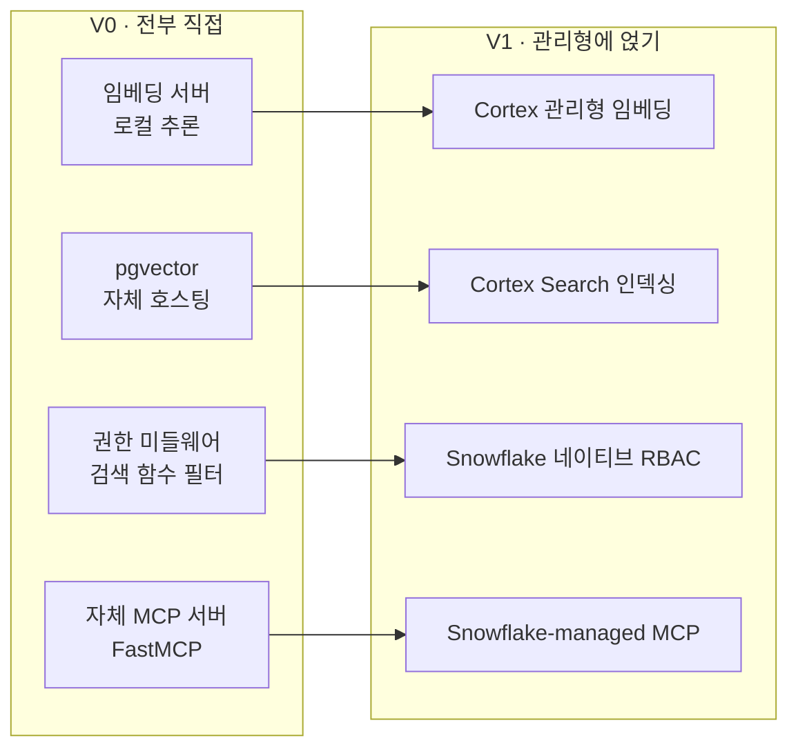
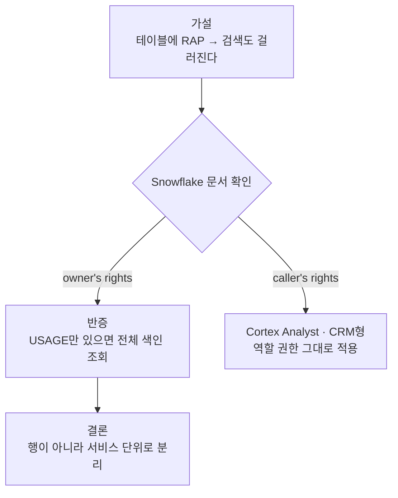

[[rag-2-embedding|임베딩 모델과 벡터 DB를 고르고]] 나서, 이제 설계하고 구현하는 일만 남았다고 생각했다. 벡터 DB도, 임베딩 서버도, 권한을 처리하는 미들웨어도 사내에서 직접 구축하고 운영할 계획이었다.

그런데 그 설계를 접게 만든 것은 논문도, 피드백도 아니었다. 사내 데이터 웨어하우스를 담당하는 직원분과 함께한 인수인계 자리에서 들은 한마디였다.

> "회사가 이미 연 단위로 계약해 둔 **Snowflake**라는 서비스가 있어요. 크레딧이 거의 안 쓰여서 놀고 있고, 심지어 거기에 임베딩 기능도 있는 것 같아요."

이 이야기를 듣고 나니, 그동안의 설계를 수정해야 할 것 같다는 생각이 들었다. 그래서 임베딩 기능이 "있는 것 같다"는 말이 사실인지 확인하려고 내 자리로 돌아갔다.

## 확인해 보니 이미 다 있었다

Snowflake는 우리 회사가 이미 연 단위로 계약해 둔 **데이터 웨어하우스**(data warehouse; 여러 소스의 데이터를 한데 모아 분석용으로 쌓아 두는 저장소)였다. 계약한 크레딧 중에서 실제로 사용하는 양은 얼마 되지 않아서, 여유가 넉넉했다.

그리고 그 안에 **Cortex Search**(임베딩, 인덱싱, 하이브리드 검색, 리랭킹을 SQL만으로 대신 해 주는 Snowflake의 관리형 검색 서비스)가 있었다. 문서를 넣어 두면 임베딩 벡터를 자동으로 만들고, 그 벡터의 인덱스를 만들고, 검색과 리랭킹까지 처리해 준다.

더 중요한 것은 데이터의 위치였다. 사내 데이터는 이미 다른 파이프라인을 거쳐 Snowflake에 적재되고 있었다. 다른 비즈니스 데이터들을 Airbyte로 추출해서 Snowflake에 Raw Data로 적재하고 정리하는 흐름이 이미 운영되고 있었던 것이다. 내가 하던 설계는 그 데이터를 다시 사내 서버의 pgvector로 옮기는 것이었는데, **데이터가 이미 있는 곳에서 검색까지 지원한다면** 그렇게 옮기는 작업 자체가 필요 없어진다.

이곳에서 문서를 검색할 수 있게 만드는 데 필요한 것은 아래의 SQL이 전부이다.

```sql
CREATE CORTEX SEARCH SERVICE kb_search
  ON chunk_text
  ATTRIBUTES access_level, source_category
  WAREHOUSE = rag_wh
  TARGET_LAG = '1 hour'
  EMBEDDING_MODEL = 'snowflake-arctic-embed-l-v2.0'   -- [!code highlight]
  AS (
    SELECT chunk_text, access_level, source_category
    FROM page_chunks
  );
```

임베딩 모델의 이름 하나만 적으면, 문장을 벡터로 바꾸는 일은 Snowflake가 관리형으로 처리한다. `TARGET_LAG`은 원본이 바뀌었을 때 인덱스가 얼마나 빨리 따라갈지를 정하는 값이다. 그래서 새벽마다 실행되는 인덱싱 Job을 내가 직접 만들 필요 없이, 이 값만 설정하면 자동으로 갱신된다.

## 직접 하기로 했던 일이 하나씩 지워졌다

관리형 서비스가 대신 해 준다는 것을 확인하고 나니, 처음의 설계(V0)에서 내가 직접 하기로 했던 일들이 하나씩 지워졌다. 관리형으로 바꾼 설계(V1)와 나란히 놓으면 아래와 같다.



가장 먼저 임베딩 서버가 지워졌다. [[rag-2-embedding|한국어 성능으로 고른 로컬 모델]]을 사내 서버에서 추론하게 하려던 계획이, Cortex의 관리형 임베딩 모델로 대체되었다. pgvector의 운영도 함께 지워졌다. 벡터의 저장, HNSW 튜닝, 백업을 직접 하는 대신 Cortex가 인덱스를 관리한다. 검색 함수 안에 고정하려던 부서, 직급 필터는 **Snowflake의 역할 권한이 대신 강제**하고, FastMCP로 만들려던 서버는 Snowflake가 제공하는 관리형 MCP로 대체되었다.

## 권한은 행이 아니라 서비스 단위로

이 가운데 가장 오래 고민한 것은 권한이었다. 자체 호스팅에서는 검색 함수의 내부에 부서나 직급의 필터를 고정해서, 권한 밖의 문서를 후보에서 아예 제외하는 방식으로 해결할 수 있었다. 그러나 관리형에서는 그 필터를 내가 직접 작성할 수 없기 때문에, Snowflake가 제공하는 권한 장치에 의존해야 했다.

첫 번째 가설은 단순했다. Snowflake에는 **Row Access Policy**(테이블의 행을 역할별로 걸러 주는 정책; RAP)가 있으니, 청크가 적재되는 테이블에 이 정책을 걸어 두면 검색 결과도 역할별로 자동으로 걸러지지 않을까? 이 가설을 SQL로 옮기면 아래와 같다.

```sql
-- 가설: 이 정책이 검색 결과까지 걸러 줄 것이다
CREATE ROW ACCESS POLICY chunk_rap
  AS (lvl string) RETURNS boolean ->
    lvl = 'public'
    OR CURRENT_ROLE() IN ('RAG_MANAGER', 'RAG_DIRECTOR');   -- [!code highlight]

ALTER TABLE page_chunks
  ADD ROW ACCESS POLICY chunk_rap ON (access_level);
```

이 정책은 `public` 등급의 행은 누구나 읽을 수 있게 하고, 그보다 높은 등급의 행은 매니저나 디렉터 역할일 때만 읽을 수 있게 한다. 테이블을 직접 조회하면 정책은 정확히 그렇게 동작한다.

문제는 검색이었다. Snowflake의 공식 문서("Query a Cortex Search Service")를 읽다가 아래의 내용이 마음에 걸렸다.

> 서비스에 USAGE 권한이 있는 역할은, 테이블의 행을 읽을 권한이 없어도 **인덱싱된 모든 데이터를 검색 결과로 받는다.**

원인은 실행 모델에 있었다. Cortex Search는 **소유자 권한**(owner's rights; 객체를 만든 소유자의 권한으로 도는 실행 방식)으로 동작한다. 인덱스를 읽을 때 검색을 호출한 사람의 권한이 아니라 서비스를 만든 소유자의 권한으로 읽기 때문에, 테이블에 걸어 둔 Row Access Policy는 검색에서 통째로 무시된다.

그래서 결론이 뒤집혔다. 행 단위로 나눌 수 없다면, <u>서비스 단위로 나누어야 한다.</u> 등급마다 Cortex Search 서비스를 따로 만들고, 각 서비스의 USAGE 권한을 역할별로 부여하는 것이다.

```sql
-- 등급마다 서비스를 따로 만들고, 소스 쿼리에서 접근 범위를 가른다
CREATE CORTEX SEARCH SERVICE kb_search_employee
  ON chunk_text
  WAREHOUSE = rag_wh
  TARGET_LAG = '1 hour'
  EMBEDDING_MODEL = 'snowflake-arctic-embed-l-v2.0'
  AS (SELECT chunk_text FROM page_chunks WHERE access_level = 'employee');

GRANT USAGE ON CORTEX SEARCH SERVICE kb_search_employee TO ROLE rag_employee;   -- [!code highlight]
GRANT USAGE ON CORTEX SEARCH SERVICE kb_search_manager  TO ROLE rag_manager;
```

이렇게 하면 어떤 역할이 어떤 서비스에 USAGE 권한을 가지고 있는지가, 곧 그 사람이 검색할 수 있는 범위가 된다. 권한을 행이 아니라 서비스에 거는 것이다.

반대로 동작하는 경로도 확인해 두었다. 정형 데이터인 CRM 데이터에 자연어로 답하는 **Cortex Analyst**(질문을 SQL로 바꿔 정형 데이터에 답하는 Snowflake 기능)는 Cortex Search와 달리 **caller's rights**(부르는 사람의 권한으로 도는 실행 방식)여서, 생성된 SQL이 호출자의 역할로 실행된다. 이쪽은 역할 권한과 행의 정책이 그대로 적용되기 때문에, 문서형 데이터만 서비스 단위로 나누면 되었다. 여기까지의 판단을 순서대로 그리면 아래와 같다.



## 얻은 것, 포기한 것

관리형 서비스에 의존하는 데에는 대가가 따랐다. 무엇을 포기했는지부터 솔직하게 적어둔다.

가장 아쉬운 것은 한국어 성능을 기준으로 고른 로컬 모델이었다. arctic-embed의 한국어 파인튜닝 버전을 KURE 리더보드 점수까지 따져 가며 골랐는데, 관리형에서는 Cortex가 제공하는 임베딩 모델만 사용할 수 있다. 같은 arctic-embed 계열이어서 한국어를 아예 처리하지 못하는 것은 아니지만, ko 파인튜닝 버전만큼의 검색 정확도는 일부 포기하는 것이다. 청킹의 규칙이나 인덱스의 세부 튜닝을 직접 조정하려던 계획도 함께 없어졌다.

> snowflake-arctic-embed-l-v2.0 관리형 채택. **한국어 특화 모델 이점 일부 포기**, 운영 단순화 취득

대신 얻은 것이 컸다. 서버, 임베딩 파이프라인, 벡터 DB의 운영, 새벽 시간의 백업, 모니터링을 직접 책임질 필요가 없어졌다. 무엇보다 이미 계약해 둔 크레딧 안에서 실행되기 때문에, **추가 인프라 비용도 0**이었다.

## 결론

돌아보면 조금 허탈하기도 했다. 서버 사양까지 정해 가며 완성해 놓은 설계를, 이미 가지고 있던 서비스를 뒤늦게 발견하고 접었기 때문이다.

그런데 아깝기만 한 것은 아니었다. 자체 호스팅을 끝까지 설계해 보았기 때문에, 관리형이 정확히 무엇을 대신 해 주는지를 하나씩 짚을 수 있었다. 임베딩 모델이 없어졌다는 것을 실감하려면, 그 서버를 만드는 설계를 먼저 해 보아야 했다. 권한을 서비스 단위로 나누어야 하는 이유도, 검색 함수에 필터를 직접 고정해 보았기 때문에 소유자 권한이라는 한 줄의 무게를 실감할 수 있었던 것 같다.

이제 남은 일은 사용되지 않던 Snowflake에 Notion이나 Slack의 데이터를 적재하고, 서비스를 등급별로 나누고, 역할들을 연결하는 것이다. 설계를 다 해 놓은 뒤에 더 나은 것을 발견하는 일이 처음에는 손해처럼 느껴졌는데, 그 덕분에 판단할 눈이 생겼다고 생각하면 그리 나쁜 선택은 아니었던 것 같다. [[rag-5-notion-pipeline|다음 글]]에서는 가장 먼저 Notion의 데이터를 적재한다. 🍀
