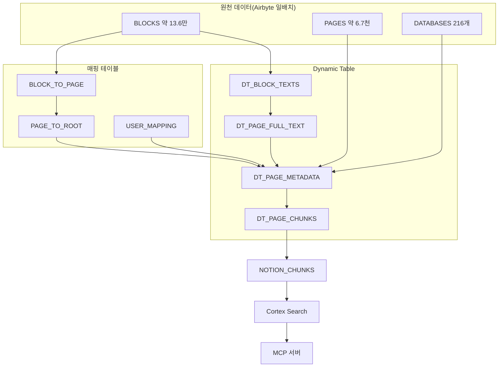
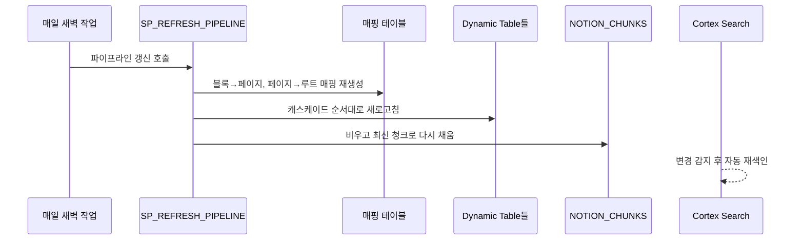

자체 호스팅을 설계하던 때에는 서버부터 데이터의 권한 관리까지 전부 내가 담당하려고 했는데, [[rag-4-managed-pivot|결국 관리형 서비스 쪽으로 방향을 바꾸게 되었다]]. 사내에 이미 사용하던 Snowflake가 있었고, 거기에서 임베딩과 검색 서비스도 제공하고 있으니, 서버를 따로 만들고 새벽의 백업까지 책임질 이유가 줄어들었기 때문이다. 방향을 정했으니 이제 필요한 데이터를 적재할 차례였다. 첫 번째 소스는 텍스트 위주의 사내 자료가 가장 많이 쌓여 있는 **Notion**이었다.

그런데 막상 Raw 테이블을 열어 보니 문제가 있었다. Notion의 데이터는 우리가 읽는 "페이지"의 형태로 들어오지 않는다. 문단 하나, 제목 하나, 체크박스 하나가 모두 따로 떨어진 **블록**(block; Notion이 글을 쪼개서 저장하는 최소 단위)으로 적재되고 있었다. 그래서 페이지 하나를 되살리려면, 흩어진 블록들을 다시 이어 붙이는 과정이 필요했다.

## Notion은 페이지가 아니라 블록으로 들어온다

Notion은 Workspace 아래에 페이지가 있고, 페이지 안에 블록이 있으며, 블록 안에 또 블록이 재귀적으로 중첩되는 구조이다. 인라인 데이터베이스나 하위 페이지도 얼마든지 겹겹이 들어갈 수 있다.

이 원천 데이터는 Airbyte로 매일 한 번씩 Snowflake의 특정 스키마에 적재되고 있었다. 해당 스키마를 열어 보니 블록이 약 14만 행, 페이지가 약 7천 행, 데이터베이스가 216개였다. 반정형 JSON 그대로 적재되어 있었기 때문에, 검색에 사용하려면 이것을 AI가 읽기 편한 **페이지 단위로 되돌리는 일**부터 해야 했다. 원천 데이터에서 검색 서비스까지 가는 전체 경로를 먼저 그리면 아래와 같다.



낱개로 적재된 블록이 페이지로 합쳐지고, 다시 검색에 사용할 청크로 나뉘어 검색 서비스까지 가는 흐름이다.

## 블록을 페이지로 되돌리기

가장 까다로웠던 것은 블록이 어느 페이지에 속하는지를 알아내는 일이었다. 인라인 데이터베이스 안에 있는 블록은, 부모가 페이지가 아니라 또 다른 블록이었다. 그렇기 때문에 부모를 따라 위로 계속 올라가야 페이지가 나온다. 그래서 **부모 관계를 재귀적으로 탐색하는 매핑 테이블**을 만들었다.

```sql
-- 블록이 어느 페이지에 속하는지, 부모를 타고 위로 올라가며 찾는다
WITH RECURSIVE BLOCK_TO_PAGE AS (
  SELECT ID AS BLOCK_ID, PARENT_ID, PARENT_TYPE, 1 AS DEPTH
  FROM BLOCKS
  WHERE PARENT_TYPE = 'block_id'
  UNION ALL
  SELECT b.BLOCK_ID, p.PARENT_ID, p.PARENT_TYPE, b.DEPTH + 1  -- [!code highlight]
  FROM BLOCK_TO_PAGE b
  JOIN BLOCKS p ON b.PARENT_ID = p.ID
  WHERE b.PARENT_TYPE = 'block_id' AND b.DEPTH < 10
)
SELECT BLOCK_ID, PARENT_ID AS PAGE_ID
FROM BLOCK_TO_PAGE WHERE PARENT_TYPE = 'page_id';
```

부모가 아직 블록이면 그 부모의 부모를 다시 탐색해서 한 단계 더 올라가고, 부모가 페이지가 되는 순간 멈추도록 했다. 이 재귀가 무한히 반복되는 것을 막기 위해 최대 10단계까지만 탐색하게 해 두었다. (실제 데이터로 측정해 보니 현재까지는 6단계가 최고였다.)

그런데 여기서 끝이 아니었다. 페이지를 찾았더라도, 그 페이지가 어느 카테고리에 속하는지는 다시 위로 올라가 보아야 알 수 있다. 페이지가 페이지에 속하고, 그 페이지가 데이터베이스에 속하고, 그 데이터베이스가 다시 상위 페이지에 속하는 식으로 이어져 있기 때문이다. 그래서 페이지에서 최상위 루트까지 6단계를 반복적인 조인으로 추적하는 매핑을 하나 더 두었다. 최상위에는 12개의 루트 페이지와 4개의 루트 데이터베이스가 있었고, 여기까지 올라가야 비로소 "이 문서는 어느 부서의 것"인지가 정해졌다.

작성자를 수집하는 데에도 비슷한 문제가 있었다. 원천 데이터에는 직원의 이름이 아니라 내부에서 사용하는 ID만 적재되어 있었고, 시스템이 채워 주는 사용자 테이블은 비어 있었다. 그래서 ID를 실제 직원의 이름으로 바꾸어 주는 테이블을 직접 만들어야 했다. 등재한 25건 중에서 직원 17명과 봇으로 사용되는 계정 2개까지는 정리되었고, 그 외에는 퇴사자의 정보여서 사용하지 않았다.

## 스스로 갱신되는 Dynamic Table

블록을 페이지로 되돌리고 카테고리와 작성자를 연결하는 이 과정을, 매번 사람이 실행할 수는 없었다. 원본이 바뀔 때마다 자동으로 다시 계산되어야 했다. 그래서 **Dynamic Table**(정의한 SELECT 결과를 실제 테이블로 유지하고, 정한 주기마다 스스로 다시 계산해 채우는 Snowflake의 기능)을 네 단계로 연결했다.

블록의 텍스트를 추출하는 첫 번째 테이블에서 시작해서, 페이지 전문으로 합치고, 카테고리와 작성자를 연결하고, 마지막에 검색용 청크로 나눈다. 앞 단계가 바뀌면 뒤 단계가 연쇄적으로 다시 계산되는 구조이다. 그중 두 번째 단계는 아래와 같이 정의했다.

```sql
-- 블록 텍스트를 페이지 단위로 이어 붙이는 두 번째 단계
CREATE DYNAMIC TABLE DT_PAGE_FULL_TEXT
  TARGET_LAG = '1 day'   -- [!code highlight]
  WAREHOUSE = RAG_WH
AS
SELECT PAGE_ID,
       LISTAGG(BLOCK_TEXT, '\n') WITHIN GROUP (ORDER BY CREATED_TIME) AS FULL_TEXT
FROM DT_BLOCK_TEXTS
GROUP BY PAGE_ID;
```

**TARGET\_LAG**(원본이 바뀐 뒤 늦어도 이만큼 안에는 반영한다는 갱신 지연 목표)이 이 테이블의 성격을 정한다. 하루로 설정해 두면, 어제 원본에서 바뀐 내용이 오늘 안에는 검색에 반영된다. 블록의 텍스트를 추출하는 첫 단계만 바뀐 블록만 다시 처리하는 증분 모드로 두어 비용을 줄였고, 나머지 단계는 전체를 다시 계산하게 했다.

마지막 단계에서는 페이지 전문을 나누었다. **청킹**(chunking; 긴 글을 검색하기 좋게 작은 조각으로 나누는 과정)은 500자 단위로 하되, 다음 청크가 앞 청크의 끝에서 50자를 겹쳐 시작하게 했다. 경계에 걸친 문장이 둘로 나뉘어 검색에서 통째로 누락되는 일을 막기 위해서이다.

이렇게 나눈 청크의 앞에는, 검색에 잘 걸리도록 메타데이터를 머리말로 추가했다.

```text
[소속: {카테고리}/{DB명}] [작성자: {작성자명}] [제목: {페이지 제목}] [날짜: {YYYY-MM-DD}]
---
{본문 청크}
```

이 머리말 덕분에 "특정 동료가 쓴 회의록"처럼 사람의 이름이나 카테고리로 질문해도, 본문이 아닌 머리말에서 먼저 검색된다. 키워드 검색의 적중률을 높이려고 의도적으로 넣은 장치이다.

## 검색 서비스에 적재하고 도구로 노출하기

청크가 준비되었으니, 이제 실제로 검색이 되게 해야 했다. 네 단계 중 마지막 Dynamic Table의 결과를 물리 테이블 하나(`NOTION_CHUNKS`)로 옮겨 담고, 그 위에 **Cortex Search**(Snowflake가 제공하는 검색 서비스; 벡터 유사도와 키워드 검색 방식을 함께 쓰는 하이브리드 검색)를 구성했다. 여기에 약 9천 개의 청크가 적재되었다. 이 서비스는 소스 테이블에 변경 추적을 설정해 두면 청크가 바뀔 때 자동으로 다시 인덱싱하고, 검색 결과를 의미 유사도로 한 번 더 재정렬해 준다. 임베딩 모델은 한국어를 지원하면서 비용이 덜 드는 쪽으로 골랐다.

검색은 JSON 하나로 호출한다. 무엇을 찾을지, 어떤 컬럼을 돌려받을지, 어떤 조건으로 걸러낼지를 담는다.

```json
{
  "query": "인수인계 미팅에서 RAG 논의가 어디까지 진행됐나",
  "columns": ["CHUNK_TEXT", "SOURCE_CATEGORY", "PAGE_TITLE", "CREATED_BY_NAME", "SOURCE_URL"],
  "filter": { "@eq": { "SOURCE_CATEGORY": "회의록" } },
  "limit": 5
}
```

여기서 중요한 것은 `filter`이다. 카테고리나 작성자로 검색 범위를 미리 좁힐 수 있어서, 회의록만 찾아본다거나 특정 동료가 쓴 문서만 본다는 요청을 한 줄로 처리한다. 여기에 카테고리별 뷰 16개를 따로 두어, 부서 단위로 나누어 보는 것도 가능하게 했다.

마지막으로 이 검색을 **MCP**(Model Context Protocol; AI가 외부 도구를 부르는 규약) 서버의 도구로 노출했다. 그렇게 해서 사내 Claude 하네스나 각자의 Claude Desktop App 같은 외부 AI가 이 도구를 호출해 사내 Notion을 검색하고, 답변에 인용할 수 있게 되었다. 그리고 이 모든 과정은 하루에 한 번, 매일 새벽에 실행되는 작업이 자동으로 갱신한다.



## 운영하면서 만난 조용한 문제들

여기까지 만들어서 운영해 보니, 예상하지 못한 곳에서 문제가 생겼다. 가장 재미있었던 것은 AI가 검색 도구를 엉뚱하게 사용하는 문제였다. 텍스트를 찾으라고 하면 전용 검색 도구를 호출하는 대신, 함께 열어 둔 SQL 도구로 `ILIKE` 같은 문자열 매칭을 실행하려는 일이 잦았다. 그쪽이 더 직관적으로 보였던 모양이다(?). 결국 클라이언트 쪽 지침에 **"텍스트 검색은 전용 검색 도구를 우선 쓸 것"**이라고 명시해 두는 것으로 막았다. <u>도구를 잘 만드는 것과, AI가 그 도구를 고르게 만드는 것은 별개의 일이었다.</u>

한계도 남았다. 블록에서 텍스트를 추출할 때 문단, 제목 같은 11가지 타입만 처리했기 때문에, 그 밖의 블록에 담긴 내용은 청크에 포함되지 않는다. 표처럼 구조가 있는 데이터가 특히 그렇다. 사용자별로 행 단위의 접근을 실시간으로 걸러 내는 것도 MCP 자체로는 되지 않아서, 이 부분은 우회 방안을 따로 찾아야 했다. 앞에서 직접 채우다가 남긴 정체불명의 작성자 6건도 그대로이다.

## 남은 것

자체 호스팅으로 전부 담당하려던 계획을 내려놓고 관리형으로 방향을 바꾸니, 서버 대신 SQL로 파이프라인을 만드는 일이 되었다. 블록을 페이지로 되돌리는 재귀 하나에 며칠을 썼지만, 흩어져 있던 블록이 검색 한 번에 문서로 되살아나는 것을 보니 그럴 만했다는 생각이 든다. Notion을 적재했으니, 이제 [[rag-6-slack-pipeline|대화가 쌓이는 Slack]]을 열어 볼 차례이다. 😎
