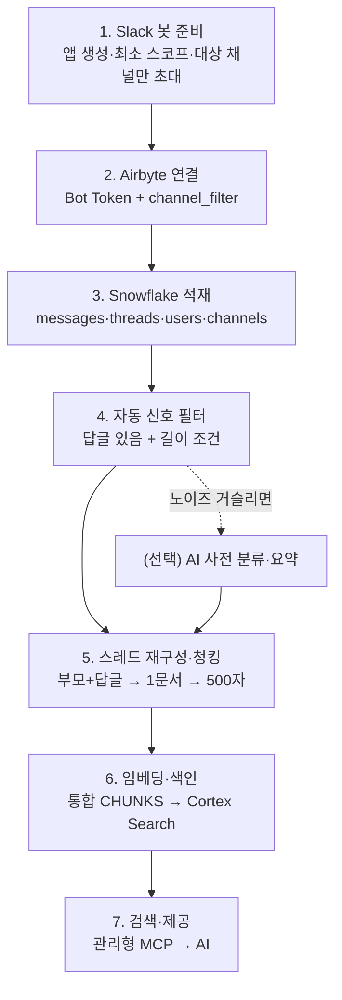

문서로 남는 지식은 일부에 지나지 않는다. "그거 그때 어떻게 해결했더라" 하고 찾아보면, 정작 답은 몇 달 전의 Slack 스레드 안에 묻혀 있는 경우가 많다. 누군가 물었고 누군가 답해서 문제는 해결되었는데, 그 대화는 어디에도 정리되지 않은 채 타임라인 아래로 밀려 내려간다.

그래서 사내 문서를 검색해서 답하던 AI에 Slack의 대화도 소스로 연결하기로 했다. 문제는 Slack에 잡담과 지식이 절반씩 섞여 있다는 것이었다. 점심 메뉴를 정하는 스레드까지 검색에 섞이게 되면, AI의 답은 오히려 나빠진다. 그래서 이번 작업에서 해야 할 일은 결국 하나, **대화에서 지식만 골라내는 것**이었다.

## 전체 흐름을 한 문장으로

세부로 들어가기 전에, 전체 흐름을 먼저 한 문장으로 줄여 보았다. 지식이 오가는 채널 몇 개만 봇이 읽어 와서 적재하고, 답글이 있으면서 일정 길이를 넘는 스레드만 거른 뒤, 부모 질문과 답글을 하나의 문서로 묶어서 임베딩하고 인덱싱하면, AI가 그것을 검색해서 답한다는 흐름이다. 단계로 나누어 그리면 아래와 같다.



일곱 단계이지만 성격으로 보면 셋으로 나뉜다. 1단계에서 3단계까지는 무엇을 읽을지를 정하고, 4단계와 5단계는 지식만 남기며, 6단계와 7단계는 그것을 검색으로 내보낸다. 어려운 판단은 모두 가운데의 두 단계에 몰려 있었다.

## 봇이 초대된 채널만 수집한다

Slack에서 데이터를 가져오는 방법은 여러 가지가 있지만, 권한을 어디까지 허용할지가 가장 조심스러웠다. 공개 채널을 전부 자동으로 수집하는 옵션도 있는데, 그렇게 하면 잡담 채널까지 함께 수집된다. 그래서 원칙을 하나 세웠다. **봇이 초대된 채널이 곧 수집 채널**이라는 것이다.

봇(앱)을 하나 만들고, 지식이 오가는 채널 몇 개에만 직접 초대한다. Slack의 규칙상 봇은 자신이 들어가 있는 채널만 읽을 수 있기 때문에, 초대한 채널이 그대로 수집 범위가 된다. 이 원칙의 좋은 점은 규칙이 눈에 보인다는 것이다. "어디를 수집하죠?"라는 물음에 "봇이 들어가 있는 채널이요"라고 답할 수 있다. 봇이 채널에 추가되면 "OO님이 채널에 추가되었습니다"라는 안내가 한 번 표시되는데, 대상 채널에만 초대하기 때문에 이 안내도 다른 채널에는 표시되지 않는다. 그래서 사전에 "지식 수집용 봇을 추가합니다"라고 한 줄만 공지해 두면 아무도 놀라지 않는다.

봇의 이름에도 신경을 썼다. 이름에 "AI"나 "어시스턴트"가 들어가면, 직원들이 봇에게 답을 기대하고 말을 걸게 된다. 이 봇은 읽기만 하기 때문에, 그런 오해가 생기지 않도록 "지식 수집기"처럼 역할이 그대로 드러나는 이름으로 정했다.

채널의 대화를 읽어 오는 툴로는 **Airbyte**(데이터를 실어 나르는 연결 도구)를 사용했다. 여기서 중요한 것은 Airbyte의 `channel_filter`가 봇을 초대한 목록과 정확히 같은 채널을 가리키도록 맞추는 것이다. 봇이 들어가 있는 채널과 실제로 동기화하는 채널이 어긋나면, 눈에 보이던 규칙이 다시 보이지 않게 되기 때문이다. 그리고 `join_channels`를 비활성화해서 공개 채널에 자동으로 가입하는 것을 막았고, `threads_ignore_no_replies`로 답글이 하나도 없는 글은 처음부터 가져오지 않도록 했다.

```yaml Airbyte Slack source
channel_filter: [지식-채널-A, 지식-채널-B]   # [!code highlight]
join_channels: false                         # 공개 채널 자동 가입 안 함
threads_ignore_no_replies: true              # 답글 없는 글은 아예 안 가져옴
```

이 가운데 답글이 없는 글을 가져오지 않는 옵션 하나만으로도, 가져오는 데이터의 양이 크게 줄었다.

수집 범위를 이렇게 좁힌 것처럼, 봇의 권한도 최소한으로 두었다. 읽기 전용으로만 사용할 것이기 때문에 **스코프**(scope; 앱에 허용하는 권한 범위)는 채널 히스토리 읽기와 사용자 정보 읽기 정도만 허용하고, 채널에 글을 쓰거나 이모지로 반응하는 권한은 넣지 않았다. DM과 비공개 채널도 이번에는 전부 제외했다. 여기까지 포함하려면 누가 무엇을 볼 수 있는지를 나누는 권한 분리가 먼저 필요해서, 다음 과제로 남겨 두었다.

스코프를 정할 때 알아 두어야 할 것이 하나 있다. 스코프를 나중에 추가하면 앱을 다시 설치해야 적용되고, 이때 토큰이 새로 발급된다. 토큰이 바뀌면 Airbyte에 넣어 둔 토큰도 함께 교체해야 동기화가 끊기지 않는다. 이것을 모르고 스코프만 추가했다가 한참 동안 동기화가 멈춰 있던 적이 있다(?). 그래서 필요한 스코프는 되도록 처음에 모두 정해 두는 편이 낫다.

## 이모지 승인 대신 데이터에 남은 신호로

수집할 범위를 정하고 나니, 처음에 꺼낸 문제가 남았다. 적재된 대화에서 지식만 어떻게 골라낼 것인가. 처음 떠올린 방법은 "쓸 만한 답글에 직원들이 승인 이모지를 달면, 그것만 수집하자"는 것이었다. 깔끔해 보이지만, 이 방법은 사람의 행동이 바뀌는 것을 전제로 한다. 모두 바쁜데 매번 이모지를 달아 줄 리가 없고, 이모지가 달리지 않으면 파이프라인에 들어올 데이터가 없어진다. 이렇게 직원이 협조해 주어야만 동작하는 장치는 대개 정착에 실패한다.

그래서 방향을 바꾸었다. **사람에게 새로운 행동을 요구하지 않고, 이미 데이터에 남아 있는 신호로 거르기로** 한 것이다. 대화에는 이미 두 가지 신호가 들어 있었다.

- 답글이 달렸는가. 누군가 물었고 누군가 답했다는 것은, 그 스레드에서 무언가가 해소되었을 가능성이 있다는 뜻이다.

- 본문이 충분히 긴가. "ㅇㅋ", "확인했습니다" 같은 한 줄짜리 잡담은 지식이 아니기 때문에 길이로 거른다.

이 두 가지 신호는 SQL로 그대로 옮길 수 있었다. 답글이 하나라도 있는 스레드 가운데, `HAVING` 절에서 스레드 전체의 글자 수가 임계값을 넘는 것만 다음 단계로 보낸다.

```sql
-- 답글이 있고, 본문이 충분히 긴 스레드만 통과
SELECT thread_ts
FROM threads
WHERE reply_count >= 1
GROUP BY thread_ts
HAVING SUM(LENGTH(text)) >= 200;   -- [!code highlight]
```

임계값으로 둔 200이라는 숫자는 처음부터 옳은 값이 아니다. 통과한 스레드를 살펴보면서 올리거나 내릴 출발점일 뿐이다. 이 방식의 장점은 아무도 새로운 일을 하지 않아도 된다는 것이다. 이미 오간 대화를 데이터로 판단하는 것이어서, 직원들은 평소처럼 Slack을 사용하면 된다.

그래도 노이즈가 신경 쓰일 때를 대비해서, 한 단계를 더 추가할 수 있게 해 두었다. 통과한 스레드를 AI에 한 번씩 넣어서 "재사용할 만한 Q\&A인가"를 판정하게 하는 방법이다. 이때에도 사람은 통과한 스레드를 가끔 표본으로 살펴보기만 한다. 사람이 직접 승인하는 것이 아니라 자동 판정에 예외 검수만 더하는 구조여서, 이 방법도 정착에 실패할 위험이 없다. 다만 처음부터 넣지는 않았고, 데이터 신호만으로 부족할 때 사용할 선택지로 남겨 두었다.

## 흩어진 메시지를 하나의 문서로

걸러낸 다음에는 형태를 잡아야 했다. Slack의 스레드 하나는 질문 하나와 답글 여러 개로 흩어져 있다. 이것을 메시지 단위로 나누어 인덱싱하면 맥락이 깨진다. 질문 없이 답만 검색되거나, 반대로 답 없이 질문만 검색되기 때문이다. 그래서 **부모 질문과 답글을 시간순으로 이어서 하나의 문서로** 다시 묶었다.

이 작업에는 `LISTAGG`를 사용했다. 같은 스레드에 속한 메시지를 `ts`(보낸 시각)의 순서대로 한 줄씩 이어 붙이는 함수이다. 이때 `users` 테이블과 조인한 이유는, Slack의 원본에는 작성자가 `U01ABCD` 같은 ID로만 기록되어 있기 때문이다. ID를 사람의 이름으로 바꾸어 두어야 누가 한 말인지가 검색 결과에 그대로 남는다.

```sql
SELECT thread_ts,
       LISTAGG(user_name || ': ' || text, '\n')
         WITHIN GROUP (ORDER BY ts) AS thread_body   -- [!code highlight]
FROM threads JOIN users USING (user_id)
WHERE thread_ts IN (/* 앞 단계를 통과한 스레드 */)
GROUP BY thread_ts;
```

이렇게 하나로 묶은 문서는 [[rag-5-notion-pipeline|앞서 만든 Notion 파이프라인]]과 같은 방식으로 나누었다. **청킹**(chunking; 긴 글을 검색용 작은 조각으로 나누기)은 500자 길이에 50자씩 겹치게 나누는 규칙을 그대로 사용했다. 두 소스가 같은 규칙을 공유하면, 나중에 한곳에서 검색할 때 청크의 크기가 들쭉날쭉하지 않다.

나눌 때 문서의 맨 위에는 출처를 적었다. 이것도 Notion 문서에 적던 것과 같은 형식이다.

```text
[소속: slack/{채널}] [작성자: {질문자}] [제목: {질문 첫 줄}] [날짜: {날짜}]
---
{질문과 답글을 이은 본문}
```

이 머리말이 있어서 검색 결과에는 어느 채널에서 누가 언제 나눈 대화인지가 함께 나온다. Notion에서 온 청크와 형식이 같기 때문에, 나중에 둘을 한 테이블에 넣어도 결과가 같은 형식으로 보인다.

## 하나의 벡터 공간에 합류시키기

마지막으로 남은 결정이 가장 중요했다. Slack의 청크를 어디에 넣을 것인가였다. 인덱스를 따로 두면, 검색할 때마다 Notion의 인덱스와 Slack의 인덱스를 각각 검색해서 결과를 합쳐야 한다. 그래서 **하나의 통합 테이블**에 넣기로 했다. 청크가 Notion에서 왔는지 Slack에서 왔는지는 `source_type` 컬럼의 값으로만 구분하고, 저장소는 하나로 둔 것이다.

```sql
-- 소스가 무엇이든 한 테이블에 쌓고, 출처는 컬럼으로 구분
CREATE TABLE KB_CHUNKS (
  chunk_text     STRING,
  source_type    STRING,   -- 'notion' | 'slack'  [!code highlight]
  source_channel STRING,
  created_by     STRING
);
```

이 테이블 하나를 하나의 **Cortex Search**(Snowflake가 임베딩과 인덱싱을 대신 맡아 주는 관리형 검색) 서비스로 인덱싱하면, 한 번의 검색으로 Notion의 문서와 Slack의 대화가 함께 나온다.

이것이 가능한 이유는 **임베딩**(embedding; 문장을 뜻이 담긴 숫자로 바꾸기) 모델을 Notion 때와 같은 것으로 맞추었기 때문이다. 같은 모델이 만든 벡터여야 같은 좌표계 위에 놓여서 서로 비교할 수 있는데, Snowflake가 관리하는 임베딩 모델을 두 소스가 공유하기 때문에 자연스럽게 하나의 벡터 공간에 모인다. 그렇게 되면 소스가 달라도 뜻이 비슷한 청크는 나란히 검색된다.

한 가지 걸리는 것은 이름이었다. 기존 검색 서비스의 이름이 `NOTION_`으로 시작해서 Notion 전용처럼 보였는데, Slack까지 들어오게 되니 이 이름이 맞지 않았다. 그래서 소스를 가리지 않는 일반적인 이름(`KB_SEARCH` 같은)으로 정리하는 일을 과제로 적어두었다. 사소해 보이지만, 이름이 실제 범위와 어긋나면 나중에 들어올 소스를 자꾸 예외처럼 느끼게 된다.

## 남은 것

Slack을 연결하고 나서 가장 달라진 것은, 문서에 없던 답이 검색되기 시작했다는 것이다. 정식 문서로 정리할 정도는 아니어도 누군가 이미 겪고 해결해 둔 문제, 타임라인 아래로 밀려 내려갔던 그 대화가 이제는 검색의 소스가 된다.

길이의 임계값을 얼마로 둘지, 노이즈가 늘어나면 AI 분류를 한 단계 추가할지는 운영하면서 조정할 일로 남았다. 그래도 <u>잡담과 지식을 사람의 손이 아니라 데이터에 남은 신호로 나눈다</u>는 방향은 마음에 든다. 오래 운영해 보아야 제대로 된 임계값을 찾을 수 있을 것 같다.

[[rag-7-eval-cost|다음 글]]에서는 이렇게 만든 검색이 정답 문서를 잘 찾는지, 그리고 운영하는 데 비용이 얼마나 드는지를 측정한다. 😎
