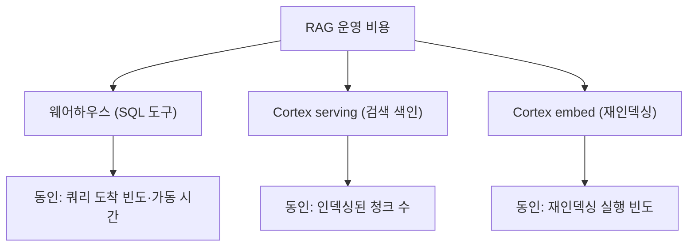

파이프라인이 한 번 끝까지 동작하고 나면, 그다음에 궁금해지는 것은 늘 두 가지이다. 잘 찾고 있는가, 그리고 비용은 얼마나 드는가. [[rag-5-notion-pipeline|Notion을 적재]]하고 [[rag-6-slack-pipeline|Slack까지 연결해서]] 검색이 실제로 응답을 돌려주기 시작하자, 나도 이 두 가지 물음에 답해야 했다. "그럭저럭 잘 되는 것 같다"는 느낌만으로는 아무것도 결정할 수 없었기 때문에, **느낌이 아니라 숫자로 답하고 싶었다**.

그래서 계획서를 두 장 작성했다. 하나는 검색이 정답 문서를 실제로 찾아내는지를 측정하는 품질 평가이고, 다른 하나는 이 시스템을 운영하는 데 크레딧이 얼마나 소모되는지를 측정하는 비용 산정이다. 두 가지를 측정한 시점은 서로 달랐다. 품질의 기준선은 [[rag-4-managed-pivot|관리형으로 옮긴]] 직후, 소스가 아직 Notion 하나뿐일 때 측정해 두었다. Slack을 연결하기 전이 Notion만의 검색 품질을 측정하기에 가장 깨끗한 시점이었기 때문이다. 반대로 비용은 Slack까지 적재한 뒤에 측정한 값이다.

## 정답을 아는 질문부터 만들기

검색 품질을 측정하려면 채점표가 있어야 한다. 그 채점표가 **골든셋**(golden set; 정답을 아는 질문/문서 쌍 모음)이다. "이 질문에는 이 문서가 정답"이라고 미리 정해 둔 문항 묶음이 있어야, 검색이 그 문서를 상위 결과에 올렸는지를 기계적으로 채점할 수 있다.

문제는 이 골든셋을 누가 만드느냐였다. 직원에게 질문을 새로 만들어 달라고 하면 시간이 오래 걸리고, 사람마다 난이도가 들쭉날쭉해진다. 그래서 순서를 뒤집었다. 정답 문서를 먼저 정하고, 그 문서에서 질문을 거꾸로 만드는 것이다. 정답을 이미 알고 있는 상태에서 질문이 나오기 때문에 **Recall**(recall; 정답 문서를 상위 결과에 담아낸 비율)을 측정할 수 있게 된다.

정답 문서를 뽑을 때는 표본이 한쪽으로 쏠리지 않게 하는 것이 중요했다. 코퍼스에서는 회의록이 약 43%로 가장 많은데, 비중대로 뽑으면 회의록만 많이 나오고 다른 영역의 약점이 가려지기 때문이다. 그래서 카테고리마다 뽑을 수 있는 수에 상한을 두어, 회의록은 8문항으로 제한했다. 배분은 "비례 + 소수 카테고리 최소 1건"으로 정해서, 청크가 적은 영역도 최소 한 문항은 포함되도록 했다.

```sql
-- 카테고리별로 청크를 무작위로 뽑되, 한쪽에 쏠리지 않게 상한을 둔다
SELECT SOURCE_CATEGORY, PAGE_ID, CHUNK_TEXT
FROM DOC_CHUNKS
QUALIFY ROW_NUMBER() OVER (
  PARTITION BY SOURCE_CATEGORY ORDER BY RANDOM()
) <= category_quota   -- [!code highlight]
```

이렇게 뽑은 청크를 하나씩 AI에 넣어서 질문, 정답, 근거가 되는 문서 ID를 자동으로 만들었고, 그 결과로 약 35문항이 담긴 CSV가 나왔다.

## 직원은 keep만 채운다

자동으로 생성한 문항이어서 품질이 고를 수는 없다. 그래서 검수 단계를 두었는데, 여기서도 직원이 질문을 새로 작성하지 않도록 했다. 자동으로 생성된 CSV에서 `keep` 컬럼만 0이나 1로 채워서 거르는 방식이다. 이때의 기준은 좋은 질문을 고르는 것이 아니라 **사용하면 안 되는 문항만 제외하는 것**이다. 판단이 가벼워야 검수가 빠르게 끝나기 때문이다. 제외하는 경우는 세 가지로 정해 두었다.

```yaml golden_set 검수 규칙
# keep=1 이 기본값. 아래에 걸리는 문항만 keep=0 으로 뺀다.
- 질문과 정답이 사실상 같은 문장이라 자명한 경우   # [!code highlight]
- 청크 없이 상식만으로 답할 수 있어 검색 변별력이 없는 경우
- 정답이 청크 내용과 어긋나는 경우
```

이 가운데 가장 자주 해당하는 것은 첫 번째이다. 정답 문장을 거의 그대로 되묻는 질문은 검색이 아니라 복사와 붙여넣기를 측정하는 것이어서 변별력이 없다. 상식으로 답할 수 있는 질문도 검색 없이 맞힐 수 있기 때문에 제외한다. 그리고 나중에 재현할 수 있도록, 골든셋을 만든 모델과 시드도 함께 기록해 두었다. 다시 실행했을 때 같은 문항이 나와야 비교가 성립하기 때문이다.

## 페이지 단위의 Recall과 지연 시간

채점표가 준비되었으니, 이제 무엇을 측정할지를 정할 차례였다. 지표는 단순하게 정했다. 정답 문서를 미리 알고 있기 때문에, 검색의 상위 K개 안에 그 문서가 들어왔는지만 보면 된다. `top_pages`가 돌려준 상위 결과의 문서 ID 집합에 정답 ID가 있으면 성공으로 계산한다.

```python
# 정답 문서가 검색 상위 K개 안에 있으면 '찾았다'로 센다 (페이지 단위)
hits = [q.gold_page_id in top_pages(q, k=K) for q in golden]  # [!code highlight]
recall_at_k = sum(hits) / len(hits)
```

여기서 판정의 단위는 청크가 아니라 **페이지**이다. 같은 문서의 다른 청크가 검색되어도 그 문서를 찾은 것으로 계산한다. 사람이 원하는 것은 정답 문단이 아니라 정답 문서이기 때문이다. K는 5와 10의 두 값으로 측정하고, 카테고리별 Recall의 편차도 따로 본다. 어떤 주제에서 유독 찾지 못하는지가 다음 튜닝의 출발점이 된다.

속도는 Latency p50/p95로 측정한다. 같은 쿼리를 여러 번 보내서 중앙값과 상위 5% 지점을 보고하는 것이다. 한 번 측정한 값만으로 "빠르다"고 말하면, 운이 좋았던 한 번에 속기 쉽다. 여기까지의 순서를 그리면 아래와 같다.


한 가지는 솔직하게 적어두어야 한다. 답변 생성의 품질(Faithfulness/Correctness)은 지금의 구조에서 직접 측정하기 어렵다. 실제 답변은 MCP로 연결된 AI가 만드는데, 그 경로를 그대로 계측할 방법이 없기 때문이다. 그래서 같은 검색 엔진에 같은 모델을 연결해서 "검색 → 컨텍스트 주입 → 답변 생성"을 다시 실행하는 오프라인 근사 경로로 측정한다. 근사는 근사일 뿐이어서, 실제 경로와의 차이는 따로 점검해야 한다. 목표선도 마찬가지이다. 업계에서 흔히 사용하는 시작값을 참고로 두었지만, 사내 데이터로 보정하기 전까지는 잠정적인 관례값이다. 그래서 이번 1차 평가에서는 합격과 불합격을 나누지 않고, 현재 상태를 측정하는 데까지만 하기로 했다.

## serving 비용은 검색 횟수를 따르지 않는다

품질 다음은 비용이다. 처음에는 당연히 "검색을 많이 하면 비용이 늘어난다"고 생각했다. 그런데 측정해 보니 그렇지 않았다.

사내 지식 검색은 Cortex Search라는 serverless 서비스로 동작하는데, 이 **serving**(serving; 인덱스를 상주시켜 검색 쿼리를 받아 주는 부분) 비용은 검색을 호출한 횟수로 계산되지 않는다. 인덱스의 크기와 상주한 시간으로 과금된다. 그래서 사용자가 검색을 더 많이 하더라도 이 비용은 거의 그대로이다. 비용을 키우는 실제 변수는 **인덱싱된 문서의 양**이었다.

측정한 숫자가 이것을 분명하게 보여주었다. 청크 1만 개당 하루의 serving 비용은 Notion이든 Slack이든 0.009에서 0.010크레딧으로 거의 같았다. serving 비용이 청크의 수에 선형으로 비례한다는 뜻이다. 그렇다면 Slack의 serving 비용이 Notion보다 3.3배 큰 것도, Slack을 더 많이 검색해서가 아니다. Slack에 적재된 청크가 3.8배 많기 때문이다.

```yaml serving 단위원가 (측정값)
청크 1만 개당 일 serving ≈ 0.0095 크레딧   # 두 소스 모두 거의 동일
Slack serving ÷ Notion serving ≈ 3.3배
Slack 청크 수 ÷ Notion 청크 수 ≈ 3.8배     # [!code highlight]
```

일별 추세도 이것을 뒷받침했다. 인덱싱이 진행되는 동안에는 serving 비용이 함께 올라가다가, 코퍼스가 자리를 잡자 더 오르지 않고 평탄해졌다.

## 비용의 대부분은 웨어하우스, 그리고 cold start

그렇다면 비용의 대부분은 어디에서 나올까. serving이 아니라 웨어하우스(warehouse; SQL형 도구가 쿼리를 처리할 때 켜지는 연산 자원)였다. 최근 7일 동안의 RAG 관련 비용 8.9크레딧 가운데 **웨어하우스가 84%를 차지했고**, serving은 0.3크레딧에도 미치지 않았다. 비용이 발생하는 경로와 각각을 움직이는 요인을 정리하면 아래와 같다.



웨어하우스는 쿼리가 들어올 때만 켜지고, 쿼리가 없으면 곧 정지한다. 그래서 켜져 있던 시간이 곧 비용이 된다. 재미있었던 것은, 이미 켜져 있는 상태에서 검색 한 건을 더할 때의 한계비용이 거의 0에 가깝다는 것이었다. 실제로 비용이 발생하는 곳은 가동 시간이고, 그중에서도 정지된 웨어하우스를 재개하는 순간이다. 재개할 때마다 최소 60초가 과금되기 때문이다. 그래서 호출당 비용은 일정하지 않고, 쿼리가 언제 도착하느냐에 따라 달라진다. 한산한 시간대에 첫 쿼리가 들어오면 정지해 있던 웨어하우스를 재개하느라 단가가 크게 오르고, 이미 바쁜 시간대에 들어오는 쿼리는 비용이 거의 들지 않는다.

그렇다면 검색을 사용하는 사람은 이 재개로 인한 지연을 느끼게 될까. **cold start**(cold start; 정지된 서비스가 첫 요청에 깨어나며 생기는 초기 지연)를 직접 측정해 보았다. 현재의 코퍼스(약 4.8만 청크)에서 정지했다가 재개한 직후의 첫 검색은 약 1.3초였다. 재개에 0.39초, 첫 검색에 0.90초가 걸렸다. 항상 켜져 있는 warm 상태(약 1초)와 큰 차이가 없었고, 30초인 MCP 타임아웃에는 한참 못 미쳤다. 비용에는 영향을 주는 재개가, 사용자에게는 거의 느껴지지 않는다는 뜻이다.

## auto-suspend는 설정하지 않았다

검색 인덱스의 serving은 웨어하우스와 성격이 반대였다. DESCRIBE로 확인해 보니 auto\_suspend가 설정되어 있지 않았고, 상태는 계속 ACTIVE였다. 24시간 상시 가동이어서, 검색이 한 건도 없는 시간대에도 비용이 발생하는 것이다. 일별 serving 비용이 평탄했던 것도 이 때문이다.

비용을 줄일 방법은 있다. AUTO\_SUSPEND를 설정해서(최소 30분) 사용하지 않을 때 자동으로 정지시키면 된다. 그런데 설정하지 않기로 했다. 절감되는 금액 자체가 작은 데다가, 운영 중에 서비스가 정지되면 그사이에 들어온 검색이 끊길 위험이 있기 때문이다. 지금은 **상시 가동을 유지하는 쪽**이 더 이득이라고 판단했다.

대신 그동안 확인할 수 없던 것을 하나 해결했다. serverless인 검색 도구는 웨어하우스의 이력에 호출이 남지 않아서, 검색이 하루에 몇 번 일어났는지조차 계산할 수 없었다. 그래서 두 검색 서비스에 요청 로깅을 활성화해서, 이후의 검색부터는 이벤트 테이블에 검색어, 응답 시간, 상태 코드, 시각이 건마다 기록되도록 했다. 이 로깅은 연산 비용 없이 로그 저장 요금만 발생하고(요청당 수백 바이트여서 연간으로도 무시할 수준이다), 검색의 지연에도 영향을 주지 않는다.

로깅을 활성화한 첫날의 로그에는 검색이 7건 기록되었는데, 모두 내가 혼자 실행해 본 관리자 테스트였다. 실제 사용 트래픽은 아직 0이라는 뜻이다(?). 성공한 검색의 서버 응답은 0.28초에서 0.38초 사이였다.

## 코퍼스가 커지면

숫자를 측정해 두니 확장을 추정할 근거가 생겼다. serving 비용이 청크의 수에 선형으로 비례하기 때문에, 코퍼스가 지금의 N배가 되면 검색 비용도 대략 N배가 된다(추정이고, 인덱스의 구조나 갱신 빈도에 따라 달라질 수 있다). 예를 들어 청크가 약 4.8만 개에서 10만 개로 늘어나면, 하루의 serving 비용은 약 0.044크레딧에서 0.095크레딧으로 오른다.

그렇다면 남은 크레딧으로 얼마나 버틸 수 있을까. 계산해 보니 RAG의 크레딧 소진을 좌우하는 것은 질문의 절대적인 수가 아니라 웨어하우스의 가동 시간이었다. 검색 도구만으로 남은 크레딧을 몇 달 안에 소진하려면 하루에 약 5만 4천 개의 질문을 보내야 하는데, 이것은 현실성이 없다. 정작 계정 전체 비용의 대부분은 RAG와 무관한 다른 경로에서 발생하고 있었다. 적어도 **이 시스템이 크레딧을 위험할 정도로 소모하지는 않는다**는 것을, 어림이 아니라 측정으로 확인한 것이다.

## 남은 것

두 계획서를 작성하기 전에는 품질도 비용도 막연하기만 했다. "잘 되는 것 같고, 그렇게 비싸지는 않을 것 같다"는 정도였다. 숫자로 측정하고 나니 그 막연함이 사라지고, 오히려 다음에 무엇을 조정해야 할지가 분명해졌다. 카테고리별로 유독 찾지 못하는 곳이 어디인지, serving 비용을 정말 줄여야 할 만큼 코퍼스가 커지는 시점이 언제인지. <u>측정해 보기 전에는 보이지 않던 질문들</u>이다. 무엇보다 내가 만든 시스템의 내부를 숫자로 들여다보는 일이 생각보다 재미있었다.

다음 글에서는 이 검색을 [[rag-8-mcp-serving|MCP 서버 하나로 묶어서]] 누구나 호출할 수 있게 한 과정을 다룬다. 😎
