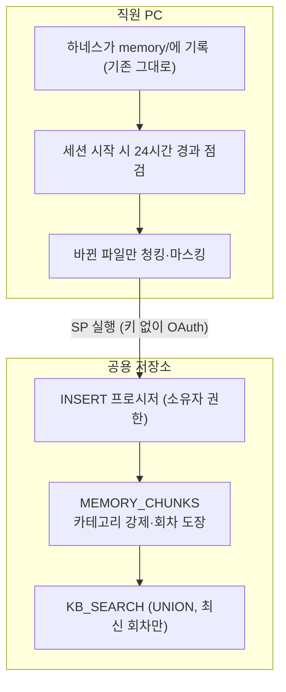
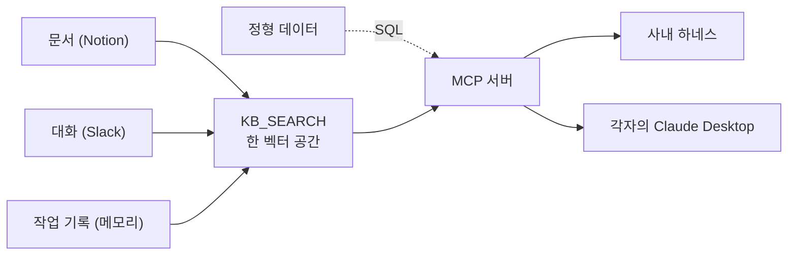

검색을 아무리 잘 설계해 두었다고 해도, 사람들이 그 검색에 닿을 방법이 없다면 아무도 사용하지 않는다. [[rag-5-notion-pipeline|Notion 문서]]를 청크로 적재했고, [[rag-6-slack-pipeline|Slack의 대화]]에서도 필요한 스레드만 걸러서 합류시켰고, [[rag-7-eval-cost|얼마나 맞히고 비용이 얼마나 드는지]]까지 검증해 보았다. 그런데 정작 직원들이 각자의 자리에서 이 검색을 사용하려면 마지막 한 단계가 남아 있었다. 누구나, 어디서나 호출할 수 있는 구조가 필요했던 것이다. 그 구조를 **MCP**(Model Context Protocol; AI가 외부 도구를 부를 수 있는 규칙) 서버 하나로 만들 수 있었다.

MCP 서버는 AI에게 "이런 도구들을 사용할 수 있다"고 알려 주는 역할을 한다. 각자의 PC에 있는 Claude Desktop App 같은 AI 서비스가 이 서버에 연결되면, 서버가 제공하는 도구 가운데 필요한 것을 골라 직접 호출하고 그 결과로 답을 생성한다. 내가 몇 주에 걸쳐 만든 파이프라인은 모두 이 서버 뒤에 있고, 사용하는 사람은 자연어로 묻기만 하면 된다.

## AI가 호출할 수 있는 도구들, 검색과 쿼리

이 서버에는 여러 도구를 등록했다. 성격으로 보면 크게 세 가지로 나뉜다.

- 문서 검색 - Notion의 청크를 의미 기반으로 검색한다. "이 내용이 담긴 회의록 있어?"처럼 주제나 키워드로 묻는 질문이 이 도구로 간다.

- 대화 검색 - Slack의 스레드를 같은 방식으로 검색한다. "결제 시스템 관련 논의는 어디까지 진행되었어?"처럼 문서에는 없고 대화에만 남아 있을 만한 답을 찾는다.

- SQL 분석 - 고객 유입, 거래, 웹 트래픽처럼 숫자로 정확하게 나오는 사내 정형 데이터를 SQL로 집계한다. "이번 달 신규 유입 몇 건 존재해?", "진행 중인 거래 건수 합계는 얼마야?" 같은 질문이 여기에 해당한다.

여기서 중요한 것은 도구를 나눈 기준이다. **텍스트로 찾을 수 있는 일과 숫자로 계산해야 하는 일을 나누었다.** 주제나 키워드로 찾는 질문은 검색으로 보내고, 집계, 카운팅, 날짜 범위 필터처럼 검색으로는 어려운 정량 분석은 SQL 쿼리로 보낸다. 날짜와만 관련된 질문("오늘 올라온 문서는 뭐야?")은 최근 페이지를 조회하는 전용 도구를 따로 두어서, 의미 기반 검색을 불필요하게 실행하지 않도록 했다.

이렇게 굳이 나눈 데에는 이유가 있다. [[rag-6-slack-pipeline|앞서]] 겪은 대로, AI는 텍스트를 찾으라고 해도 종종 SQL 도구로 `ILIKE` 문자열 매칭을 실행하려고 한다. 그 방법이 더 직관적으로 보이는 모양(?)이다. 도구를 잘 만드는 것과, AI가 그 도구를 제대로 고르게 하는 것은 별개의 일이었다.

## 도구의 설명이 곧 AI가 읽는 사용 설명서

그렇다면 AI는 무엇을 보고 도구를 고를까. 근거는 하나, 도구에 적힌 **설명**이다. 사람이 API 공식 문서를 읽는 것처럼, AI는 이 설명만 보고 "이 질문에는 이 도구"라고 판단한다. 그래서 설명을 라벨이 아니라 사용 설명서처럼 작성했다. 아래는 문서 검색 도구의 정의이다.

```json
{
  "title": "Notion Knowledge Search",
  "name": "notion-search",
  "identifier": "KB_SEARCH",
  "type": "CORTEX_SEARCH_SERVICE_QUERY",
  "description": "사내 문서와 작업 기록을 의미 기반으로 검색한다. 카테고리·작성자·제목으로 필터할 수 있고, 결과마다 원본 링크(SOURCE_URL)가 붙는다. 페이지 절반쯤은 같은 PAGE_ID를 공유하는 여러 청크로 쪼개져 있어, 답이 첫 결과가 아닌 다른 청크에 있을 수 있다. 표처럼 구조가 있는 내용은 청크에 안 담기니, 그런 사실은 그 PAGE_ID의 청크 전체를 CHUNK_INDEX 순으로 sql-query로 읽어라."
}
```

이 설명에는 [[rag-5-notion-pipeline|파이프라인]]을 구축하면서 배운 것들이 모두 들어 있다. 결과마다 원본 링크가 있으니 인용하라는 것, 필터로 범위를 좁힐 수 있다는 것, 한 페이지가 여러 청크로 나뉘어 있어서 첫 결과만 믿으면 안 된다는 것이다. 무엇보다 표처럼 구조가 있는 내용은 청크에 담기지 않는다는 한계를 적고, 그럴 때는 SQL로 그 페이지의 청크 전체를 읽으라는 우회 방법까지 적어두었다. 검색이 찾지 못하는 것을 SQL 쿼리가 보완하도록, 두 도구가 서로를 가리키게 한 것이다.

Slack 검색 도구의 설명도 같은 방식으로 작성했다. 스레드가 여러 청크로 나뉘어 있어서 청크 하나만으로는 대화 전체가 보이지 않는다는 것, 참여자 목록은 스레드 단위의 정보여서 그 청크에 없는 사람도 포함되어 있을 수 있다는 것을 적어두었다. AI가 헷갈릴 만한 지점을 미리 알려 주는 주석에 가깝다.

## 각자의 PC에 있는 기록을 검색에 합류시키기

이 서버 뒤에 모이는 데이터는 문서, 대화, 정형 데이터, 작업 기록의 네 갈래이다. 이 가운데 마지막인 작업 기록이 이번 작업의 핵심이었다. 하네스는 직원이 작업할 때마다 학습한 내용, 진행 맥락, 반복되는 에러의 해결법 같은 것을 각자의 PC에 자동으로 기록한다. 문제는 이 기록이 **자신의 PC에만** 있다는 것이었다. 내가 어제 해결한 에러를 옆자리 동료가 똑같이 겪더라도, 그 해결 과정이 검색되지 않기 때문에 동료는 처음부터 다시 헤매게 된다.

이 기록을 사내 공용 저장소에 적재한 이야기는 [[harness-7-snowflake|하네스를 다루면서 한 번]] 적었다. 그 글에서는 청킹과 마스킹, 변경된 것만 적재하는 증분 적재를 다루었고, 여기서는 같은 일을 검색 쪽에서 본다. 적재된 기록이 어떻게 검색에 합류하는지가 남은 절반이었다. 전체 경로를 그리면 아래와 같다.



첫 번째 결정은 기록을 별도의 테이블에 담는 것이었다. Notion과 Slack의 청크가 적재되는 테이블에 섞지 않고, 작업 기록만 담는 테이블(`MEMORY_CHUNKS`)을 따로 만들었다. 회사 문서와 개인의 작업 로그는 권한도 성격도 다르기 때문에, 물리적으로 나누어 두는 편이 나중을 위해 깔끔했다.

두 번째 결정은 검색 서비스를 하나로 유지하는 것이었다. 테이블이 둘로 늘었다고 해서 검색 서비스까지 둘로 두면, 호출할 때마다 양쪽을 각각 검색해서 결과를 합쳐야 한다. 그래서 기존 **Cortex Search**(Snowflake가 임베딩/인덱싱/검색을 대신 맡는 관리형 검색 기능) 서비스의 소스를 두 테이블의 합집합으로 한 번만 변경했다. 사내 콘텐츠가 담긴 테이블과 작업 기록을 `UNION ALL`로 묶어서, 검색 서비스 하나가 둘을 함께 보도록 한 것이다.

```sql
-- 검색 서비스 하나가 두 창고를 함께 본다: 사내 콘텐츠 + 작업 기록(최신 회차만)
CREATE OR REPLACE CORTEX SEARCH SERVICE KB_SEARCH
  ON CHUNK_TEXT
  WAREHOUSE = RAG_WH
  TARGET_LAG = '1 day'
AS
  SELECT CHUNK_TEXT, SOURCE_CATEGORY, PAGE_TITLE, SOURCE_URL
  FROM KB_CHUNKS
  UNION ALL                                            -- [!code highlight]
  SELECT CHUNK_TEXT, SOURCE_CATEGORY, PAGE_TITLE, SOURCE_URL
  FROM MEMORY_LATEST;
```

검색 서비스는 그대로 하나이기 때문에, 작업 기록이 추가되었다고 해서 serving 비용이 더 들지는 않는다. 소스를 한 번 변경하면서 기존 청크를 다시 인덱싱하는 일회성 비용만 감수하면 되었다.

## 수정해서 다시 적재해도 최신 기록만 보이게

여기서 까다로운 문제가 하나 있었다. 같은 기록을 나중에 수정해서 다시 적재하면, 이전 내용과 새 내용이 모두 검색된다는 것이다. 보통은 이전 행을 삭제하고 새 행을 넣지만(DELETE 후 INSERT), 직원에게는 삭제 권한을 주지 않기로 했다(이유는 뒤에서 적는다). 삭제할 수 없다면, **삭제하지 않고도 최신 기록만 보이게** 해야 했다.

그래서 적재할 때마다 `SYNCED_AT`, 즉 적재한 시각을 회차 도장으로 기록했다. 그리고 검색에는 같은 문서(`PAGE_ID`)의 여러 회차 가운데 가장 최근 회차만 노출한다. 이 조건은 뷰에 두었는데, `QUALIFY`로 문서마다 가장 늦게 기록된 회차만 통과시킨다.

```sql
-- 같은 기록을 고쳐 올려도 최신 회차만 검색에 노출한다 (DELETE 없이)
CREATE VIEW MEMORY_LATEST AS
SELECT *
FROM MEMORY_CHUNKS
QUALIFY SYNCED_AT = MAX(SYNCED_AT) OVER (PARTITION BY PAGE_ID);  -- [!code highlight]
```

이전 회차의 행은 테이블에 그대로 남아 있지만, 이 뷰를 거치면서 걸러지기 때문에 검색에는 보이지 않는다. 그렇게 되면 **멱등성**(idempotent; 같은 일을 여러 번 해도 결과가 한결같은 성질)이 지켜진다. 청크의 수가 줄어드는 수정, 예를 들어 청크 3개였던 기록을 청크 2개로 수정해서 다시 적재하더라도, 이전의 청크 3개가 섞이지 않고 새로운 청크 2개만 검색된다.

추가로, 마커는 적재에 성공했을 때에만 앞으로 옮겨지도록 했다. 그래서 PC를 며칠 동안 꺼 두었다가 켜더라도, 그동안 기록된 내용이 다음 실행에서 한꺼번에 적재된다. 실제 업로드 대상이 "마지막으로 성공한 동기화 이후에 변경된 모든 파일"이기 때문에, 중간에 며칠이 비어도 유실되는 기록이 없다.

물론 이전 회차의 행이 계속 쌓이면 저장 공간이 조금씩 늘어난다. 이 행들은 삭제 권한을 가진 관리자의 예약 작업이 주기적으로 삭제하도록 했다. 검색의 정확성은 위의 뷰가 이미 보장하기 때문에, 삭제가 조금 늦어지더라도 검색 결과에는 문제가 없다.

## 한 테이블 밖으로는 쓰지 못하게

앞에서 미루어 둔 이야기가 있다. 직원에게 삭제 권한은 물론이고 직접 쓰는 권한조차 주지 않은 이유이다. 권한을 아주 좁게 제한해야 했기 때문이다.

작업 기록에는 민감정보가 섞이기 쉽고, 무엇보다 회사 문서가 적재된 테이블은 절대로 건드리면 안 되었다. 그래서 직원 계정의 테이블 권한은 아예 0으로 두고, **저장 프로시저 하나를 실행할 권한만** 부여했다. 실제 INSERT는 이 프로시저가 소유자 권한으로 대신 실행한다. 프로시저에 `EXECUTE AS OWNER`를 지정했기 때문에, INSERT는 호출한 직원이 아니라 프로시저를 만든 관리자의 권한으로 실행된다.

```sql
-- 직원은 이 프로시저를 '실행'만 할 수 있다. 실제 INSERT는 소유자 권한으로 프로시저가 대신 한다
CREATE PROCEDURE SP_INSERT_MEMORY(ROWS VARIANT)
  RETURNS STRING
  EXECUTE AS OWNER                         -- [!code highlight]
AS
$$
  INSERT INTO MEMORY_CHUNKS (PAGE_ID, CHUNK_TEXT, SOURCE_CATEGORY, SYNCED_AT)
  SELECT r.value:page_id, r.value:chunk_text,
         'HARNESS_MEMORY',                 -- 카테고리를 코드가 강제로 박는다
         CURRENT_TIMESTAMP()               -- 올린 시각을 회차 도장으로 찍는다
  FROM TABLE(FLATTEN(input => :ROWS)) r;
$$;

-- 쓰기 권한이 없는 역할에 '프로시저 실행'만 내준다
GRANT USAGE ON PROCEDURE SP_INSERT_MEMORY(VARIANT) TO ROLE MEMORY_WRITER;  -- [!code highlight]
```

직원 계정에는 그 테이블에 쓸 권한이 없지만, 이 프로시저를 통해서만 한 테이블에 행을 추가할 수 있다. 그마저도 프로시저 안의 INSERT는 정적이어서 값만 바꾸어 넣을 수 있고, 임의의 SQL을 끼워 넣을 여지가 없다. 카테고리도 코드에서 `HARNESS_MEMORY`로 고정했기 때문에, 직원이 다른 카테고리로 위장할 수도 없다.

결국 호출하는 쪽이 할 수 있는 일은 한 테이블에 기록을 추가하는 것 하나로 좁혀진다. 삭제도, 수정도, 다른 테이블에 대한 접근도 구조적으로 막혀 있다. <u>텍스트로 "건드리지 마세요"라고 부탁하는 것이 아니라, 권한 목록에서 제외해서 할 수 없게 만든 것이다.</u> 검색 도구(MCP) 쪽도 읽기 전용으로 제한해 두었기 때문에, 임의의 쓰기는 어느 쪽으로도 일어나지 않는다.

## 네 갈래의 데이터가 하나의 입구로

이제 전체 구조가 완성된다. 문서, 대화, 정형 데이터, 작업 기록이 MCP 서버 하나 뒤에 모였다.



문서와 대화, 작업 기록은 하나의 검색 서비스에 모여서 같은 벡터 공간에서 함께 검색된다. 숫자로 계산하는 정형 데이터만 검색을 거치지 않고 SQL 도구로 바로 간다. 어느 쪽이든 **입구는 MCP 서버 하나뿐**이고, 사내 하네스든 각자의 Claude Desktop App이든 이 입구로 연결해서 자연어로 묻는다.

처음 이 일을 시작할 때 세운 목표는 "과거 작업과 해결 사례를 사내에서 재활용하자"였다. 내가 겪은 일을 동료가 다시 겪지 않도록, 흩어져 있는 회사의 기억을 검색 한 줄로 불러오자는 것이었다. 그 목표가 여기에서 완성된다. 이제 "그거 그때 어떻게 했더라" 싶을 때, 답은 누군가의 PC나 몇 달 전의 대화에 묻혀 있지 않고 검색 결과로 나온다.

## 남은 것

완성되었다고는 해도 과제는 남아 있다. 작업 기록의 본문에 섞인 비구조적인 민감정보, 예를 들어 고객사의 이름이나 계약 금액 같은 것은 정규식으로 찾아낼 수 없다. 어디까지 코드로 마스킹하고 어디부터 운영 정책으로 거를지는 계속 조정해야 한다. 쌓이는 이전 회차를 삭제하는 관리자의 예약 작업도 아직 예약만 해 둔 상태이다. 그리고 쓰기는 세션 중에 AI가 호출하는 구조여서, PC에서 세션을 시작하지 않은 날의 기록은 보류되었다가 다음에 적재되는데, 이것도 결정적이지는 않다.

돌아보면 처음에는 무엇을 사용할지 고르는 것부터 막막했다. 서버를 직접 구축하겠다고 시작했다가 [[rag-4-managed-pivot|관리형으로 방향을 바꾸었고]], 소스를 하나씩 적재하고, 얼마나 맞히는지 측정해 보고, 마지막에 이렇게 입구를 만들었다. 길게 돌아온 길이지만, 검색창에 한 줄을 입력하면 회사의 기억이 함께 나오는 것을 직접 보니 돌아온 만큼의 값은 했다고 생각한다 🍀
